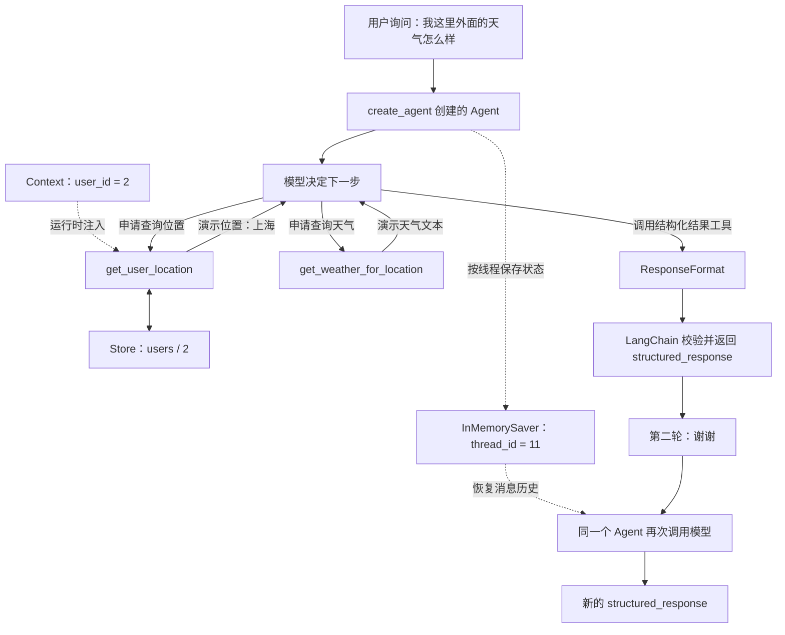

# 16. LangChain 结构化天气 Agent：ToolRuntime、ToolStrategy 与两层记忆

这一篇从一个能连续对话两轮的天气 Agent 出发，串起模型接入、工具调用、运行上下文、结构化输出、线程检查点和 Store。重点既包括代码怎样运行，也包括一次真实的排错过程：**普通工具调用能成功，开启结构化输出却返回 `Provider returned error`，切换 `ToolStrategy` 后两轮对话成功。**

示例代码：[langchain_weather_structured_agent.py](../langchain_weather_structured_agent.py) · 离线验证：[test_weather_structured_agent.py](../tests/test_weather_structured_agent.py)

## 阅读目录

- [一句话理解与本次成果](#overview)
- [最终运行流程与能力边界](#flow)
- [先看懂变量与数据分工](#data-map)
- [用 dataclass 定义上下文和回答](#dataclass)
- [用 init_chat_model 接入 OpenRouter](#model)
- [API Key、变量名和导入之间的关系](#credentials)
- [两个工具怎样执行](#tools)
- [ToolRuntime 为什么不用模型填写](#runtime)
- [两种结构化输出方式](#structured-output)
- [两轮对话如何共享消息](#conversation)
- [Checkpointer 与 Store 有什么不同](#memory)
- [这次真实的困惑与排错过程](#debugging)
- [成功输出应该怎样解读](#result)
- [检查点反序列化警告](#checkpoint-warning)
- [运行方式与完整源码](#run)
- [常用语法与 API 速查](#cheatsheet)
- [验证记录与结论边界](#validation)
- [额外补充与扩展练习](#extensions)
- [复习问答](#review)
- [官方资料与相邻主题](#references)

<a id="overview"></a>

## 一句话理解与本次成果

**模型决定调用哪个工具；LangChain 执行工具并整理结果；Context 提供当前用户；Checkpointer 保存同一线程的对话；Store 保存可以跨线程访问的用户数据。**

最终得到的回答采用固定结构：

```python
ResponseFormat(
    punny_response="太阳今天在‘沪’上班，笑得很灿烂！",
    weather_conditions="演示天气信息",
)
```

这里展示的是字段结构。真实运行中的措辞由模型生成，不会每次完全相同。

本次完成的链路包括：

1. 使用 `init_chat_model` 创建 OpenRouter 模型。
2. 让 Agent 根据问题调用位置工具和天气工具。
3. 在工具中读取 `ToolRuntime[Context]`，取得用户 ID 和 Store。
4. 用 `ToolStrategy(ResponseFormat)` 生成结构化回答。
5. 在同一个线程中先问天气，再发送“谢谢！”。
6. 识别模型请求错误和检查点警告的不同处理层次。

天气工具返回的是固定演示文本，位置也由 Python 规则决定。本例验证 Agent 编排能力，没有接入真实天气服务。

<a id="flow"></a>

## 最终运行流程与能力边界



图中展示的是一种预期的决策顺序。位置和天气之间存在数据依赖，但模型是否重新查工具、需要几次模型调用，仍取决于提示词、历史消息和模型决策。

| 层次 | 在本例中负责什么 |
| --- | --- |
| 应用代码 | 定义用户上下文、演示位置规则、演示天气数据、回答字段、线程标识 |
| 大模型 | 理解问题、选择工具、生成工具参数、组织带双关语的回答 |
| LangChain | 创建 Agent、暴露工具描述、执行工具、处理结构化输出 |
| LangGraph | 承载 Agent 的图执行、消息状态、运行上下文与检查点 |
| OpenRouter 集成 | 从相应环境变量读取密钥，把模型请求发送到 OpenRouter |

`create_agent` 是 LangChain 提供的较高层入口，它构建的 Agent 使用 LangGraph 的运行能力。因此代码调用的是 `create_agent`，报错堆栈中仍会出现 `langgraph.pregel` 等执行模块。

<a id="data-map"></a>

## 先看懂变量与数据分工

| 名称 | 例子 | 表达的含义 | 谁提供或更新 |
| --- | --- | --- | --- |
| `model` | `openai/gpt-5-mini` | 负责理解与生成的模型客户端 | 应用初始化 |
| `Context.user_id` | `"2"` | 本次运行对应哪个用户 | 调用方通过 `context=` 提供 |
| `thread_id` | `"11"` | 当前消息状态属于哪个会话线程 | 调用方通过 `config` 提供 |
| `messages` | 用户消息、模型消息、工具消息 | 当前对话及工具执行记录 | Agent 运行过程更新 |
| `runtime.store` | `InMemoryStore` | 工具可访问的键值存储 | 构建 Agent 时注入 |
| `("users",)` | 单元素元组 | Store 的命名空间 | 应用代码定义 |
| Store key | `"2"` | 命名空间中的记录键 | 本例使用用户 ID |
| Store value | `{"name": "name_2"}` | 业务数据 | 工具中的 `put()` 写入 |
| `ResponseFormat` | 一个 dataclass 类型 | 最终答案的字段定义 | 应用定义 Schema |
| `structured_response` | `ResponseFormat(...)` | 框架解析后的本轮结构化结果 | Agent 返回 |

最容易混淆的是两个 ID：`user_id` 表示“谁”，`thread_id` 表示“哪段会话”。同一用户可以有多个会话线程。本例由应用保证 ID 的使用关系，框架不会自动完成用户登录或会话授权。

<a id="dataclass"></a>

## 用 dataclass 定义上下文和回答

### Context：告诉工具本次运行对应谁

```python
@dataclass
class Context:
    user_id: str
```

`@dataclass` 是标准库 `dataclasses` 中的装饰器，它根据字段生成初始化、展示和比较等方法。于是可以直接创建：

```python
context = Context(user_id="2")
print(context.user_id)  # 2
```

本例的 `Context` 用于传递调用方已经知道的信息。它不需要让模型猜出用户是谁，也不需要把用户 ID 放进聊天文本。

### ResponseFormat：规定回答有哪些字段

```python
@dataclass
class ResponseFormat:
    punny_response: str
    weather_conditions: str | None = None
```

拆开看第二个字段：

- `weather_conditions`：字段名。
- `str | None`：类型允许字符串或 `None`，这种联合类型语法要求 Python 3.10 及以上。
- `= None`：没有提供这个字段时使用默认值 `None`。

“允许为 `None`”和“允许省略”是两个概念。这里同时写了联合类型与默认值，所以同时支持这两种情况：

```python
ResponseFormat(punny_response="不客气")
ResponseFormat(punny_response="不客气", weather_conditions=None)
```

`punny_response` 没有默认值，因此必须提供。

普通 dataclass 构造函数不会自动执行完整的类型校验。本例中，**Agent 的结构化输出解析步骤**会根据 Schema 校验工具参数，再构建相应结果。字段格式通过校验，也不代表字段里的天气内容经过事实核验。

<a id="model"></a>

## 用 init_chat_model 接入 OpenRouter

本次使用的模型初始化方式是：

```python
model = init_chat_model(
    model="openai/gpt-5-mini",
    model_provider="openrouter",
)
```

两个参数分工不同：

| 参数 | 本例取值 | 含义 |
| --- | --- | --- |
| `model` | `"openai/gpt-5-mini"` | OpenRouter 使用的模型标识，其中 `openai/` 是模型 ID 的一部分 |
| `model_provider` | `"openrouter"` | 让 LangChain 使用哪个提供商集成创建客户端 |

因此，模型 ID 中出现 `openai/` 不表示请求一定直接发送到 OpenAI。这里客户端由 `model_provider="openrouter"` 决定。

`init_chat_model` 可以继续使用，它是统一的模型初始化入口；选择具体集成后，仍需要安装对应包。本例需要 `langchain-openrouter`。

学习时最早使用了 `"gpt-5-mini"` 和 `temperature=0`。排查中补全了 OpenRouter 模型 ID，并省略了 `temperature`。这些调整让初始化配置更明确，但调整后结构化请求仍然报错，所以不能把最后的问题直接归因于模型名或温度参数。

<a id="credentials"></a>

## API Key、变量名和导入之间的关系

本次反复困惑的是：**环境里已经有 Key，为什么还要写 `api_key=`？只改 import 会读哪个变量？把 OpenRouter 的 Key 放进 `OPENAI_API_KEY` 又会怎样？**

关键要分清“变量的名字”和“变量里存放的值”。

| 客户端接法 | 通常自动读取的密钥变量 | 服务地址如何决定 |
| --- | --- | --- |
| `ChatOpenRouter` | `OPENROUTER_API_KEY` | OpenRouter 集成的配置 |
| `init_chat_model(..., model_provider="openrouter")` | 同上 | 工厂选择 OpenRouter 集成 |
| `ChatOpenAI` | `OPENAI_API_KEY` | `base_url`、`OPENAI_BASE_URL` 或客户端默认值 |

### 情况一：已经设置 OPENROUTER_API_KEY

选择 OpenRouter 集成后，通常可以省略显式的 `api_key=`。本例就是这种方式。

```dotenv
OPENROUTER_API_KEY=your_openrouter_api_key_here
```

### 情况二：把 OpenRouter 的密钥值存进 OPENAI_API_KEY

这只是把某个字符串放进一个叫 `OPENAI_API_KEY` 的环境变量。客户端不会根据密钥字符串的内容，自动替你判断提供商或切换地址。

如果使用 `ChatOpenRouter`，而只有这个变量，可以显式传入：

```python
model = init_chat_model(
    model="openai/gpt-5-mini",
    model_provider="openrouter",
    api_key=os.environ["OPENAI_API_KEY"],
)
```

这里是程序明确读取 `OPENAI_API_KEY`，再把值交给 OpenRouter 客户端。它不表示 OpenRouter 集成默认读取这个名字。为减少误解，本例统一使用 `OPENROUTER_API_KEY`。

### 情况三：两个变量都配置了

没有显式覆盖 `api_key` 时，具体客户端按自己的默认规则读取变量。环境里同时存在两个名字，不会让客户端自动比较、合并或任选一个。

### 只改 import 够不够

`import` 负责把名称引入当前 Python 文件。真正决定行为的是之后构造了哪个客户端、传了哪些参数，以及客户端的默认规则。只修改一个没有被使用的导入，不会改变请求。

另外，`.env` 是普通文本配置文件，并不会仅因为文件存在就自动进入 `os.environ`。仓库示例在 `run_demo()` 中使用 `load_dotenv()` 加载它；如果已经由系统或 IDE 注入环境变量，也可以直接读取。默认的 `load_dotenv` 不覆盖已经存在的环境变量。

<a id="tools"></a>

## 两个工具怎样执行

### 天气工具：模型负责填写 city

```python
@tool
def get_weather_for_location(city: str) -> str:
    """获取指定城市的演示天气；返回值固定为阳光明媚。"""
    return f"在{city}总是阳光明媚！"
```

`@tool` 将函数包装成 Agent 可调用的工具。函数名、文档字符串和参数类型会参与生成工具描述和参数 Schema。

模型可以申请这样一次调用：

```text
工具：get_weather_for_location
参数：{"city": "上海"}
```

随后是 Python 执行函数，将返回值作为工具消息交回模型。模型本身没有直接运行这段 Python。

### 位置工具：用户身份从 Runtime 读取

工具的核心逻辑如下：

```python
user_id = runtime.context.user_id
memory_store = runtime.store
memory_store.put(("users",), user_id, {"name": f"name_{user_id}"})
user_info = memory_store.get(("users",), user_id)
print(f"user_name:{user_info.value.get('name')}")
return "北京" if user_id == "1" else "上海"
```

执行顺序为：

1. 从本次运行上下文读取用户 ID。
2. 取得创建 Agent 时配置的 Store。
3. 在 `("users",)` 命名空间下，用用户 ID 作为 key 写入一条记录。
4. 读取相同位置的记录，并打印其中的 `name`。
5. 按演示规则返回城市：用户 `"1"` 对应北京，其他值对应上海。

特别要看清：**Store 中存的是姓名记录，城市由最后一行的条件表达式决定。** 本例没有把城市存进 Store，也没有从数据库查询真实地址。

`get()` 返回的是一条记录对象，业务字典位于 `.value`，所以写成：

```python
user_info.value.get("name")
```

`put()` 是按 key 写入或覆盖，不是把每次调用追加成一条聊天历史。工具再次运行时，当前演示会再次写入同名用户记录。

<a id="runtime"></a>

## ToolRuntime 为什么不用模型填写

```python
@tool
def get_user_location(runtime: ToolRuntime[Context]) -> str:
    ...
```

拆开这段注解：

- `runtime`：本例使用的运行时参数名称。
- `ToolRuntime`：LangChain 为工具提供的运行时对象。
- `[Context]`：泛型类型参数，说明 `runtime.context` 使用什么结构。
- `-> str`：函数返回字符串。

框架能识别这个运行时参数，并在执行工具时注入。它不会把 `runtime` 当成要求模型填写的普通业务参数。因此，模型可以用空参数申请位置工具：

```text
get_user_location({})
```

随后 Python 工具仍能读取：

```python
runtime.context.user_id
runtime.store
```

本次离线测试检查了实际暴露给模型的 Schema：位置工具没有 `runtime` 输入字段，天气工具则有 `city` 字段。

这将两类信息清楚分开：`city` 可以由模型从问题或工具结果中推导；当前用户身份由调用方提供。Context 中的数据不会仅因为被传入就自动变成提示词，但工具可以选择将业务结果返回给模型。

<a id="structured-output"></a>

## 两种结构化输出方式

### 原写法：把 Schema 直接交给框架

```python
response_format=ResponseFormat
```

这里没有调用 `ResponseFormat()`，传入的是类本身，表示“最终输出应符合这个结构”。LangChain 会根据模型能力选择策略。

在本次安装环境中，对 `openai/gpt-5-mini` 的请求采用了原生结构化输出路径，发出的模型参数中同时包含业务工具和类似下面的结构：

```text
response_format:
  type: json_schema
  json_schema:
    name: ResponseFormat
    schema: ...
```

这要求模型、上游接口和适配层能够共同处理当前请求中的工具与输出 Schema。

### 本次跑通的写法：显式使用 ToolStrategy

```python
from langchain.agents.structured_output import ToolStrategy

response_format=ToolStrategy(ResponseFormat)
```

此时框架把回答结构包装成一个用于提交最终结果的工具。模型生成这次工具调用的参数，框架校验参数并整理为结果。


这个结果工具与两个业务工具共同参与 Agent 运行，但不需要再手写一个执行天气查询的 `ResponseFormat` 函数。

| 对比项 | 直接传 Schema，自动选择策略 | 显式 ToolStrategy |
| --- | --- | --- |
| 写法 | `response_format=ResponseFormat` | `response_format=ToolStrategy(ResponseFormat)` |
| 策略选择 | 由框架根据模型能力判断 | 固定使用工具调用方式 |
| 本次请求表现 | 选择原生 JSON Schema 路径，并被上游拒绝 | 使用结果工具，实际两轮调用成功 |
| 主要依赖 | 当前原生输出协议与工具组合的兼容性 | 模型工具调用、参数生成与框架校验 |
| 结果读取位置 | `result["structured_response"]` | 同左 |

这次对照实验定位的是调用路径，不能据此认定所有 OpenRouter 模型都不支持原生结构化输出。由于当时没有保存上游错误正文，具体哪个参数或 Schema 约束被拒绝仍未确认。

如果工具参数不符合 Schema，`ToolStrategy` 默认可以向模型反馈校验错误并请求修正。但 API 层的 `400 Provider returned error` 与这种模型输出校验失败属于不同层次，不能假定 `handle_errors` 能自动修复所有 HTTP 错误。

<a id="conversation"></a>

## 两轮对话如何共享消息

第一轮：

```python
config = {"configurable": {"thread_id": "11"}}

response = agent.invoke(
    {"messages": [{"role": "user", "content": "我这里外面的天气怎么样？"}]},
    config=config,
    context=Context(user_id="2"),
)
```

第二轮继续使用同一个 Agent、同一个检查点存储和同一个线程 ID：

```python
response2 = agent.invoke(
    {"messages": [{"role": "user", "content": "谢谢！"}]},
    config=config,
    context=Context(user_id="2"),
)
```

第二轮只需要提交新消息。Checkpointer 会按照线程标识恢复此前保存的状态，消息合并机制把新消息加入对话。

注意四个条件：

1. 两轮使用同一个 Agent 实例及其检查点后端。
2. `thread_id` 相同。
3. 第二轮只追加新的用户输入，不必把所有旧消息手动重发。
4. 每次运行仍显式提供需要的 Context，它不是靠线程检查点自动恢复的运行依赖。

`response["structured_response"]` 和 `response2["structured_response"]` 分别是两轮的最终结果。变量名只用于 Python 保存返回值，真正关联两次对话的是检查点后端和 `thread_id`。

<a id="memory"></a>

## Checkpointer 与 Store 有什么不同

```python
checkpointer=InMemorySaver()
store=InMemoryStore()
```

虽然二者都带有“内存”，职责不同：

| 项目 | Checkpointer | Store |
| --- | --- | --- |
| 记录内容 | 图运行的状态快照，包括消息和本例结构化结果 | 应用主动写入的业务记录 |
| 本例的定位方式 | `thread_id="11"` | namespace `("users",)` + key `"2"` |
| 谁触发保存 | 框架在图执行过程中保存检查点 | 业务代码调用 `put()` |
| 典型用途 | 同一会话继续、状态恢复、历史与时间旅行 | 跨会话读取用户偏好或资料 |
| 本例内存后端的寿命 | 当前 Python 进程及对应实例存活期间 | 当前 Python 进程及对应实例存活期间 |

把 Store 称为长期记忆，是从数据用途上区分跨线程记录，不表示 `InMemoryStore` 能在程序重启后保留数据。

换一个线程 ID，旧线程的消息不会自动进入新线程；复用相同 Store 时，按同一 namespace 和 key 仍可读取用户记录。离线测试验证了这种区别。

<a id="debugging"></a>

## 这次真实的困惑与排错过程

以下记录来自本次开发过程；扩展知识放在后面的独立章节。

### 1. “我环境里已经有 Key，还需要写 api_key 吗？”

如果选择的集成能默认读取那个变量，可以省略。问题不在于环境里是否存在任意一个 Key，而在于客户端默认读取的名字是否与实际配置一致。最终使用 OpenRouter 集成与 `OPENROUTER_API_KEY` 对齐。

### 2. “只改导入，能不能继续用 init_chat_model？”

`init_chat_model` 可以保留。通过 `model_provider="openrouter"` 明确选择集成，通过 `model="openai/gpt-5-mini"` 指定该服务里的模型 ID。导入只是让函数或类可以被当前文件使用。

### 3. “Provider returned error 到底是哪行错了？”

错误摘要为：

```text
openrouter.errors.badrequestresponse_error.BadRequestResponseError:
Provider returned error
During task with name 'model'
```

堆栈中的 `agent.invoke()` 是应用进入执行的地方；更深处的 `self.client.chat.send(...)` 表示模型请求由 OpenRouter SDK 发出并收到了错误。`During task with name 'model'` 帮助定位到模型执行阶段。

只看到这一句，无法准确推断究竟是 Schema、参数组合、路由还是其他上游限制。当前 SDK 的异常字符串只显示概括信息，错误正文保存在异常的 `.body` 中。

用于诊断的最小写法是：

```python
from openrouter.errors import OpenRouterError

try:
    response = agent.invoke(
        {"messages": [{"role": "user", "content": "我这里外面的天气怎么样？"}]},
        config=config,
        context=Context(user_id="2"),
    )
except OpenRouterError as error:
    print("状态码：", error.status_code)
    print("详细错误：", error.body)
    raise
```

`raise` 会继续抛出原异常，保留完整堆栈。诊断时需要响应正文，不需要打印请求认证头或密钥。

### 4. “我把下面的测试注释了，为什么还是同样的错误？”

当时把“测试2：结构化输出与多轮对话”注释掉，改跑“测试1”，但创建 Agent 时仍保留：

```python
response_format=ResponseFormat
```

这两个测试共用同一个 `agent`。注释调用代码不会重新配置 Agent，`print(response)` 也不会改变模型请求，所以仍然启用了结构化输出。

配置决定执行行为，注释中的“测试1”“测试2”只是给人看的分组名称。

### 5. “注释 response_format 能跑，加回来为什么又失败？”

这次对照操作提供了关键证据：

| 操作 | 当时观察到的结果 | 能支持的判断 |
| --- | --- | --- |
| 使用明确的 OpenRouter 模型配置，保留原结构化输出写法 | 仍然报 `Provider returned error` | 仅调整初始化不足以解决问题 |
| 注释 `response_format`，运行普通工具调用 | 可以运行 | 基础模型与工具链路可以工作 |
| 恢复 `response_format=ResponseFormat` | 再次失败 | 结构化输出路径是关键触发点 |
| 改为 `ToolStrategy(ResponseFormat)` | 两轮成功，退出码 0 | 这条工具调用输出路径在当前环境可用 |

最终只需为核心学习代码增加 `ToolStrategy` 导入，并替换这一项配置。`Context`、两个工具和两次 `invoke()` 的主要逻辑可以继续使用。

这并没有证明 dataclass 的某一个字段写错，也没有证明 API Key 错误。没有保存 `.body`，就不把未验证的具体原因写成结论。

### 6. “能跑以后，原来的写法到底怎么了？”

区别在于输出生成协议。原写法让框架自动选择策略，本次选择了原生 Schema 请求；新写法显式使用结果工具来填写字段。两者目标相同，但发出的请求不同。

本次可复用的排错方法是：先用最小调用验证基础链路，再逐项增加工具、输出约束和记忆；每次只改变一个关键条件，观察哪一步开始失败。

<a id="result"></a>

## 成功输出应该怎样解读

切换策略后，实际终端输出如下。这里只保留结果和警告，不保留本机路径或随机任务 ID：

```text
user_name:name_2
ResponseFormat(punny_response='太阳今天在“沪”上班，笑得很灿烂！', weather_conditions='外面是阳光明媚，适合出门；建议戴墨镜并涂防晒，早晚可备薄外套。')
Deserializing unregistered type __main__.ResponseFormat from checkpoint. This will be blocked in a future version. Set LANGGRAPH_STRICT_MSGPACK=true to block now, or add to allowed_msgpack_modules to allow explicitly: [('__main__', 'ResponseFormat')]
user_name:name_2
ResponseFormat(punny_response='不客气！太阳今天在“沪”上班，乐得晒人心情也好。', weather_conditions='需要我再查明天或未来几天的预报吗？')

进程已结束，退出代码为 0
```

逐项理解：

- `user_name:name_2` 是位置工具中的 `print()`。再次出现说明工具再次运行，并不单独表示程序整体重启。
- `ResponseFormat(...)` 表示本次安装环境把结构化结果解析成 dataclass 对象。
- 第二轮有新的结构化回答；消息恢复和自定义类恢复还需要结合检查点来理解。
- `退出代码为 0` 表示这次程序正常结束。
- 中间的反序列化信息是警告，当前这次运行没有因此失败。

还有两个值得复习的限制：

1. 墨镜、防晒、薄外套等建议来自模型生成，演示工具只提供了“阳光明媚”。没有温度或实时来源可以验证这些建议。
2. 第二轮 `weather_conditions` 实际填入了一句追问。Schema 保证的是字段形状，无法仅凭字符串类型保证语义符合“天气状况”。如果不需要天气字段，可让它为 `None`；需要更强约束时再设计字段说明、校验和评估。

<a id="checkpoint-warning"></a>

## 检查点反序列化警告

警告的对象是：

```text
__main__.ResponseFormat
```

`__main__` 表示直接执行当前脚本时的模块名。检查点中包含自定义 `ResponseFormat` 对象，恢复时需要识别允许构建的 Python 类型。

先后发生的两个问题分属不同环节：

| 信息 | 发生位置 | 本次状态 |
| --- | --- | --- |
| `BadRequestResponseError` | 模型 HTTP 请求 | 原输出路径运行失败 |
| `Deserializing unregistered type` | 检查点恢复自定义类型 | 成功运行中出现警告 |

仓库示例为这个类建立明确的允许项：

```python
serde = JsonPlusSerializer(
    allowed_msgpack_modules=[
        (ResponseFormat.__module__, ResponseFormat.__name__),
    ],
)
checkpointer = InMemorySaver(serde=serde)
```

两个字符串分别是模块名和类型名。使用 `ResponseFormat.__module__`，可以同时适应直接运行脚本的 `__main__` 和测试导入时的模块名，无须硬编码本机路径。

本仓库环境模板已经设置 `LANGGRAPH_STRICT_MSGPACK=true`。示例仍保留这个设置，并只登记需要恢复的自定义类。

本次在 `langgraph-checkpoint 4.3.0` 中做了实际验证：

- 登记类后，严格模式能够恢复等值的 `ResponseFormat` 实例。
- 显式不允许该类时，会记录阻止反序列化的警告；对本例 dataclass，恢复结果保留为字段字典，未构造原类型，且没有抛出异常。

因此不能笼统地把“严格模式阻止恢复”解释为“程序一定立即抛异常”。对象类型是否保持一致同样需要检查，未来版本行为也应以实际依赖版本为准。

<a id="run"></a>

## 运行方式与完整源码

### 配置与启动

使用 Python 3.10 或以上；本次实际验证环境为 Python 3.11.7。

```bash
pip install -r requirements.txt
```

若已有 `.env`，直接补充新变量即可。尚无配置文件时，可以复制仓库模板：

```powershell
Copy-Item .env.example .env
```

在 `.env` 中填写自己的配置：

```dotenv
OPENROUTER_API_KEY=your_openrouter_api_key_here
WEATHER_MODEL=openai/gpt-5-mini
WEATHER_THREAD_ID=11
WEATHER_USER_ID=2
```

从仓库目录运行：

```bash
python langchain_weather_structured_agent.py
```

没有配置 OpenRouter 密钥时，示例会在创建模型前提示补充配置。`if __name__ == "__main__"` 使导入模块只加载定义，不会立即执行两轮真实模型调用。

### 完整源码

以下代码与仓库根目录的 [源码文件](../langchain_weather_structured_agent.py) 保持一致。

<details>
<summary>展开完整可运行代码</summary>

<!-- WEATHER_SOURCE_BEGIN -->
```python
"""LangChain 天气 Agent：工具、运行上下文、结构化输出与两轮记忆。

天气数据和用户位置均为演示规则，不会访问真实天气服务。
运行前配置 OPENROUTER_API_KEY；导入本模块不会调用模型。
"""

import os
from dataclasses import dataclass
from pathlib import Path

from dotenv import load_dotenv
from langchain.agents import create_agent
from langchain.agents.structured_output import ToolStrategy
from langchain.chat_models import init_chat_model
from langchain.tools import ToolRuntime, tool
from langchain_core.language_models.chat_models import BaseChatModel
from langgraph.checkpoint.memory import InMemorySaver
from langgraph.checkpoint.serde.jsonplus import JsonPlusSerializer
from langgraph.store.memory import InMemoryStore
from openrouter.errors import OpenRouterError


@dataclass
class Context:
    """由调用方提供的本次运行上下文。"""

    user_id: str


@dataclass
class ResponseFormat:
    """最终回答的结构；字段格式不等于天气事实已被验证。"""

    punny_response: str
    weather_conditions: str | None = None


@tool
def get_weather_for_location(city: str) -> str:
    """获取指定城市的演示天气；返回值固定为阳光明媚。"""
    return f"在{city}总是阳光明媚！"


@tool
def get_user_location(runtime: ToolRuntime[Context]) -> str:
    """根据运行上下文中的用户 ID 获取演示位置。"""
    user_id = runtime.context.user_id
    memory_store = runtime.store
    if memory_store is None:
        raise RuntimeError("该工具需要在 create_agent 中配置 store。")

    # namespace + key 定位一条记录；同一个 key 再次 put 会覆盖旧记录。
    memory_store.put(("users",), user_id, {"name": f"name_{user_id}"})
    user_info = memory_store.get(("users",), user_id)
    if user_info is None:
        raise RuntimeError("未能读取刚写入的演示用户记录。")
    print(f"user_name:{user_info.value.get('name')}")

    # 位置由这条规则决定，不是从用户记录中查出的城市。
    return "北京" if user_id == "1" else "上海"


SYSTEM_PROMPT = """你是一位擅长用双关语表达的天气预报专家。
你拥有以下两种工具的使用权：
- get_weather_for_location：使用此功能可获取特定地点的天气情况
- get_user_location：使用此功能可获取用户的当前位置
如果用户向您询问天气情况，请务必先确认其所在位置。如果从问题中不能推断出他们指的是其所在的具体地点，那么请使用“get_user_location”工具来获取他们的位置信息。"""


def build_model() -> BaseChatModel:
    """使用 OpenRouter 集成，自动读取 OPENROUTER_API_KEY。"""
    if not os.getenv("OPENROUTER_API_KEY", "").strip():
        raise RuntimeError("请在环境变量或 .env 中配置 OPENROUTER_API_KEY。")
    return init_chat_model(
        model=os.getenv("WEATHER_MODEL", "openai/gpt-5-mini"),
        model_provider="openrouter",
    )


def build_agent(
    model: BaseChatModel | None = None,
    *,
    store: InMemoryStore | None = None,
):
    """创建 Agent；可以注入离线模型和共享 Store 进行验证。"""
    # structured_response 会进入检查点。只登记本例要恢复的自定义类，
    # 同时兼容直接运行时的 __main__ 和被测试模块导入时的真实模块名。
    serde = JsonPlusSerializer(
        allowed_msgpack_modules=[
            (ResponseFormat.__module__, ResponseFormat.__name__),
        ],
    )
    return create_agent(
        model=build_model() if model is None else model,
        name="weather_agent",
        system_prompt=SYSTEM_PROMPT,
        tools=[get_user_location, get_weather_for_location],
        context_schema=Context,
        response_format=ToolStrategy(ResponseFormat),
        checkpointer=InMemorySaver(serde=serde),
        store=InMemoryStore() if store is None else store,
    )


def run_demo() -> None:
    """复用同一个 Agent 和线程执行两轮对话。"""
    load_dotenv(Path(__file__).with_name(".env"))
    agent = build_agent()
    config = {
        "configurable": {"thread_id": os.getenv("WEATHER_THREAD_ID", "11")},
        "recursion_limit": 30,
    }
    context = Context(user_id=os.getenv("WEATHER_USER_ID", "2"))

    try:
        response = agent.invoke(
            {"messages": [{"role": "user", "content": "我这里外面的天气怎么样？"}]},
            config=config,
            context=context,
        )
        print(response["structured_response"])

        response2 = agent.invoke(
            {"messages": [{"role": "user", "content": "谢谢！"}]},
            config=config,
            context=context,
        )
        print(response2["structured_response"])
    except OpenRouterError as error:
        print("状态码：", error.status_code)
        print("详细错误：", error.body)
        raise


if __name__ == "__main__":
    run_demo()
```
<!-- WEATHER_SOURCE_END -->

</details>

<a id="cheatsheet"></a>

## 常用语法与 API 速查

| 写法 | 所属模块或对象 | 参数与作用 |
| --- | --- | --- |
| `@dataclass` | 标准库 `dataclasses` | 根据类字段生成初始化、展示等方法 |
| `str \| None = None` | Python 类型注解与默认值 | 允许字符串或空值，并允许调用时省略字段 |
| `@tool` | `langchain.tools` | 从函数、文档字符串和类型生成工具描述 |
| `ToolRuntime[Context]` | `langchain.tools` | 为工具提供带 Context 类型提示的运行时对象 |
| `init_chat_model(model=..., model_provider=...)` | `langchain.chat_models` | 选择模型标识和提供商集成 |
| `ToolStrategy(ResponseFormat)` | `langchain.agents.structured_output` | 用工具调用生成符合指定 Schema 的结果 |
| `create_agent(...)` | `langchain.agents` | 组合模型、提示词、工具、上下文、输出与记忆配置 |
| `store.put(namespace, key, value)` | Store 实例 | 在命名空间下按 key 写入或覆盖业务字典 |
| `store.get(namespace, key)` | Store 实例 | 获取记录或 `None`；业务字典在记录的 `.value` 中 |
| `agent.invoke(input, config=..., context=...)` | Agent 图 | 提交新输入，并提供执行配置和本次运行上下文 |
| `result["structured_response"]` | 返回的状态字典 | 按键取得结构化结果 |
| `InMemorySaver(serde=...)` | `langgraph.checkpoint.memory` | 在内存中保存和恢复线程状态 |
| `JsonPlusSerializer(allowed_msgpack_modules=...)` | `langgraph.checkpoint.serde.jsonplus` | 显式指定需要恢复的自定义类型 |
| `load_dotenv(path)` | `python-dotenv` | 将指定配置文件加载进环境变量，默认不覆盖已存在变量 |
| `os.environ["KEY"]` | 标准库 `os` | 必须存在的环境变量，缺失会抛 `KeyError` |
| `os.getenv("KEY", default)` | 标准库 `os` | 读取变量，未设置时使用默认值 |

另有四个容易跳过的 Python 细节：

```python
("users",)                                  # 逗号让它成为单元素元组
f"name_{user_id}"                            # f-string，将变量插入字符串
"北京" if user_id == "1" else "上海"           # 条件表达式，根据条件选择一个值
ResponseFormat                              # 类本身，用来声明结构
ResponseFormat(punny_response="晴天")          # 创建这个类的一个实例
```

`("users")` 仍然只是字符串；`("users",)` 才是这个 Store API 所使用的元组命名空间。

<a id="validation"></a>

## 验证记录与结论边界

### 实际模型运行

本次学习过程中，切换 `ToolStrategy` 后，两轮真实模型调用正常完成，终端结果见前面的成功输出。它验证了当时的模型接入、工具编排与结构化输出链路。

整理仓库时没有再次使用真实密钥发起付费模型请求。下面的自动化验证使用离线模型，负责把预先编排的工具调用交给**真实的 LangChain Agent 和 LangGraph 检查点机制**执行。

### 离线验证

运行命令：

```bash
python -m unittest discover -s tests -p test_weather_structured_agent.py -v
```

| 检查项 | 验证内容 |
| --- | --- |
| 两轮对话 | 真实执行位置工具和天气工具，第二轮模型输入包含第一轮消息 |
| 用户上下文 | 用户 `"1"` 得到北京，用户 `"2"` 得到上海 |
| 线程边界 | 新线程没有旧线程聊天，复用的 Store 记录仍然存在 |
| 用户记录 | 两个用户分别使用不同 Store key |
| 工具 Schema | `runtime` 不暴露给模型，天气工具暴露 `city`，结果 Schema 以工具形式存在 |
| 格式错误恢复 | 缺少必填字段后，框架反馈错误；离线模型补齐字段后成功结束 |
| 可选字段 | 省略 `weather_conditions` 后结果为 `None` |
| 严格模式允许项 | 登记后的 dataclass 正确往返序列化 |
| 严格模式阻止项 | 未登记类不被重新构造，本版本保留字段字典并记录警告 |
| 脚本入口 | 离线运行完整入口，验证 `__main__.ResponseFormat` 在第二轮恢复时不再产生未登记警告 |

实际结果：**10 项测试通过**。测试对 HTTP 客户端设置了阻断，防止意外访问外部模型服务。

本次验证版本：

| 组件 | 版本 |
| --- | --- |
| Python | 3.11.7 |
| langchain | 1.4.6 |
| langchain-core | 1.6.12 |
| langgraph | 1.2.16 |
| langgraph-checkpoint | 4.3.0 |
| langchain-openrouter | 0.2.9 |
| openrouter | 0.11.46 |

离线测试验证的是程序控制流、数据注入、状态恢复和格式处理；不能代替当前上游服务的网络可用性、真实模型选择工具的质量或天气事实准确性验证。

<a id="extensions"></a>

## 额外补充与扩展练习

下面是复习时可以继续完成的练习，不作为本次已经解决过的实际报错：

1. **真实天气工具**：接入天气 API，在结果里加入城市、查询时间、来源和温度，区分事实与模型建议。
2. **提高字段语义质量**：为两个输出字段增加清晰说明，要求寒暄时 `weather_conditions=None`，再为输出做业务校验。
3. **Store 先读后写**：先查已有用户资料，只有不存在时再初始化，观察每次 `put()` 覆盖旧值与按需更新的区别。
4. **跨线程练习**：同一个用户切换 `thread_id`，比较历史消息与用户记录各自是否存在。
5. **持久化练习**：替换内存 Checkpointer 和 Store，在程序重启后继续运行；参考第 07、08 篇。
6. **消息观察**：遍历结果中的 `messages`，记录 `HumanMessage`、`AIMessage`、`ToolMessage` 的顺序。
7. **策略对照**：保留相同工具与 Schema，对照两种输出策略，并在失败时保存脱敏后的状态码和响应正文。

本例没有设置 `temperature`。不同模型与服务对生成参数的支持可能不同，后续添加参数时应单独验证，避免把新参数错误与结构化输出错误混在一次改动中。

<a id="review"></a>

## 复习问答

<details>
<summary>1. init_chat_model 中 model 和 model_provider 有什么区别？</summary>

`model` 标识服务里的具体模型；`model_provider` 决定 LangChain 用哪一个集成创建客户端。本例通过 OpenRouter 调用模型 ID `openai/gpt-5-mini`。

</details>

<details>
<summary>2. 把 OpenRouter Key 放进 OPENAI_API_KEY，会自动改变服务地址吗？</summary>

不会。环境变量的值、客户端默认读取的变量名、服务地址是不同配置。需要让具体客户端读取正确密钥，并使用正确地址。

</details>

<details>
<summary>3. ToolRuntime[Context] 为什么不需要模型生成参数？</summary>

它是框架识别并注入的运行时依赖，不是暴露给模型填写的普通业务字段。模型可用空参数申请位置工具。

</details>

<details>
<summary>4. Context 会随着 thread_id 自动恢复吗？</summary>

Context 是本次运行依赖，不是线程 State。新调用仍应提供所需的 Context；Checkpointer 负责恢复线程状态。

</details>

<details>
<summary>5. ResponseFormat 和 ToolStrategy 分别管什么？</summary>

前者定义结果字段，后者指定通过工具调用生成符合这些字段的结果。直接传类时由框架自动选择策略。

</details>

<details>
<summary>6. 为什么注释测试2，测试1仍可能报同样错误？</summary>

因为二者共用的 Agent 配置没变。`response_format` 在创建 Agent 时生效，不取决于测试区块的注释或打印方式。

</details>

<details>
<summary>7. 这次是否证明了原生结构化输出永远不可用？</summary>

没有。对照实验只说明本次原生输出请求被拒绝、工具策略成功。未取得错误正文，无法确认具体不兼容的参数。

</details>

<details>
<summary>8. user_id 与 thread_id 可以互相替代吗？</summary>

二者分别表达用户身份和会话标识。一个用户可以有多个线程，Store 和检查点也使用不同的数据定位方式。

</details>

<details>
<summary>9. InMemoryStore 为什么不能保证重启后还有数据？</summary>

它把记录放在当前进程内存。跨线程访问与跨进程持久化是两个维度，后者需要持久化后端。

</details>

<details>
<summary>10. 检查点警告与之前的 Provider returned error 有关系吗？</summary>

两者涉及不同阶段：一个是恢复 Python 自定义类型，一个是上游模型请求被拒绝。本次模型调用成功后仍可能出现恢复类型的警告。

</details>

<details>
<summary>11. structured_response 是字符串吗？能否一律写 .punny_response？</summary>

它是框架解析后的结果。本次实际版本与 dataclass Schema 得到 `ResponseFormat` 对象，因此可使用属性访问。使用不同 Schema 或版本时应检查实际返回类型，不能把对象与字典访问方式混用。

</details>

<details>
<summary>12. 字段格式合法，是否说明天气描述真实且符合字段含义？</summary>

不能。格式校验主要检查结构与类型。真实数据需要可信工具；字段语义需要提示、业务校验与评估。本次第二轮天气字段里出现追问，就是一个例子。

</details>

<a id="references"></a>

## 官方资料与相邻主题

- [LangChain Structured output：策略与 Schema](https://docs.langchain.com/oss/python/langchain/structured-output)
- [LangChain Tools：ToolRuntime 与工具定义](https://docs.langchain.com/oss/python/langchain/tools)
- [LangChain ChatOpenRouter 集成](https://docs.langchain.com/oss/python/integrations/chat/openrouter)
- [LangGraph Persistence：检查点与线程](https://docs.langchain.com/oss/python/langgraph/persistence)
- [JsonPlusSerializer 源码](https://github.com/langchain-ai/langgraph/blob/main/libs/checkpoint/langgraph/checkpoint/serde/jsonplus.py)
- [第 03 篇：工具调用循环](03-langgraph-tool-calling-search-agent.md)
- [第 07 篇：PostgreSQL 持久化与时间旅行](07-langgraph-postgres-persistence-time-travel.md)
- [第 08 篇：长期记忆 Store](08-langgraph-long-term-memory-store.md)
- [第 15 篇：Runtime Context](15-langgraph-runtime-context.md)
- [返回学习目录](../README.md#学习目录)
