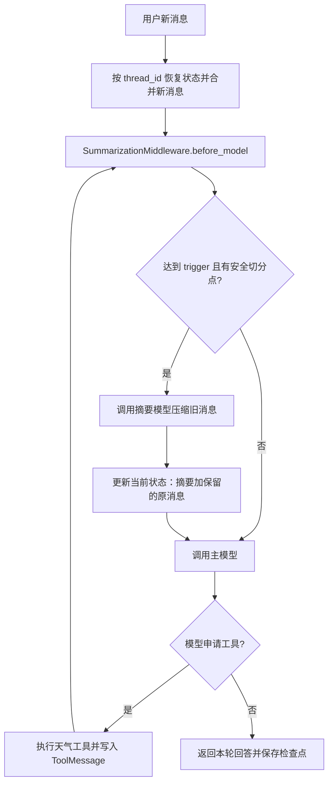

# 17. LangChain 摘要中间件：双模型配置、触发条件与消息保留

这一篇把内置 `SummarizationMiddleware` 接入天气 Agent：先问北京天气，再追问“太原呢？”，让框架在历史达到阈值时压缩较早消息。

本次排错最关键的发现是：**Agent 的对话模型与中间件的摘要模型分别初始化。主模型能够通过 OpenRouter 回答，不代表摘要模型也自动使用相同的提供商配置。**

完整示例：[langchain_summarization_middleware.py](../langchain_summarization_middleware.py) · 离线测试：[test_summarization_middleware.py](../tests/test_summarization_middleware.py)

## 阅读目录

- [一句话理解与学习目标](#overview)
- [从两轮天气对话看完整流程](#flow)
- [先分清两个模型的职责](#two-models)
- [401 报错的实际定位过程](#debugging)
- [最小修正与密钥读取规则](#fix)
- [trigger：什么时候尝试摘要](#trigger)
- [keep：哪些原消息继续保留](#keep)
- [为什么第一轮成功、第二轮才报错](#first-and-second)
- [before_model：摘要发生在哪一步](#before-model)
- [摘要怎样替换当前消息状态](#state-update)
- [摘要消息、线程与历史检查点](#checkpoint)
- [逐段读懂本例代码](#code-walkthrough)
- [运行方式与完整源码](#run)
- [输出观察与日志阅读](#observation)
- [验证记录与结论边界](#validation)
- [与手写滚动摘要的区别](#comparison)
- [语法与 API 速查](#cheatsheet)
- [额外补充与练习](#extensions)
- [复习问答](#review)
- [官方资料与相邻主题](#references)

<a id="overview"></a>

## 一句话理解与学习目标

**摘要中间件在调用主模型之前检查消息：达到触发条件、且存在可以安全压缩的旧消息时，先调用摘要模型，再把“摘要 + 保留的原消息”交给主模型。**

这段代码要串起来的知识是：

1. 使用 `create_agent` 组合模型、工具、检查点与中间件。
2. 为主模型和摘要模型分别明确 OpenRouter 配置。
3. 用 `trigger` 控制摘要尝试的时机。
4. 用 `keep` 控制最近原文的保留目标。
5. 识别 Human、AI、Tool 消息以及摘要包装消息。
6. 通过同一个 `thread_id` 继续对话，观察当前状态与旧检查点的区别。

天气工具仍然返回固定演示文本。这里学习的是消息管理和 Agent 执行机制，没有接入真实天气服务。

<a id="flow"></a>

## 从两轮天气对话看完整流程



需要特别注意图中的回边：工具执行后还会再次调用主模型，因此一次 `agent.invoke()` 内可以多次经过 `before_model`。阈值设置得很低时，同一轮也可能不止调用一次摘要模型。

这也是为什么不能简单地把“轮数”“模型调用次数”和“消息条数”当成同一个概念。

<a id="two-models"></a>

## 先分清两个模型的职责

最初的配置可以简化为：

```python
agent = create_agent(
    model=init_chat_model(
        model="openai/gpt-5-mini",
        model_provider="openrouter",
    ),
    middleware=[
        SummarizationMiddleware(
            model="gpt-4o-mini",
            trigger=("tokens", 30),
            keep=("messages", 3),
        ),
    ],
)
```

这里两个 `model=` 虽然同名，却属于不同对象的参数：

| 配置位置 | 模型职责 | 最初怎样初始化 |
| --- | --- | --- |
| `create_agent(model=...)` | 理解天气问题、申请工具、生成最终回答 | 已显式选择 OpenRouter |
| `SummarizationMiddleware(model=...)` | 压缩较早的对话消息 | 只传入 `"gpt-4o-mini"` 字符串 |

中间件收到模型字符串时，会自行调用 `init_chat_model(model)`。它不会去读取外层主模型的 `model_provider`。

本次安装环境会将 `"gpt-4o-mini"` 自动识别为 OpenAI 集成。主模型配置正确，并不能覆盖这个独立创建的摘要客户端。

两个职责可以使用相同模型，也可以使用不同模型。当前完整示例默认将二者都配置为 `openai/gpt-5-mini`，保持本次最终代码的选择，但仍明确区分两个客户端的创建位置。

<a id="debugging"></a>

## 401 报错的实际定位过程

### 现象：第一轮有回答，第二轮失败

实际终端记录中，第一轮已经输出：

```text
第一轮回复：我查到的信息是：在北京总是阳光明媚！
```

随后第二次 `agent.invoke()` 报错。脱敏后的关键部分为：

```text
OpenAIAuthenticationError: Error code: 401
Incorrect API key provided: [已隐藏]
During task with name 'SummarizationMiddleware.before_model'
```

这条记录说明第一轮的主模型和工具调用能够工作；第二轮的问题需要沿着摘要执行路径继续定位。

### 沿堆栈找真正失败的调用

关键调用关系为：

```text
第二轮 agent.invoke()
    ↓
SummarizationMiddleware.before_model()
    ↓
_create_summary()
    ↓
self._summary_model.invoke(...)
    ↓
langchain_openai / OpenAI 客户端
    ↓
401 invalid_api_key
```

有三个证据互相对应：

1. 失败任务名是 `SummarizationMiddleware.before_model`。
2. 失败前正在执行 `_create_summary` 和 `_summary_model.invoke`。
3. 摘要调用进入 `langchain_openai`，而外层主模型配置的是 OpenRouter。

因此本次需要修正的是摘要客户端的提供商配置。把 OpenRouter 密钥用于不匹配的 OpenAI 服务请求，会被拒绝为无效密钥。

这与第 16 篇的 `400 Provider returned error` 不同：那次是在排查结构化输出请求的兼容性；这次已经有明确的 `401`、认证错误和独立摘要模型初始化证据。

<a id="fix"></a>

## 最小修正与密钥读取规则

将中间件中的这一项：

```python
model="gpt-4o-mini",
```

改成显式创建的 OpenRouter 模型对象。本次最终代码采用：

```python
SummarizationMiddleware(
    model=init_chat_model(
        model="openai/gpt-5-mini",
        model_provider="openrouter",
    ),
    trigger=("tokens", 30),
    keep=("messages", 3),
)
```

核心修正是 `model_provider="openrouter"`；`openai/` 则属于 OpenRouter 模型 ID 的一部分。

模型对象传入中间件后，中间件使用这个对象生成摘要，无须再根据一个裸字符串猜测集成。

| 客户端配置 | 默认密钥变量 | 本次应如何理解 |
| --- | --- | --- |
| OpenRouter 集成 | `OPENROUTER_API_KEY` | 主模型和摘要模型分别使用这个集成 |
| OpenAI 集成 | `OPENAI_API_KEY` | 不会因为值实际是 OpenRouter Key 就自动切换服务 |
| 显式 `api_key=...` | 由传入表达式决定 | 仍需与客户端服务地址匹配 |

只要 `OPENROUTER_API_KEY` 已由系统、IDE 或 `.env` 加载进环境变量，当前两个 OpenRouter 客户端都可以自动读取它。

不需要把 Key 写进 Python 源码。也不要仅因为变量名字里有 `OPENAI` 或模型 ID 里有 `openai/`，就把客户端、模型标识和服务地址混为一谈。

<a id="trigger"></a>

## trigger：什么时候尝试摘要

### 本例：绝对 Token 阈值

```python
trigger=("tokens", 30)
```

这个元组描述一个触发条件：当前消息的 Token 使用达到相应阈值时，尝试摘要。

`30` 是为了快速观察效果而设置的演示值。它既不是模型的最大上下文窗口，也不是要求摘要后的整次请求一定少于 30 Token。

完整示例显式传入 `count_tokens_approximately`，让本地近似计数的意图清楚可见。中间件还可能利用消息中已有的用量信息辅助判断。这里的阈值管理不等于模型账单的精确 Token 统计。

### 改按消息数触发

```python
trigger=("messages", 100)
```

这里检查的是消息对象数量，而不是用户发言轮数。一次天气问答可能产生用户、模型工具申请、工具结果、模型回答四条消息。

### 按上下文比例触发

```python
trigger=("fraction", 0.8)
```

比例条件需要可用的模型上下文窗口资料，即模型 profile 中的相关限制。应确认中间件读取到的模型能力数据，不能在缺少窗口信息时把 `0.8` 理解为一个已经确定的 Token 数。

### 多种条件满足其一即可

```python
trigger=[
    ("tokens", 4000),
    ("messages", 100),
]
```

列表表示 OR：达到任意一项条件，就满足这部分的触发判断。

满足阈值之后，中间件还要判断是否存在可安全切出的旧消息。只有阈值，没有可摘要部分，也不会真的调用摘要模型。

<a id="keep"></a>

## keep：哪些原消息继续保留

```python
keep=("messages", 3)
```

它表达“以保留最近三条原消息为目标”。这里的三条不是三轮对话。

一次带天气工具的问答可以表示为：

```text
HumanMessage：北京的天气怎么样？
AIMessage：申请 get_weather_for_location
ToolMessage：在北京总是阳光明媚！
AIMessage：最终回答
```

模型申请工具的 `AIMessage` 与返回结果的 `ToolMessage` 之间存在调用 ID 的对应关系。如果把工具申请摘要掉，却单独留下工具结果，模型请求可能成为不完整的工具对话序列。

所以中间件会寻找安全切分点，避免拆散相关工具消息。保留目标、实际安全切分点和最后返回的消息数量不是一回事。

最终结果也不一定只有三条，因为：

1. 摘要本身会被包装成一条新消息。
2. 工具消息边界可能改变切分点。
3. 摘要之后还会追加新的模型消息和工具结果。

`keep` 配置一个保留策略；可以按 `messages`、`tokens` 或 `fraction` 表达目标。本例沿用消息数策略，方便观察。

<a id="first-and-second"></a>

## 为什么第一轮成功、第二轮才报错

触发摘要的时机不等于“一到第二轮就必须摘要”。要同时看消息列表、阈值和可切分的旧内容。

### 第一轮：主模型回答，不一定调用摘要模型

开始时只有一条用户消息；天气工具执行完、主模型再次回答前，通常有三条消息：

```text
HumanMessage → AIMessage（工具申请）→ ToolMessage
```

当前 `keep=("messages", 3)` 希望保留三条。即便估算 Token 达到阈值，此时也没有需要切出的旧消息，中间件可以直接跳过摘要。

主模型生成最终回答后，第一轮返回四条消息。`before_model` 在模型调用之前运行，不会仅因为本轮刚追加了最终回答，就在返回后自动再摘要一次。

### 第二轮：新消息使历史出现可压缩部分

追加“太原呢？”后，消息成为：

```text
1. HumanMessage：北京的天气怎么样？
2. AIMessage：申请北京天气工具
3. ToolMessage：北京演示天气
4. AIMessage：北京天气回答
5. HumanMessage：太原呢？
```

这时有了超过保留目标的旧消息。达到阈值并找到安全切分点后，中间件开始调用摘要模型。

原配置的认证问题因此在第二轮暴露：主模型已在第一轮正常工作，而另一个摘要客户端直到这里才真的发出请求。

离线测试专门把 Token 计数固定为 100，以排除分词波动：第一轮摘要调用为 0，第二轮会进入摘要。这个观察验证控制流，不表示真实服务的精确 Token 数就是 100。

<a id="before-model"></a>

## before_model：摘要发生在哪一步

`before_model` 是“准备调用主模型之前”的中间件钩子，不是“只在整个 Agent 开始时执行一次”。

一个工具循环可以经过：

```text
before_model
    ↓
主模型申请工具
    ↓
执行工具
    ↓
before_model
    ↓
主模型生成最终回答
```

所以用很低的阈值演示时，工具结果追加后又可能触发摘要。

在本次固定计数的离线观察里，两轮天气对话共执行了四次主模型调用；第一轮没有调用摘要模型，第二轮调用了两次摘要模型。真实次数会受到消息内容、工具调用和计数配置影响，不能把这个数字当成每次运行都固定的规则。

摘要本身也消耗模型调用。设置阈值时要结合消息规模、上下文窗口、延迟和摘要质量，不能仅以“越早生成摘要越好”为目标。

<a id="state-update"></a>

## 摘要怎样替换当前消息状态

当前安装版本的中间件大致执行四步：

1. 按 `trigger` 判断是否需要尝试。
2. 按 `keep` 和工具边界切分“旧消息”与“保留的原消息”。
3. 用摘要模型处理旧消息。
4. 返回状态更新，清理当前消息列表，再写入摘要和保留的消息。

状态更新的核心形态是：

```python
{
    "messages": [
        RemoveMessage(id=REMOVE_ALL_MESSAGES),
        *new_messages,
        *preserved_messages,
    ]
}
```

这是理解机制的片段，不需要在示例里重新手写一遍。

- `RemoveMessage(id=REMOVE_ALL_MESSAGES)`：通过消息 Reducer 清理当前列表。
- `*new_messages`：把新摘要消息展开进列表。
- `*preserved_messages`：把仍保留的原消息展开进列表。

因此它会改变当前 State。之后同一线程继续对话时，恢复的是经过压缩的当前状态，而不只是对某一次临时模型输入做裁剪。

<a id="checkpoint"></a>

## 摘要消息、线程与历史检查点

### 摘要怎样出现在 messages 中

本次实际版本会把摘要包装为一条 `HumanMessage`，并附加来源标记：

```python
additional_kwargs={"lc_source": "summarization"}
```

它的文本带有类似前缀：

```text
Here is a summary of the conversation to date:
```

这是一条框架生成的历史摘要包装消息，不是用户又输入了一段新问题。观察时应结合 `lc_source`，不能只看消息类名。

它与第 10 篇手写方案的表示方式不同：第 10 篇把摘要放在独立的 `summary` 字段，再自行构造模型输入；内置中间件会把摘要放回 `messages`。不能假定所有摘要方案都有同一个字段或消息角色。

### thread_id 负责恢复哪段对话

两次调用都使用：

```python
config = {"configurable": {"thread_id": "11"}}
```

并复用同一个 Agent 与 `InMemorySaver`，第二轮才会接着第一轮的状态继续运行。

更换线程 ID 会得到独立的消息状态。这个 ID 只是会话定位标识，不会自动建立用户登录和访问权限。

### 压缩当前状态，不等于删除所有旧检查点

中间件用摘要替换当前消息列表，并不等于把旧检查点里的原消息一起物理删除。

离线验证中：最新状态已经没有最初那条“北京的天气怎么样？”原消息，但使用 `get_state_history()` 仍能在较早快照里看到它。

`InMemorySaver` 只在当前进程内保存这些状态；程序退出后无法依靠它跨进程恢复。

<a id="code-walkthrough"></a>

## 逐段读懂本例代码

### 1. 天气工具仍然是演示函数

```python
@tool
def get_weather_for_location(city: str) -> str:
    """获取指定城市的演示天气；返回值固定为阳光明媚。"""
    return f"在{city}总是阳光明媚！"
```

模型从问题里生成 `city` 参数，Python 执行工具，工具返回值成为 `ToolMessage`。`@tool` 使用函数签名和说明建立工具 Schema。

第二轮只有“太原呢？”时，主模型需要根据保留的消息或摘要理解：用户继续询问另一个城市的天气。

### 2. 模型工厂明确提供商

```python
def build_openrouter_model(model_name: str) -> BaseChatModel:
    ...
    return init_chat_model(
        model=model_name,
        model_provider="openrouter",
    )
```

主模型和摘要模型都通过这个函数创建。它们可以接受不同模型 ID，但不能遗漏各自的提供商配置。

### 3. build_agent 支持注入两个模型

运行示例时不传模型参数，会读取环境配置创建客户端；测试时传入两个离线模型，使用真实框架执行工具、摘要和检查点。

这样可以把“程序机制是否正确”和“当前外部服务是否可用”分开验证。离线模型预先安排好回复，不代表真实模型一定按相同次数选择工具。

### 4. 两轮调用只提交新消息

第一轮传入“北京的天气怎么样？”，第二轮传入“太原呢？”。检查点负责恢复之前的状态，调用方无须把旧消息重新拼接一次。

### 5. 用结果列表的最后一条查看回答

```python
response["messages"][-1].content
```

逐步拆解：

1. `response["messages"]`：从返回的状态字典读取消息列表。
2. `[-1]`：Python 中取列表的最后一个元素。
3. `.content`：读取这条消息的正文。

在本例正常完成的 Agent 调用中，最后一条是助手最终回答。

### 6. 用摘要标记观察历史压缩

`print_messages()` 输出消息类型、`lc_source` 标记和正文，同时显示工具名与参数；它不展开供应商的完整元数据，方便对比压缩前后结构。

<a id="run"></a>

## 运行方式与完整源码

### 安装与环境配置

```bash
pip install -r requirements.txt
```

需要 Python 3.10 及以上；本次验证使用 Python 3.11.7。

若已经有 `.env`，补充这些配置；尚无配置文件时，可先复制仓库的 `.env.example`。

```dotenv
OPENROUTER_API_KEY=your_openrouter_api_key_here
SUMMARY_CHAT_MODEL=openai/gpt-5-mini
SUMMARY_MODEL=openai/gpt-5-mini
SUMMARY_THREAD_ID=11
```

`SUMMARY_CHAT_MODEL` 是负责回答的主模型，`SUMMARY_MODEL` 是生成摘要的模型。两者默认相同，分开配置是为了明确职责。

执行：

```bash
python langchain_summarization_middleware.py
```

源码在 `run_demo()` 中加载与脚本同目录的 `.env`，并在环境变量缺少 OpenRouter Key 时给出提示。导入模块不会自动创建真实模型或执行对话。

阈值保留在 `build_agent()` 的参数中，与本次学习代码一致：`trigger=("tokens", 30)`、`keep=("messages", 3)`。复习时可以先保持配置，再单独修改一个条件观察差异。

### 完整源码

以下完整代码与根目录 [示例文件](../langchain_summarization_middleware.py) 一致。

<details>
<summary>展开完整可运行代码</summary>

<!-- SUMMARIZATION_SOURCE_BEGIN -->
```python
"""使用内置摘要中间件管理天气 Agent 的线程消息。

主模型与摘要模型分别显式选择 OpenRouter。天气工具只返回演示数据。
导入本模块不会读取密钥或调用模型。
"""

import os
from pathlib import Path

from dotenv import load_dotenv
from langchain.agents import create_agent
from langchain.agents.middleware import SummarizationMiddleware
from langchain.chat_models import init_chat_model
from langchain.tools import tool
from langchain_core.language_models.chat_models import BaseChatModel
from langchain_core.messages import BaseMessage
from langchain_core.messages.utils import count_tokens_approximately
from langgraph.checkpoint.memory import InMemorySaver
from openrouter.errors import OpenRouterError


@tool
def get_weather_for_location(city: str) -> str:
    """获取指定城市的演示天气；返回值固定为阳光明媚。"""
    return f"在{city}总是阳光明媚！"


def build_openrouter_model(model_name: str) -> BaseChatModel:
    """创建独立模型客户端，自动读取 OPENROUTER_API_KEY。"""
    if not os.getenv("OPENROUTER_API_KEY", "").strip():
        raise RuntimeError("请在环境变量或 .env 中配置 OPENROUTER_API_KEY。")
    return init_chat_model(
        model=model_name,
        model_provider="openrouter",
    )


def build_agent(
    chat_model: BaseChatModel | None = None,
    summary_model: BaseChatModel | None = None,
    *,
    trigger=("tokens", 30),
    keep=("messages", 3),
    token_counter=count_tokens_approximately,
):
    """组合两个模型和中间件；测试可注入模型及确定性的 Token 计数器。"""
    if chat_model is None:
        chat_model = build_openrouter_model(
            os.getenv("SUMMARY_CHAT_MODEL", "openai/gpt-5-mini")
        )
    if summary_model is None:
        summary_model = build_openrouter_model(
            os.getenv("SUMMARY_MODEL", "openai/gpt-5-mini")
        )

    return create_agent(
        model=chat_model,
        tools=[get_weather_for_location],
        system_prompt="你是一位乐于助人的助手。",
        checkpointer=InMemorySaver(),
        middleware=[
            SummarizationMiddleware(
                model=summary_model,
                trigger=trigger,
                keep=keep,
                token_counter=token_counter,
            ),
        ],
    )


def print_messages(messages: list[BaseMessage]) -> None:
    """显示消息角色、摘要标记和内容，不展开供应商元数据。"""
    for index, message in enumerate(messages, start=1):
        is_summary = message.additional_kwargs.get("lc_source") == "summarization"
        marker = " [摘要]" if is_summary else ""
        print(f"{index}. {type(message).__name__}{marker}：{message.content}")
        for call in getattr(message, "tool_calls", []):
            print(f"   工具调用：{call['name']}({call['args']})")


def run_demo() -> None:
    """在同一个线程中从北京天气继续追问太原，观察消息变化。"""
    load_dotenv(Path(__file__).with_name(".env"))
    agent = build_agent()
    config = {
        "configurable": {"thread_id": os.getenv("SUMMARY_THREAD_ID", "11")},
        "recursion_limit": 30,
    }
    prompts = ["北京的天气怎么样？", "太原呢？"]

    try:
        for turn, prompt in enumerate(prompts, start=1):
            response = agent.invoke(
                {"messages": [{"role": "user", "content": prompt}]},
                config=config,
            )
            print(f"第 {turn} 轮用户：{prompt}")
            print(f"第 {turn} 轮回复：{response['messages'][-1].content}")
            print_messages(response["messages"])
    except OpenRouterError as error:
        print("状态码：", error.status_code)
        print("详细错误：", error.body)
        raise


if __name__ == "__main__":
    run_demo()
```
<!-- SUMMARIZATION_SOURCE_END -->

</details>

<a id="observation"></a>

## 输出观察与日志阅读

### 真实记录和示意注释要分开

本次保留的真实终端记录显示：第一轮通过 OpenRouter 正常回答，第二轮使用原摘要模型配置时发生 `401`。

最新代码已经显式配置两个 OpenRouter 客户端，但目前没有附上这次修正后的真实服务完整运行日志，因此这里不把它写成“真实接口重跑已通过”。

代码注释中存在“上海”回复，而当前第二轮输入为“太原呢？”。这些注释适合说明消息结构，不能当作当前输入对应的验证结果。

### 离线实际观察

下面是执行真实中间件、使用预先编排模型回复得到的结果。计数器在此测试中固定返回 100，摘要正文与最终回答也是离线测试文本：

```text
第一轮消息类型：HumanMessage、AIMessage、ToolMessage、AIMessage
第一轮摘要调用次数：0
第二轮累计摘要调用次数：2

1. HumanMessage [摘要]：Here is a summary of the conversation to date:

较早对话讨论北京的演示天气，继续处理保留的最近消息。
2. HumanMessage：太原呢？
3. AIMessage：
   工具调用：get_weather_for_location({'city': '太原'})
4. ToolMessage：在太原总是阳光明媚！
5. AIMessage：太原的演示天气是晴天。
```

可以观察到：

- 摘要模型确实被调用，主模型收到替换后的历史上下文。
- 当前用户的“太原呢？”仍以原消息形式保留。
- 太原的工具申请与工具结果成对存在。
- 最终状态有五条消息，说明 `keep=3` 不是最终列表长度必须等于 3。

### 为什么原始 print 输出特别长

```python
print(response["messages"])
```

这会展示消息对象的完整表示，除了正文，还可能包括工具调用、Token 用量、供应商元数据和推理相关附加数据。很长的 `reasoning_details` 或不透明加密字段本身不等于程序报错。

阅读日志时，先关注消息角色、工具名、回答正文和最终异常。需要看具体失败原因时再定位堆栈；不必将整个元数据对象都当作用户可见的回答。

<a id="validation"></a>

## 验证记录与结论边界

### 不调用真实模型的自动化验证

```bash
python -m unittest discover -s tests -p test_summarization_middleware.py -v
```

测试使用两个离线模型：主模型按脚本申请北京与太原的天气工具，摘要模型生成固定摘要；工具执行、摘要中间件、消息 Reducer 与检查点均由真实框架运行。测试阻断 HTTP 客户端，不读取真实密钥发起模型请求。

| 检查项 | 实际验证内容 |
| --- | --- |
| 两个模型的提供商 | 创建主模型和摘要模型时均显式传入 `model_provider="openrouter"` |
| 两轮对话与城市 | 北京与太原的工具执行、最终回答和摘要消息均符合离线脚本 |
| 高阈值 | 未达到 Token 阈值时不调用摘要模型，原历史保留 |
| 无可切旧历史 | 阈值已满足、消息仍在保留范围内时跳过摘要 |
| 工具消息边界 | 主模型输入和最终状态没有孤立的工具申请或工具结果 |
| 检查点历史 | 当前状态已压缩，旧快照仍保留较早原消息 |
| 多条件 OR | Token 条件未满足、消息数条件满足时仍会摘要 |
| 新线程 | 更换 `thread_id` 不带入上一线程的旧消息 |
| 日志显示 | 可见摘要标记与正文，不展开供应商不透明元数据 |

实际结果：**9 项新测试通过**。

与第 16 篇一起验证：

```bash
python -m unittest discover -s tests -v
```

本次合计 **19 项测试通过**。

### 验证环境

| 组件 | 版本 |
| --- | --- |
| Python | 3.11.7 |
| langchain | 1.4.6 |
| langchain-core | 1.6.12 |
| langgraph | 1.2.16 |
| langgraph-checkpoint | 4.3.0 |
| langchain-openrouter | 0.2.9 |
| openrouter | 0.11.46 |

### 这些测试不能证明什么

它们不替代真实服务的认证与连通性验证，也不保证真实模型总能准确理解省略问句、生成高质量摘要或选择正确城市。天气函数本身没有实时数据；摘要也属于有损压缩，需要根据业务问题评估遗漏和失真。

<a id="comparison"></a>

## 与手写滚动摘要的区别

第 10 篇和本篇都在解决长对话管理，但实现位置不同：

| 对比项 | 第 10 篇手写工作流 | 本篇内置中间件 |
| --- | --- | --- |
| 入口 | 自己定义 `StateGraph` 与节点 | `create_agent(..., middleware=[...])` |
| 执行时机 | 由自定义节点和条件边决定 | 主模型调用前的 `before_model` |
| 摘要保存位置 | 自定义 `summary` 状态字段 | 当前实现把摘要包装为消息并放回 `messages` |
| 触发规则 | 应用自行编写判断 | 配置 `trigger` |
| 原文保留 | 应用自行切片、处理工具边界 | 配置 `keep`，框架寻找安全切分点 |
| 模型输入 | 应用组合摘要与最近消息 | 中间件更新消息，Agent 继续调用模型 |
| 可控程度 | 便于实现特殊业务规则 | 适合用较少配置接入常见摘要机制 |

先理解手写方案，有助于看懂内置中间件替应用处理了哪些步骤；掌握内置方案后，再判断业务是否需要额外的结构化记忆提取、摘要质量评估或自定义状态字段。

<a id="cheatsheet"></a>

## 语法与 API 速查

| 写法 | 所属模块或对象 | 参数与作用 |
| --- | --- | --- |
| `SummarizationMiddleware(...)` | `langchain.agents.middleware` | 创建在主模型调用前管理历史的中间件 |
| `model=init_chat_model(...)` | 中间件参数 | 传入已经明确配置好的摘要模型对象 |
| `trigger=("tokens", 30)` | 中间件参数 | 一个 Token 触发条件，元组的第一项是维度、第二项是阈值 |
| `trigger=[(...), (...)]` | 中间件参数 | 多个条件满足其一即可，列表表示 OR |
| `keep=("messages", 3)` | 中间件参数 | 最近原消息的保留目标，不代表三轮或最终三条 |
| `middleware=[...]` | `create_agent` 参数 | 向 Agent 安装中间件对象列表 |
| `count_tokens_approximately(messages)` | `langchain_core.messages.utils` | 本地近似计算消息 Token 使用 |
| `InMemorySaver()` | `langgraph.checkpoint.memory` | 在当前进程内保存线程检查点 |
| `response["messages"][-1].content` | Python 字典、列表与消息对象 | 读取本例正常完成调用的最后一条回答正文 |
| `message.additional_kwargs.get("lc_source")` | 消息对象附加字典 | 在当前实现中识别摘要来源标记 |
| `getattr(message, "tool_calls", [])` | Python 内置函数 | 有该属性时读取；没有时返回空列表 |
| `for turn, prompt in enumerate(prompts, start=1)` | Python 内置函数 | 同时获得从 1 开始的轮次编号与问题文本 |
| `*preserved_messages` | Python 可迭代展开语法 | 将列表元素逐个放入新列表，而不是嵌套一整个列表 |

同名关键字参数的含义取决于当前调用对象。外层 `create_agent(model=...)` 和内层 `SummarizationMiddleware(model=...)` 没有自动的参数继承关系，这是本次错误最值得记住的语法层面细节。

<a id="extensions"></a>

## 额外补充与练习

下面是本次代码之外可以继续验证的内容，不作为已经发生过的个人报错：

1. **调整阈值**：从 30 增大到更适合完整对话的数值，记录主模型和摘要模型各自调用次数。
2. **更换保留方式**：分别使用消息数和 Token 保留，比较工具调用较多时的切分点。
3. **摘要事实检查**：先让用户说明姓名、城市和约束，触发摘要后检查这些信息是否仍准确。
4. **多次滚动摘要**：连续询问多个城市，观察旧摘要怎样再次成为待压缩历史的一部分。
5. **主模型与摘要模型分开选择**：明确二者的能力、上下文窗口和配置，不依赖提供商自动继承。
6. **按条款组合条件**：当前版本还支持用一个条件字典表达 AND，再把多个条款放进列表表达 OR；使用前先确认安装版本的 API。
7. **持久化检查点**：切换为数据库后端，重启程序后继续；同时理解摘要更新和历史数据清理是不同操作。
8. **真实天气数据**：让工具返回来源、查询时间、温度和天气状况，再验证摘要不会改写关键事实。

摘要不是权威业务数据库。对于必须精确保存的信息，可以另外设计结构化状态或 Store 记录，再决定自然语言摘要承担哪些背景信息。

<a id="review"></a>

## 复习问答

<details>
<summary>1. 主模型配置成 OpenRouter 后，摘要模型会自动继承吗？</summary>

不会。中间件会使用自己收到的模型对象，或自行初始化收到的模型字符串。两处配置必须分别明确。

</details>

<details>
<summary>2. 为什么本次第一轮成功，第二轮才报 401？</summary>

第一轮没有需要安全切出的旧消息，主要使用已正确配置的主模型。第二轮满足摘要条件，另一个摘要客户端开始请求，才暴露认证配置错误。

</details>

<details>
<summary>3. 模型名中的 openai/ 是否表示一定直连 OpenAI？</summary>

不是。它可以是 OpenRouter 模型 ID 的组成部分，具体客户端集成由 `model_provider` 等配置决定。

</details>

<details>
<summary>4. trigger 和 keep 分别控制什么？</summary>

`trigger` 控制何时尝试摘要；`keep` 控制保留哪些最近原消息。达到触发条件后，还要有可安全压缩的旧内容。

</details>

<details>
<summary>5. keep 三条消息，等于保留最近三轮吗？</summary>

不等于。一轮包含若干消息对象，工具调用还会增加消息。安全切分、摘要包装和后续回复都会影响最终列表长度。

</details>

<details>
<summary>6. before_model 每轮只执行一次吗？</summary>

不是。一次 Agent 运行可能多次调用主模型，例如工具执行后再次回答，每次之前都可能经过这个钩子。

</details>

<details>
<summary>7. 为什么不能把 AI 工具申请与 ToolMessage 随便拆开？</summary>

两者通过调用 ID 对应。留下孤立申请或孤立结果可能破坏模型接口要求的消息序列，中间件需要寻找安全边界。

</details>

<details>
<summary>8. 当前内置中间件的摘要一定在 summary 字段里吗？</summary>

不是。本次版本将摘要包装成带 `lc_source="summarization"` 标记的消息，放入当前 `messages`。独立 `summary` 字段是另一种可由应用设计的方案。

</details>

<details>
<summary>9. 当前消息压缩后，所有旧检查点都会被删除吗？</summary>

不会。最新状态被更新，不表示较早的历史快照被物理清除。本次测试仍能从历史快照中读取原消息。

</details>

<details>
<summary>10. 30 Token 是最终请求的硬性长度上限吗？</summary>

不是。它是摘要触发阈值。摘要文本、保留原文、系统提示和工具信息都可能继续占用上下文，计数方式也不等于精确账单。

</details>

<details>
<summary>11. 怎样分清日志中的错误和普通元数据？</summary>

先定位最终异常类型、状态码和失败任务，再沿堆栈找调用。完整消息对象中的推理附加字段、Token 用量和工具参数属于运行数据，长度很大并不表示本身出错。

</details>

<details>
<summary>12. 离线测试通过是否证明修正后的真实服务调用成功？</summary>

不能。它验证路由参数、控制流、消息状态和边界处理。真实密钥、网络、上游模型行为与摘要质量还需要另外验证。

</details>

<a id="references"></a>

## 官方资料与相邻主题

- [LangChain 内置摘要中间件](https://docs.langchain.com/oss/python/langchain/middleware/built-in#summarization)
- [SummarizationMiddleware API](https://reference.langchain.com/python/langchain/agents/middleware/summarization/SummarizationMiddleware)
- [LangChain OpenRouter 集成](https://docs.langchain.com/oss/python/integrations/chat/openrouter)
- [LangChain 短期记忆](https://docs.langchain.com/oss/python/langchain/short-term-memory)
- [LangGraph 检查点与线程](https://docs.langchain.com/oss/python/langgraph/persistence)
- [第 03 篇：工具调用循环](03-langgraph-tool-calling-search-agent.md)
- [第 10 篇：手写短期记忆与滚动摘要](10-langgraph-short-term-memory-management.md)
- [第 16 篇：结构化天气 Agent 与模型配置](16-langchain-weather-structured-agent.md)
- [返回学习目录](../README.md#学习目录)
