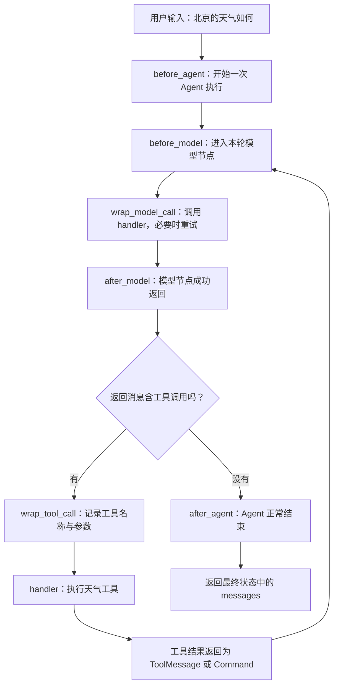

# LangChain 自定义中间件：从六个钩子看懂 Agent、回调与重试

> 一次天气查询可以串起四个概念：Agent 的执行生命周期、模型与工具的调用边界、`handler` 回调，以及失败时如何继续或退出。本篇从一段包含六种装饰器的实际练习出发，逐行拆解它们怎样进入真实的 Agent 图。

[返回首页](../README.md) · [完整源码](../langchain_custom_middleware.py) · [离线测试](../tests/test_custom_middleware.py) · [上一章：内容审核](18-langchain-content-moderation.md)

<a id="toc"></a>
## 目录

- [1. 这段代码在做什么](#purpose)
- [2. 从原始练习定位需要注意的地方](#original)
- [3. 一次天气查询的完整执行过程](#flow)
- [4. 四个节点式钩子：State、Runtime 与返回值](#node-hooks)
- [5. 两个包装式钩子：request 与 handler](#wrappers)
- [6. Python 复杂写法逐项拆解](#syntax)
- [7. 模型重试：三次尝试怎样运行](#model-retry)
- [8. 工具包装：异常、ToolMessage 与 Command](#tool-wrapper)
- [9. 多个中间件的执行顺序](#order)
- [10. OpenRouter 配置与运行步骤](#run)
- [11. 完整可运行代码](#source)
- [12. 日志、消息列表与失败时的表现](#output)
- [13. 实际验证与能力边界](#validation)
- [14. 复习卡片与扩展练习](#review)
- [15. 相关资料](#references)

<a id="purpose"></a>
## 1. 这段代码在做什么

中间件让我们在 Agent 的某个执行位置插入逻辑。业务工具负责“查什么”，中间件负责“执行前后做什么、失败后怎么办”。

本例的业务很小：用户问北京天气，模型可以申请调用 `get_weather_for_location(city)`，程序执行工具，把结果交回模型组织回答。

这里的天气工具只返回固定字符串 `在{city}总是阳光明媚！`，目的是观察调用过程，并没有接入真实天气服务。

| 装饰器 | 进入的位置 | 本例承担的工作 | 正常返回什么 |
| --- | --- | --- | --- |
| `@before_agent` | 一次 Agent 执行开始时 | 打印开始日志 | 状态更新字典或 `None` |
| `@after_agent` | 一次 Agent 正常走到结束阶段时 | 打印结束日志 | 状态更新字典或 `None` |
| `@before_model` | 每次进入模型节点前 | 打印模型开始日志 | 状态更新字典或 `None` |
| `@after_model` | 每次模型节点成功返回后 | 打印模型完成日志 | 状态更新字典或 `None` |
| `@wrap_model_call` | 围住一次模型调用 | 调用、捕获异常、有限重试 | 本例为 `ModelResponse` |
| `@wrap_tool_call` | 围住每个工具调用 | 记录名称、参数、结果或异常 | `ToolMessage` 或 `Command` |

前四个叫**节点式钩子**：它们处于图中的执行位置。后两个叫**包装式钩子**：它们拿到一个可以继续执行的 `handler`，由自己的代码决定调用它几次。[官方自定义中间件说明](https://docs.langchain.com/oss/python/langchain/middleware/custom)

本章讨论同步 `agent.invoke()`。异步调用需要对应的异步钩子与 `await handler(...)`，不能把同步函数原样当成异步实现。

<a id="original"></a>
## 2. 从原始练习定位需要注意的地方

练习已经包含四个日志钩子、一个模型重试包装器、一个工具包装器，并将六个对象传入 `create_agent(middleware=[...])`。主体思路是成立的。

这次提供了代码，没有附新的运行日志。下面的“待核对点”来自代码检查，不代表这些问题都已经在真实请求里发生过。

### 2.1 工具异常分支没有明确退出

原来的关键部分：

```python
try:
    result = handler(request)
    print("【wrap tool】工具调用完成")
    return result
except Exception as e:
    print(f"【wrap tool】工具调用出现错误：{e}")
```

假设工具真的抛出异常，程序进入 `except`，打印后走到函数末尾。Python 会隐式返回 `None`。

但这里是工具包装器，返回协议要求得到工具消息或图命令。**把异常打印出来，不等于把失败处理完了。** 上游可能在后续校验或合并结果时再报一个更难定位的问题。

本篇完整源码采用最小的处理：在打印之后加一个裸 `raise`，将原异常交给调用方。没有编造一个“晴天”来冒充工具结果，也没有吞掉异常。

```python
except Exception as error:
    print(f"【wrap tool】工具调用出现错误：{error}")
    raise
```

如果业务确实希望失败后继续让模型解释，应明确构造错误 `ToolMessage`，见[工具错误处理](#tool-wrapper)。

### 2.2 `retry_tool` 这个名字并没有实现工具重试

原函数体里只有一次 `handler(request)`，没有循环，也没有第二次调用。

因此它的实际能力是“工具调用日志 + 异常捕获”，不能因为函数名里有 `retry` 就认为工具会重试。源码保留这个名字便于对照练习，并在注释里说明这一点。独立整理业务代码时可以改名为 `log_tool_call`。

### 2.3 模型的三次是“尝试次数”

原代码：

```python
for t in range(3):
    try:
        return handler(request)
    except Exception as e:
        if t == 2:
            raise
        print(f"将重试{t+1}次/3次，错误信息为：{e}")
```

循环最多运行三轮，含首次调用，因此最多重试两次。原日志把 `/3次` 写在“重试”后面容易产生误解，完整源码改为“第几次尝试失败，准备第几次尝试”。

### 2.4 不要把相似的 `None` 当成同一件事

| 位置 | 返回 `None` 的含义 |
| --- | --- |
| `before_agent` 等四个节点式钩子 | 本钩子不提交状态更新，图继续执行 |
| 本例的模型包装器 | 缺少应交回的模型结果，不符合本例返回协议 |
| 工具包装器 | 缺少应交回的工具结果或命令，不符合返回协议 |

返回值应该结合调用方的约定理解，不能只看它是不是 Python 允许的语法。

[回到目录](#toc)

<a id="flow"></a>
## 3. 一次天气查询的完整执行过程

先假设模型选择“申请一次天气工具，再生成一句回答”，而且所有调用都成功。这是离线测试设定的路径，不是对真实模型每次行为的保证。



逐步看消息是怎样变化的：

| 步骤 | 新增消息 | 谁生成的 | 作用 |
| --- | --- | --- | --- |
| 1 | `HumanMessage("北京的天气如何")` | 调用方输入经框架转换 | 表达用户需求 |
| 2 | 含 `tool_calls` 的 `AIMessage` | 第一次模型调用 | 申请执行 `get_weather_for_location(city="北京")` |
| 3 | `ToolMessage("在北京总是阳光明媚！")` | 工具执行与框架包装 | 回传这次工具调用的结果 |
| 4 | 不含工具调用的 `AIMessage` | 第二次模型调用 | 组织最终回答，结束循环 |

这里不是“模型自己运行 Python 函数”。模型先输出工具调用请求，程序执行已注册的函数，再将工具结果交给模型。

关键计数：

| 内容 | 该路径中的次数 |
| --- | --- |
| `agent.invoke(...)` | 1 |
| `before_agent` / `after_agent` | 各 1 |
| `before_model` / `after_model` | 各 2 |
| 进入 `wrap_model_call` | 2 |
| 成功调用模型 `handler` | 2，无失败所以不用重试 |
| 进入 `wrap_tool_call` | 1 |
| 执行天气工具 | 1 |

**Agent 的一次执行可以包含多次模型调用。** 如果模型不申请工具，通常只有一个模型周期；如果多次申请工具，就可能出现更多周期。

<a id="node-hooks"></a>
## 4. 四个节点式钩子：State、Runtime 与返回值

以一个钩子为例：

```python
@before_model
def log_before_model(state: AgentState, runtime: Runtime) -> dict[str, Any] | None:
    print("即将执行LLM")
    return None
```

### 4.1 `state` 是到当前阶段为止的状态

`AgentState` 的常用字段是 `messages`。进入第一次模型节点时，里面有用户消息；工具执行后再进入模型节点时，里面还会包含模型的工具调用消息和对应工具结果。

例如可以观察 `state["messages"][-1]`。但它表示**当前状态里最后一条消息**，不保证是用户消息，也不保证有可见文本。

节点式钩子可以返回更新字典。这里日志不改变业务数据，所以返回 `None` 即可。若返回 `{"messages": [...]}`，消息会按状态字段的合并规则处理；`messages` 通常使用消息 reducer，不能假设这会直接覆盖整个历史。替换、删除消息的细节见[第 10 篇](10-langgraph-short-term-memory-management.md)和[第 18 篇](18-langchain-content-moderation.md#message-id)。

### 4.2 `runtime` 是框架传入的运行依赖入口

它可以让钩子访问本次执行的上下文、配置的 Store 等资源。状态里的业务消息与运行时依赖承担不同职责，具体见[Runtime Context](15-langgraph-runtime-context.md)。

本例只打日志，没有读取这些依赖。即使没有用到 `state` 和 `runtime`，函数也保留接口要求的参数，框架执行时会传入它们。

### 4.3 `after_*` 不是 `finally`

`after_model` 表示模型节点正常返回后的阶段，`after_agent` 表示 Agent 走到结束节点时的阶段。

如果模型尝试三次后仍抛出未处理异常，当前执行直接向调用者抛错，不会因为名字叫 `after` 就一定运行这两个钩子。本篇离线测试专门检查了这个分支。

如果必须无论成功失败都释放调用方拥有的资源，应使用 Python 的上下文管理器或 `try/finally`，不要把清理保证寄托在 `after_agent` 上。

<a id="wrappers"></a>
## 5. 两个包装式钩子：request 与 handler

### 5.1 为什么多了一个 `handler`

节点式钩子执行完后，图决定下一步。包装式钩子则拿到“下一段执行逻辑”，可以把它放在自己的 `try` 里面：

```python
print("调用之前")
result = handler(request)
print("调用之后")
return result
```

这四行构成最小包装过程。第二行真正继续执行，前后两行只是自己的附加逻辑。

`handler` 不需要自己定义，框架在调用包装器时传进来。它不一定只是“直接调用模型”的函数：当存在多个包装器时，它也可能继续进入下一个包装器。

### 5.2 模型请求与响应

| 名称 | 类型 | 本例怎样使用 |
| --- | --- | --- |
| `request` | `ModelRequest` | 读取准备交给模型的 `messages` |
| `handler` | 可调用对象 | `handler(request)` 继续执行模型调用链 |
| `result` | `ModelResponse` | 把结果返回给框架，继续处理状态和路由 |

`ModelResponse` 是框架使用的响应容器，不能简单把它当成一个普通字符串。包装器应保留响应协议，而不是 `return result.content`。

`request.messages` 用属性访问，因为 `request` 是请求对象。消息中的 `content` 也用属性访问，例如 `request.messages[-1].content`。

### 5.3 工具请求与响应

| 表达式 | 含义 |
| --- | --- |
| `request.tool_call` | 本次模型申请的工具调用字典 |
| `request.tool_call["name"]` | 要调用的工具名 |
| `request.tool_call["args"]` | 参数字典，例如 `{"city": "北京"}` |
| `request.tool_call["id"]` | 这次工具调用的唯一标识，用于结果配对 |
| `handler(request)` | 继续执行工具调用链 |

为什么有的地方用点，有的地方用方括号？因为 `request` 是对象，而它的 `tool_call` 字段是字典；`request.tool_call['name']` 是先取对象属性，再取字典项。

包装器可以不调用 `handler` 而直接返回合法结果，例如缓存命中；也可以多次调用实现重试。本例模型包装器最多调用三次，工具包装器只调用一次。

[回到目录](#toc)

<a id="syntax"></a>
## 6. Python 复杂写法逐项拆解

这部分是根据本段代码补充的语法复习，不把它们写成已经提出过的报错。

### 6.1 `@before_agent` 与 `@tool`

`@...` 是装饰器语法：定义对象时，把刚定义的函数交给装饰器处理。

- `@tool` 把函数转成可注册的工具对象，框架可以读取参数和说明，并在需要时调用。
- `@before_agent` 等中间件装饰器把函数包装成中间件对象，让框架知道这个函数属于哪个执行位置。

所以注册时直接写：

```python
middleware=[log_before_agent, retry_model, retry_tool]
```

这里放的是处理后的对象，不写 `log_before_agent()`。加括号会尝试现在调用，而不是把对象交给 `create_agent` 安排执行。

### 6.2 `state: AgentState` 与 `-> dict[str, Any] | None`

```python
def log_before_agent(state: AgentState, runtime: Runtime) -> dict[str, Any] | None:
```

从左到右拆开：

| 写法 | 含义 |
| --- | --- |
| `state: AgentState` | 参数名是 `state`，类型提示是 Agent 状态 |
| `runtime: Runtime` | 参数名是 `runtime`，类型提示是运行时对象 |
| `-> ...` | 后面描述返回值类型 |
| `dict[str, Any]` | 键为字符串、值可以是任意类型的字典 |
| `| None` | 也可以返回 `None` |

这类类型提示主要帮助编辑器、类型检查器和读者理解接口。**写了返回类型，不会让 Python 自动生成对应结果，也不会阻止函数隐式返回 `None`。** 这正是原工具异常分支需要补 `raise` 的原因。

`Any` 和 `Callable` 来自标准库 `typing`。这里不需要手动安装一个叫 `typing` 的第三方包。`X | Y` 联合类型语法需要 Python 3.10+；本次实际验证使用 Python 3.11。

### 6.3 `Callable[[ModelRequest], ModelResponse]`

这是对“函数参数”的类型描述：

```text
Callable[ [输入参数类型列表], 返回值类型 ]
             ModelRequest       ModelResponse
```

因此这行：

```python
handler: Callable[[ModelRequest], ModelResponse]
```

读成：`handler` 是可以调用的对象，接收一个 `ModelRequest`，正常返回一个 `ModelResponse`。

双层方括号不是笔误：内层 `[ModelRequest]` 列出参数类型，外层属于 `Callable[...]` 的类型参数写法。

工具版本同理：

```python
Callable[[ToolCallRequest], ToolMessage | Command]
```

输入一个工具调用请求，正常返回工具消息或命令。联合类型表示二选一，不是必须把二者同时放进元组。

### 6.4 `[-1]`、f-string 与引号

```python
request.messages[-1].content
```

`-1` 表示列表的最后一个元素。若列表为空就会越界，完整源码先用 `if request.messages else ...` 做一个保护。

```python
print(f"【wrap tool】执行工具：{request.tool_call['name']}")
```

`f"...{表达式}..."` 会计算花括号里的表达式并插入文本。外面用双引号，字典键用单引号，可以清晰地避免引号混淆。

### 6.5 `return result`、裸 `raise`、`except ... as error`

| 写法 | 作用 |
| --- | --- |
| `return result` | 立即结束当前函数，把结果交回调用者；也会结束当前循环 |
| `except Exception as error` | 捕获匹配的异常，并用 `error` 引用它 |
| `raise` | 在异常处理分支重新抛出当前异常，保留原始异常链和 traceback |

`print(error)` 只输出文本，既不会自动重试，也不会自动让调用者知道这里失败了。

### 6.6 `tools=None` 与关键字参数 `*`

完整源码把构建过程放进 `build_agent(model=None, *, tools=None)`，方便验证时注入离线模型和工具。

- `model=None`：没传模型时，函数内部创建 OpenRouter 模型。
- `*`：它后面的 `tools` 只能按名称传入，例如 `build_agent(model, tools=[])`。
- `tools is None`：没传时使用天气工具；传空列表 `[]` 时表示明确禁用所有工具。

这里不能简单写 `tools or [get_weather_for_location]`，因为空列表也会被当作假值，导致“明确不要工具”的设置失效。

<a id="model-retry"></a>
## 7. 模型重试：三次尝试怎样运行

### 7.1 逐轮推演

| `attempt` | 第几次尝试 | 成功时 | 失败时 |
| --- | --- | --- | --- |
| 0 | 1 | `return result`，立即结束 | 打印日志，进入下一轮 |
| 1 | 2 | `return result`，立即结束 | 打印日志，进入下一轮 |
| 2 | 3 | `return result`，立即结束 | 裸 `raise`，向上抛错 |

`range(3)` 产生 `0、1、2`，索引从零开始，所以面向人的日志使用 `attempt + 1`。

完整源码在循环后还有一个 `raise AssertionError(...)`，用于明确表达“不允许悄悄落到函数末尾”。在当前三轮逻辑下，正常路径一定已经返回或抛错，不应该走到这里。

### 7.2 `before_model` 不会随内部重试执行三次

当一次逻辑模型节点内部失败两次、第三次成功时：

```text
before_model                         1 次
  retry_model 包装器进入              1 次
    handler(request) -> 第一次失败
    handler(request) -> 第二次失败
    handler(request) -> 第三次成功
  包装器返回 ModelResponse
after_model                          1 次
```

原因是重试写在包装函数内部。`handler` 继续的是模型调用链，没有让整个图跳回 `before_model` 节点。

同时应区分三个层次：

| 层次 | 本例怎样计数 |
| --- | --- |
| Agent 模型节点次数 | 一个工具循环通常有两次 |
| 本包装器调用 `handler` 的次数 | 每个模型节点最多三次 |
| 实际网络请求次数 | 还受模型 SDK、底层客户端或其他重试层影响，不能只由本循环推断 |

### 7.3 重试第二次模型调用，不等于重新执行工具

假设工具已执行完成，但模型在“把工具结果组织成回答”时超时。本包装器只是重新调用当前模型链，已经完成的工具不会因此重新运行。离线测试用计数工具验证：该工具仍只执行一次。

不过重试模型请求仍可能产生额外费用；把整个 `agent.invoke()` 放进另一层重试，也可能重新执行业务工具。这些是不同的重试边界。

### 7.4 练习与实际业务策略的区别

本例沿用 `except Exception`，便于观察机制，但它会连 `ValueError` 等永久错误也尝试三次。离线测试明确验证了这个局限。

接真实服务时，应根据 SDK 的异常类型、HTTP 状态与服务约定缩小重试范围。临时超时、部分限流与服务故障可能适合退避重试；密钥错误、错误参数、模型名错误通常应先修配置，不能靠反复请求解决。

常见的指数退避是让连续失败后的等待时间逐步增加，再加随机抖动。本篇为了看清最小控制流，没有引入等待或真实服务故障。也不要把 Python 内置 `TimeoutError` 与某个 SDK 自定义的超时异常自动视为同一个类型。

[回到目录](#toc)

<a id="tool-wrapper"></a>
## 8. 工具包装：异常、ToolMessage 与 Command

### 8.1 为什么工具要返回 `ToolMessage`

模型申请工具调用后，需要有一条能对应到该调用的结果。例如：

```python
ToolMessage(
    content="在北京总是阳光明媚！",
    tool_call_id=request.tool_call["id"],
)
```

`tool_call_id` 连接“模型申请的那次调用”与“程序返回的这条结果”。不要随便编一个 ID，否则即使文本看起来正确，消息协议也可能不完整。

通常业务函数返回字符串即可，框架会把它包装成工具消息。本例 `retry_tool` 返回 `handler` 的原结果，保留框架已经完成的包装。

### 8.2 为什么还允许返回 `Command`

有些工具不只是提供一个字符串，而是要通过图命令提交状态更新或控制流程。因此处理器的类型允许 `Command`。

如果包装器把所有结果强制转成字符串，就可能破坏这个能力。直接 `return result` 可以保留原有语义。本篇测试中有一个工具返回包含 `ToolMessage` 的 `Command(update=...)`，真实 Agent 能继续读取它。

使用工具提交状态更新时，仍要遵守状态 schema 与工具消息配对要求。进一步理解见[邮件工具审批](13-langgraph-email-tool-human-approval.md)。

### 8.3 两种不同的工具失败

| 情况 | `handler(request)` 的表现 | 本例包装器的行为 |
| --- | --- | --- |
| 未被底层处理的 Python 异常 | 抛出异常 | 进入 `except`，打印并重新抛出 |
| 底层已将错误转换成 `ToolMessage(status="error")` | 正常返回一个对象 | 进入成功返回分支，透传错误消息 |

因此日志“工具调用完成”只说明处理器返回了，并不保证业务结果成功。若要细分日志，可补充检查：

```python
if isinstance(result, ToolMessage) and result.status == "error":
    print("工具调用返回了错误消息")
```

不是所有工具异常都会被自动转换，具体取决于工具、ToolNode 与错误处理配置。本篇测试分别构造了未处理的 `RuntimeError`，以及开启 `handle_tool_error` 后的 `ToolException`，没有把某一种默认行为说成所有版本都相同。

### 8.4 若希望失败后继续对话

可以用下面的策略替代“重新抛出”，这是补充方案，完整源码没有启用它：

```python
except Exception:
    return ToolMessage(
        content="天气查询暂时失败，请稍后再试。",
        tool_call_id=request.tool_call["id"],
        name=request.tool_call["name"],
        status="error",
    )
```

这样模型收到一条明确的失败结果，可以据此说明情况。应用还需要限制整体循环次数，避免模型不断申请同一个失败工具。

如果要实现工具重试，必须明确重试条件和次数。只读天气查询与发邮件、扣款、创建订单不同，后几类操作不能仅因为“抛了异常”就盲目再执行一次；应先设计幂等或结果确认机制。

<a id="order"></a>
## 9. 多个中间件的执行顺序

练习中的列表是：

```python
middleware=[
    log_before_agent,
    log_after_agent,
    log_before_model,
    log_after_model,
    retry_model,
    retry_tool,
]
```

**这不是把六个函数从上到下调用一遍的普通列表循环。** 框架会根据每个中间件实现的钩子，将它安排到对应位置。`log_after_agent` 写在第二项，仍然在 Agent 的结束阶段运行。

当两个中间件 A、B 都实现同一种钩子，并按 `[A, B]` 注册时：

```text
A.before_agent
B.before_agent

  A.before_model
  B.before_model
    A.wrap_model_call 进入
      B.wrap_model_call 进入
        模型
      B.wrap_model_call 返回
    A.wrap_model_call 返回
  B.after_model
  A.after_model

B.after_agent
A.after_agent
```

可以把包装器理解成嵌套函数：先进入外层，再进入内层，返回时从内层退回外层。同类 `before_*` 从前到后，同类 `after_*` 从后到前；本例六个独立钩子只有各自一种，不会因为列表位置改变生命周期阶段。[官方执行顺序说明](https://docs.langchain.com/oss/python/langchain/middleware/custom#execution-order)

这会影响重试边界：如果外层包装器负责重试，它每次调用 `handler` 时会重新经过内层包装器；把日志、缓存或限额中间件放在内外不同位置，计数范围也可能不同。本篇离线测试实际断言了 A、B 的完整进入与返回顺序。

<a id="run"></a>
## 10. OpenRouter 配置与运行步骤

### 10.1 环境与文件

从仓库根目录执行，使用 Python 3.10+；本次验证环境为 Python 3.11.7。

```bash
pip install -r requirements.txt
```

尚未创建 `.env` 时，PowerShell 可以执行：

```powershell
Copy-Item .env.example .env
```

如果已有 `.env`，直接补充下面的配置，不要为了这个例子覆盖其他配置。将占位符换成自己的密钥，不要把实际密钥提交到 GitHub：

```ini
OPENROUTER_API_KEY=your_openrouter_api_key_here
CUSTOM_MIDDLEWARE_MODEL=openai/gpt-5-mini
CUSTOM_MIDDLEWARE_QUERY=北京的天气如何
```

### 10.2 模型前缀与提供商不是同一件事

```python
init_chat_model(
    model="openai/gpt-5-mini",
    model_provider="openrouter",
)
```

`openai/gpt-5-mini` 是这里交给 OpenRouter 的模型 ID；`model_provider="openrouter"` 显式选择集成。凭据由原生 OpenRouter 集成读取 `OPENROUTER_API_KEY`。

不需要为了这个脚本把 OpenRouter Key 再复制成 `OPENAI_API_KEY`，也不需要加 OpenAI 官方审核中间件。前面独立审核客户端的认证问题，见[第 18 篇](18-langchain-content-moderation.md)。

`load_dotenv(...)` 在 `main()` 中加载与脚本同目录的 `.env`，默认不覆盖进程中已经存在的同名环境变量。若文件与系统环境中的配置不一致，需要先确认程序实际读到哪一份；检查时只看变量是否存在，不要打印密钥全文。

### 10.3 运行

```bash
python langchain_custom_middleware.py
```

脚本读取配置、创建模型、组合 Agent、发起一次调用并输出消息列表。它没有加入检查点，所以两次独立的 `invoke` 不会自动持久化前一轮消息。线程记忆的接入见[结构化天气 Agent](16-langchain-weather-structured-agent.md)。

只验证中间件逻辑、不调用真实模型：

```bash
python -m unittest discover -s tests -p test_custom_middleware.py -v
```

<a id="source"></a>
## 11. 完整可运行代码

源码：[langchain_custom_middleware.py](../langchain_custom_middleware.py)。下面代码块与源文件保持一致。

保留六个装饰器与 Agent 主体；工具异常打印后补上重新抛出；构建过程收进函数，方便运行与离线注入。模型重试仍为教学用的宽泛捕获，工具包装器没有新增重试行为。

<details>
<summary>展开完整 Python 源码</summary>

<!-- CUSTOM_MIDDLEWARE_SOURCE_BEGIN -->
```python
"""六种自定义中间件：生命周期日志、模型重试与工具调用包装。

天气是固定演示值。模型包装器最多尝试三次；工具包装器只记录和重新抛错。
导入本模块不会读取密钥或调用外部服务，测试可注入离线模型和工具。
"""

import os
from pathlib import Path
from typing import Any, Callable

from dotenv import load_dotenv
from langchain.agents import AgentState, create_agent
from langchain.agents.middleware import (
    ModelRequest,
    ModelResponse,
    after_agent,
    after_model,
    before_agent,
    before_model,
    wrap_model_call,
    wrap_tool_call,
)
from langchain.chat_models import init_chat_model
from langchain.tools import tool
from langchain_core.language_models.chat_models import BaseChatModel
from langchain_core.messages import ToolMessage
from langchain_core.tools import BaseTool
from langgraph.prebuilt.tool_node import ToolCallRequest
from langgraph.runtime import Runtime
from langgraph.types import Command


@tool
def get_weather_for_location(city: str) -> str:
    """获取指定城市的演示天气，固定返回阳光明媚。"""
    return f"在{city}总是阳光明媚！"


@before_agent
def log_before_agent(state: AgentState, runtime: Runtime) -> dict[str, Any] | None:
    print("即将执行Agent")
    return None  # 不更新状态；不是停止 Agent。


@after_agent
def log_after_agent(state: AgentState, runtime: Runtime) -> dict[str, Any] | None:
    print("Agent执行完成")
    return None


@before_model
def log_before_model(state: AgentState, runtime: Runtime) -> dict[str, Any] | None:
    print("即将执行LLM")
    return None


@after_model
def log_after_model(state: AgentState, runtime: Runtime) -> dict[str, Any] | None:
    print("LLM执行完成")
    return None


@wrap_model_call
def retry_model(
    request: ModelRequest,
    handler: Callable[[ModelRequest], ModelResponse],
) -> ModelResponse:
    # 教学示例沿用宽泛捕获；接真实服务时应只重试确认可恢复的异常。
    for attempt in range(3):
        latest = request.messages[-1].content if request.messages else "（无消息）"
        print(f"【wrap model】最新消息：{latest}")
        try:
            result = handler(request)
            print("【wrap model】模型调用完成")
            return result  # 成功立即结束，不会固定调用三次。
        except Exception as error:
            if attempt == 2:
                raise  # 保留原始异常；after_model/after_agent 不是 finally。
            print(
                f"【wrap model】第{attempt + 1}次尝试失败，"
                f"准备第{attempt + 2}/3次尝试，错误信息为：{error}"
            )
    raise AssertionError("模型重试循环未返回或抛错")


@wrap_tool_call
def retry_tool(
    request: ToolCallRequest,
    handler: Callable[[ToolCallRequest], ToolMessage | Command],
) -> ToolMessage | Command:
    # 保留练习中的函数名；这里只有一次 handler 调用，并没有工具重试。
    print(f"【wrap tool】执行工具：{request.tool_call['name']}")
    print(f"【wrap tool】参数：{request.tool_call['args']}")
    try:
        result = handler(request)
        print("【wrap tool】工具调用完成")
        return result  # 透传 ToolMessage 或 Command，包括已封装的错误消息。
    except Exception as error:
        print(f"【wrap tool】工具调用出现错误：{error}")
        raise  # 不能只打印错误后隐式返回 None。


def build_agent(
    model: BaseChatModel | None = None,
    *,
    tools: list[BaseTool] | None = None,
):
    """组合真实中间件；传入离线模型时不读取 OpenRouter 密钥。"""
    if model is None:
        if not os.getenv("OPENROUTER_API_KEY", "").strip():
            raise RuntimeError("请在环境变量或 .env 中配置 OPENROUTER_API_KEY。")
        model = init_chat_model(
            model=os.getenv("CUSTOM_MIDDLEWARE_MODEL", "openai/gpt-5-mini"),
            model_provider="openrouter",
        )
    return create_agent(
        model=model,
        tools=[get_weather_for_location] if tools is None else tools,
        system_prompt="你是一位乐于助人的助手。",
        middleware=[
            log_before_agent,
            log_after_agent,
            log_before_model,
            log_after_model,
            retry_model,
            retry_tool,
        ],
    )


def main() -> None:
    load_dotenv(Path(__file__).resolve().with_name(".env"))
    agent = build_agent()
    query = os.getenv("CUSTOM_MIDDLEWARE_QUERY", "北京的天气如何")
    response = agent.invoke(
        {"messages": [{"role": "user", "content": query}]}
    )
    print(response["messages"])


if __name__ == "__main__":
    main()
```
<!-- CUSTOM_MIDDLEWARE_SOURCE_END -->

</details>

[回到目录](#toc)

<a id="output"></a>
## 12. 日志、消息列表与失败时的表现

### 12.1 一次工具调用的离线实际轨迹

下面是测试中设定“申请一次北京天气工具，然后给出回答”时捕获并逐行校验的日志，**不是本次真实 OpenRouter 请求记录**：

```text
即将执行Agent
即将执行LLM
【wrap model】最新消息：北京的天气如何
【wrap model】模型调用完成
LLM执行完成
【wrap tool】执行工具：get_weather_for_location
【wrap tool】参数：{'city': '北京'}
【wrap tool】工具调用完成
即将执行LLM
【wrap model】最新消息：在北京总是阳光明媚！
【wrap model】模型调用完成
LLM执行完成
Agent执行完成
```

第二次“最新消息”是天气工具结果，而不是用户问题。这个变化能直接说明：消息列表已经随着 Agent 循环向前推进。

本例没有打印 `request.system_message`，因此这条日志不能代表“模型收到的全部输入”。它只是打印了请求消息列表的最后一条文本。

### 12.2 为什么最后会有一长串消息对象

原代码最后写的是：

```python
print(response["messages"])
```

这会输出最终状态里的整个消息列表，包括用户输入、工具调用申请、工具结果与最终回答，消息对象还可能带有 ID、使用量等元数据。

想观察调用轨迹，保留它有用；只想看最后一条消息的文本，可以写：

```python
print(response["messages"][-1].content)
```

不要因为列表里有多个消息对象就认为模型“回答了多次”。工具调用申请与工具结果也是消息。

### 12.3 模型失败两次再成功

离线模型被安排先抛两次异常，再返回正常消息时，日志会包含：

```text
【wrap model】第1次尝试失败，准备第2/3次尝试，错误信息为：first
【wrap model】第2次尝试失败，准备第3/3次尝试，错误信息为：second
```

这两行分散在各次“最新消息”日志之后。最终成功后，才会出现本轮的“模型调用完成”和 `after_model` 日志。

### 12.4 用观察结果定位执行到了哪里

| 观察 | 可以判断什么 | 还不能直接判断什么 |
| --- | --- | --- |
| 只到 `即将执行LLM` | 已进入模型调用前阶段 | 是认证、网络还是参数问题，需要继续看异常 |
| 多次打印“准备第几次尝试” | 模型包装器捕获了异常 | 不代表都是临时故障 |
| 有工具名称与参数日志 | 模型已经申请了工具，进入工具包装器 | 工具是否业务成功还要看返回或异常 |
| 有“工具调用完成” | 工具处理器返回了结果 | 结果也可能是错误 `ToolMessage` |
| 没有“Agent执行完成”且抛错 | 本次未正常走到结束阶段 | 不能由此认定 `after_agent` 没注册成功 |

<a id="validation"></a>
## 13. 实际验证与能力边界

### 13.1 验证方式

本篇新增 [test_custom_middleware.py](../tests/test_custom_middleware.py)，让可编排的离线聊天模型驱动真实 `create_agent` 图、中间件、工具和消息合并过程。同步与异步 HTTP 客户端的发送方法被阻断，避免误发外部请求。

并不是把所有 Agent 行为都替换成一个假的 `invoke`：模型输出由测试指定，图的生命周期、工具执行、异常传播与包装器组合使用实际库实现。

| 验证点 | 实际断言 |
| --- | --- |
| 不调用工具直接回答 | 一个模型周期，四个节点钩子按阶段执行 |
| 一次天气工具调用 | 两个模型周期、一个工具周期，日志逐行匹配，工具结果 ID 配对 |
| 先失败两次再成功 | 三次 `handler` 尝试，`before_model` 与 `after_model` 各一次 |
| 三次全部失败 | 重新抛出原异常，后置模型与 Agent 钩子不执行 |
| 宽泛捕获的局限 | 永久性 `ValueError` 也会被尝试三次 |
| 工具后模型调用失败 | 重试模型，没有重复执行已完成的工具 |
| 未处理的工具异常 | 只执行一次，记录后重新抛出，没有隐式 `None` |
| 已封装的工具错误 | 保留 `ToolMessage(status="error")` 与调用 ID，未进入 `except` |
| 工具返回 `Command` | 状态更新与配对工具消息被保留，下一次模型能读取 |
| 两个中间件组合 | before 正序、after 逆序、wrap 嵌套 |
| 模型创建配置 | 显式使用 OpenRouter 提供商与模型 ID |
| 两次独立调用 | 没有检查点时不自动复用上一轮历史 |

本次新增 **12 项离线测试通过**；仓库累计 **48 项离线测试通过**。已检查 Python 文件的语法、Markdown 本地链接和内部锚点，以及本文完整代码块与源文件的一致性。

验证环境：Python 3.11.7、`langchain 1.4.6`、`langchain-core 1.6.12`、`langgraph 1.2.16`、`langchain-openrouter 0.2.9`。不同版本的内部实现可能变化，升级时应重新运行测试。

### 13.2 没有验证的内容

没有用真实 Key 发起 OpenRouter 请求，因此不把离线通过写成真实服务认证成功、提供商可用或模型一定选择天气工具。本篇工具也没有真实天气准确性保证。

这里的手写重试是用于学习包装边界的同步示例，不包含生产服务的异常分类、退避等待、并发限额与持久化恢复设计。扩展到真实服务时再根据实际需求增加这些能力。

<a id="review"></a>
## 14. 复习卡片与扩展练习

### 14.1 先不看答案，试着回答

| 问题 | 核心答案 |
| --- | --- |
| 一次 `invoke` 会调用几次模型？ | 看工具循环路径，可能一次也可能多次，不能固定理解成一次 |
| `log_after_agent` 在列表第二项，为什么最后才运行？ | 框架按钩子类型安排图位置，列表不是直接调用顺序 |
| `handler` 是我自己定义的吗？ | 框架传入的继续执行函数，多个包装器时还可能进入下一层 |
| 为什么 `Callable` 有双层方括号？ | 内层列出输入参数类型，外层属于可调用类型的泛型参数 |
| `range(3)` 是重试三次吗？ | 共三次尝试，最多两次重试 |
| 第一次成功还会调用两次吗？ | 不会，`return` 立即结束函数 |
| 第三次失败怎么办？ | 裸 `raise`，把原异常向调用者传播 |
| 模型内部重试，`before_model` 也重复吗？ | 本例不会；重试发生在包装器内部 |
| 工具包装器名叫 `retry_tool` 就会重试吗？ | 不会，要看有没有实际重复调用 `handler` |
| 打印异常后不返回会怎样？ | 函数隐式返回 `None`，工具包装器缺少合法结果 |
| `return None` 为什么在日志钩子里没问题？ | 节点式钩子的约定允许不提交更新，返回协议不同 |
| “工具调用完成”是否代表查询成功？ | 不一定，可能返回了已封装的错误消息 |
| 为什么透传 `Command`？ | 避免破坏工具提交图状态更新或流程控制的能力 |
| 异常退出时 `after_agent` 会兜底执行吗？ | 不会，它不是 `finally` |
| 模型名前面是 `openai/` 就读 OpenAI Key 吗？ | 此处显式 provider 是 OpenRouter，读取 OpenRouter Key |

### 14.2 小练习

1. 在工具包装器中增加 `ToolMessage.status` 判断，区分“有结果”和“业务成功”。
2. 将模型包装器改成只重试自定义的临时异常，检查永久错误是否只执行一次。
3. 用 A、B 两个包装器分别打印进入和离开，交换列表顺序，预测再验证日志。
4. 给只读演示工具实现有限重试，先确定它抛的是 Python 异常还是返回错误消息。
5. 接入真实天气服务时，保持工具接口不变，把“固定晴天”替换成可验证的数据来源。

继续学习可与[摘要中间件](17-langchain-summarization-middleware.md)和[内容审核中间件](18-langchain-content-moderation.md)对照：内置中间件与自己编写钩子，最终都要处理执行位置、状态更新、返回协议与错误边界。

[回到目录](#toc)

<a id="references"></a>
## 15. 相关资料

- [LangChain：自定义中间件](https://docs.langchain.com/oss/python/langchain/middleware/custom)：钩子接口、包装器与组合顺序。
- [LangChain：中间件概览](https://docs.langchain.com/oss/python/langchain/middleware/overview)：理解 Agent 循环中的中间件位置。
- [LangChain：Agent 源码](https://github.com/langchain-ai/langchain/blob/master/libs/langchain/langchain/agents/factory.py)：对应模型节点、包装器链与前后钩子的图连接逻辑；在线默认分支可能与本地版本不同。
- [LangGraph：ToolNode 源码](https://github.com/langchain-ai/langgraph/blob/main/libs/prebuilt/langgraph/prebuilt/tool_node.py)：工具请求、返回结果与错误处理边界；行为以安装版本与测试为准。
- [本章测试说明](../tests/README.md#自定义中间件)：运行验证命令与覆盖范围。
