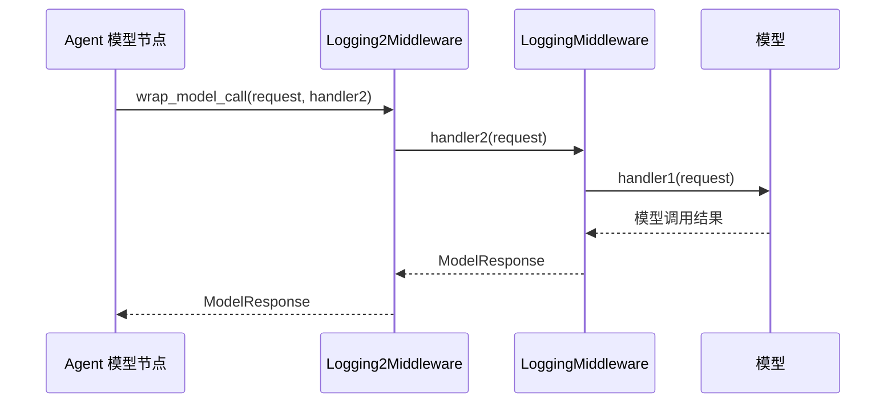

# LangChain 类式中间件：继承、执行顺序与两层重试

> 把多个钩子写进一个类，可以集中组织同一项中间件能力。本篇沿着两个日志中间件，理解 `AgentMiddleware`、`self`、实例化、`handler` 的嵌套关系，以及为什么两层“三次尝试”可能变成九次模型尝试。

[返回首页](../README.md) · [完整源码](../langchain_class_middleware.py) · [离线测试](../tests/test_class_middleware.py) · [上一章：装饰器式中间件](19-langchain-custom-middleware.md)

<a id="toc"></a>
## 目录

- [1. 这次练习要理解什么](#purpose)
- [2. 从粘贴代码核对实现](#original)
- [3. 类、继承、self 与实例化](#classes)
- [4. 三个方法各自负责什么](#hooks)
- [5. 两层 handler 怎样嵌套](#nesting)
- [6. 正常路径的日志顺序](#normal-order)
- [7. 两层重试：为什么最多是九次](#retry)
- [8. 工具循环与异常边界](#tools)
- [9. 与装饰器写法对照](#comparison)
- [10. 配置和运行](#run)
- [11. 完整可运行代码](#source)
- [12. 实际验证记录](#validation)
- [13. 补充知识与复习问题](#review)
- [14. 相关资料](#references)

<a id="purpose"></a>
## 1. 这次练习要理解什么

上一章用装饰器分别声明钩子；这次定义两个类，各自组合三个方法：

```text
AgentMiddleware
├── LoggingMiddleware
│   ├── before_agent
│   ├── after_agent
│   └── wrap_model_call
└── Logging2Middleware
    ├── before_agent
    ├── after_agent
    └── wrap_model_call
```

两个类都是直接继承 `AgentMiddleware`。**`Logging2Middleware` 没有继承 `LoggingMiddleware`**，名字中的 `2` 只是便于区分，框架不会按数字大小自动排列它们。

注册列表保持这次练习的顺序：

```python
middleware=[Logging2Middleware(), LoggingMiddleware()]
```

因此核心观察对象是：

| 位置 | 实例 | 日志标签 | 负责的内容 |
| --- | --- | --- | --- |
| 列表第一项 | `Logging2Middleware()` | `【2】` | Agent 前后日志、外层模型包装 |
| 列表第二项 | `LoggingMiddleware()` | `【1】` | Agent 前后日志、内层模型包装 |

两个包装器作用于同一个模型调用链，不是创建了两个独立模型，也不是分别调用两个天气 Agent。

天气工具依然是演示函数，固定返回 `在{city}总是阳光明媚！`，没有连接真实天气服务。

<a id="original"></a>
## 2. 从粘贴代码核对实现

本次提供的是代码，没有新的终端运行结果。下面区分代码中可以确定的行为、粘贴时需要核对的内容，以及额外知识；不把它们写成已经发生过的用户报错。

### 2.1 模型提供商一行不完整

粘贴内容里的 `model_provideter",` 不是一个完整的 Python 参数写法。按本次接入意图，完整调用应为：

```python
model=init_chat_model(
    model="openai/gpt-5-mini",
    model_provider="openrouter",
)
```

参数名是 `model_provider`，提供商字符串是 `"openrouter"`。如果原文件中也存在不完整的引号或参数，Python 会先在解析阶段失败，还没开始发模型请求；若只是粘贴缺失，则无需据此认定真实脚本有问题。

本篇源码使用完整参数，仍通过原生 OpenRouter 集成读取 `OPENROUTER_API_KEY`。

### 2.2 导入钩子名称，不等于注册钩子

粘贴代码导入了 `before_model`、`after_model`、`wrap_tool_call` 等名称，但两个类只重写了：

```text
before_agent
after_agent
wrap_model_call
```

所以不能期待这两个类额外打印“模型节点前后”或“工具执行前后”的日志。`import` 只让名称可用，不会替我们实现或注册它们。

`ToolMessage`、`Command`、`ToolCallRequest` 在这份类式练习里也没有实际用到，完整源码只保留必要导入。工具仍可由 Agent 正常调用，不需要为了执行工具而强行增加工具包装器。

### 2.3 原重试日志容易把总次数说混

每个类都写了 `for t in range(3)`。这代表**每层最多三次尝试，含第一次调用**，不是失败后再额外重试三次。

源码仍保留双层循环来展示嵌套，只把日志改为“第几次尝试失败，准备第几次尝试”，方便准确数数。生产环境是否保留两层重试，要单独决定，见[重试推演](#retry)。

[回到目录](#toc)

<a id="classes"></a>
## 3. 类、继承、self 与实例化

这一节是针对代码中出现的语法做补充拆解。

### 3.1 `class LoggingMiddleware(AgentMiddleware)`

```python
class LoggingMiddleware(AgentMiddleware):
    ...
```

拆成三部分：

| 写法 | 含义 |
| --- | --- |
| `class` | 定义一个类 |
| `LoggingMiddleware` | 当前定义的类名，可以自己命名 |
| `(AgentMiddleware)` | 指定父类，继承框架提供的中间件接口 |

这里的继承让框架能把对象当作中间件使用。子类按约定重写钩子方法，框架在相应执行位置调用它们。

普通业务类可以自己决定方法名，但这里的 `before_agent`、`after_agent`、`wrap_model_call` 是框架约定的名字。写成其他名字，即使 Python 允许，也不会自动变成对应钩子。

### 3.2 为什么方法前面有 `self`

```python
def before_agent(self, state: AgentState, runtime: Runtime) -> dict[str, Any] | None:
    print("【1】即将执行Agent")
    return None
```

`self` 表示当前中间件实例。它不是 Agent 状态，也不是模型对象。

当通过实例调用方法时，Python 会自动把实例绑定给第一个参数：

```python
middleware = LoggingMiddleware()
middleware.before_agent(state, runtime)
```

从参数绑定角度，可以理解成：

```python
LoggingMiddleware.before_agent(middleware, state, runtime)
```

第二段是解释绑定关系，不是让业务代码绕开框架手动执行钩子。正常使用只需要把实例放进 `middleware` 列表。

### 3.3 类与实例的括号不能混淆

| 写法 | 是什么 | 本例注册时用哪一个 |
| --- | --- | --- |
| `LoggingMiddleware` | 类对象，描述如何创建这类中间件 | 不直接注册这个类 |
| `LoggingMiddleware()` | 调用类，创建一个实例 | 注册这个实例 |
| `middleware.before_agent` | 实例上的绑定方法 | 由框架选择执行时机 |

因此类式中间件的正确注册是：

```python
middleware=[Logging2Middleware(), LoggingMiddleware()]
```

与上一章看起来相反：装饰器式的 `log_before_agent` 已经被装饰器变成中间件对象，所以那里不加调用括号。区别在于变量当前指向什么，不能记成“中间件永远加括号”或“永远不加括号”。

### 3.4 为什么没有在类方法上继续加装饰器

类本身已经继承 `AgentMiddleware`。在这个写法中，通过重写约定的方法来声明钩子，不需要在方法上重复添加 `@before_agent` 或 `@wrap_model_call`。

可以把二者看成框架支持的两种组织形式：

- 装饰器式：用一个函数表达一个钩子，再由装饰器生成中间件对象。
- 类式：用一个中间件实例组织相关方法，框架读取它重写了哪些钩子。

一个类里有多个方法，并不表示这些方法会按源文件中的书写顺序逐个执行。

<a id="hooks"></a>
## 4. 三个方法各自负责什么

### 4.1 `before_agent`：进入本次执行

它拿到当前 `state` 和 `runtime`，在本次 Agent 执行前打印日志。本例返回 `None`，表示不提交状态更新，图继续执行。

`AgentState` 通常包含 `messages`；`Runtime` 提供本次执行的上下文与运行依赖。它们与 `self` 的职责不同：

| 参数 | 对应什么 |
| --- | --- |
| `self` | 当前中间件实例 |
| `state` | 执行到当前阶段的 Agent 状态 |
| `runtime` | 框架传入的运行时依赖入口 |

详见[Runtime Context](15-langgraph-runtime-context.md)和[第 19 篇的 State 说明](19-langchain-custom-middleware.md#node-hooks)。

### 4.2 `after_agent`：正常走到结束阶段

它也返回状态更新字典或 `None`。当 Agent 正常结束时，两个类各打印一次完成日志。

`after_agent` 不是 `finally`。如果异常没有被处理，本次执行会向调用者抛错，不能保证进入结束钩子。本篇持续失败和工具失败测试都检查了这个区别。

### 4.3 `wrap_model_call`：围住当前模型调用链

```python
def wrap_model_call(
    self,
    request: ModelRequest,
    handler: Callable[[ModelRequest], ModelResponse],
) -> ModelResponse:
    ...
```

- `ModelRequest`：本轮准备交给模型调用链的请求，包含消息等信息。
- `Callable[[ModelRequest], ModelResponse]`：一个接收请求、返回模型响应的可调用对象。
- `handler(request)`：继续执行下一层；下一层可能还是中间件。
- `return result`：把完整 `ModelResponse` 交回框架，不能随便改成字符串或漏掉返回值。

`Callable` 的内层方括号列出输入参数类型，外层写返回类型。`dict[str, Any] | None`、`[-1]`、f-string 和裸 `raise` 的基础拆解，见[第 19 篇语法速查](19-langchain-custom-middleware.md#syntax)。

<a id="nesting"></a>
## 5. 两层 handler 怎样嵌套

默认列表是 `[2, 1]`，第一项在外层。可以把组合过程画成：



两个函数中参数都叫 `handler`，但它们不是同一个位置上的回调：

| 所在层 | `handler(request)` 继续到哪里 |
| --- | --- |
| 外层 `Logging2Middleware` | 内层 `LoggingMiddleware` 的包装器 |
| 内层 `LoggingMiddleware` | 底层模型调用处理逻辑 |

这也是为什么外层调用一次 `handler`，底层模型可能已经被内层尝试多次。

用一句伪代码表示包裹关系：

```text
模型节点 = 包装器2(包装器1(底层模型调用))
```

它只表达嵌套关系，不是把 `ModelResponse` 当作函数参数的一段可执行 Python。

框架对同类钩子的规则是：before 按注册顺序，after 反向返回，wrap 按函数嵌套进入和返回。类式和装饰器式遵守同样的组合规则。[官方执行顺序说明](https://docs.langchain.com/oss/python/langchain/middleware/custom#execution-order)

<a id="normal-order"></a>
## 6. 正常路径的日志顺序

### 6.1 直接回答，不调用工具

假设底层模型第一次就返回最终回答，顺序是：

```text
【2】即将执行Agent
【1】即将执行Agent
【2】【wrap model】最新消息：北京的天气如何
【1】【wrap model】最新消息：北京的天气如何
【1】【wrap model】模型调用完成
【2】【wrap model】模型调用完成
【1】Agent执行完成
【2】Agent执行完成
```

这份轨迹来自离线测试，已逐行断言，不是本次真实 OpenRouter 请求记录。

顺序拆开看：

1. before：先列表第一项【2】，再第二项【1】。
2. wrap 进入：先外层【2】，再内层【1】。
3. 底层模型成功，先回到内层【1】，再回到外层【2】。
4. after：先第二项【1】，再第一项【2】。

**两个“模型调用完成”不表示模型调用了两次。** 这里是两个包装器分别在同一次结果返回途中打印日志，测试中底层模型只执行一次。

### 6.2 交换列表会怎样

如果改成：

```python
middleware=[LoggingMiddleware(), Logging2Middleware()]
```

就变成【1】在外、【2】在内：

```text
before：1 → 2
wrap 进入：1 → 2 → 模型
wrap 返回：模型 → 2 → 1
after：2 → 1
```

生效的是注册列表顺序，不是类在文件中定义的先后，也不是日志标签里的数字。测试同时验证了两种列表顺序。

[回到目录](#toc)

<a id="retry"></a>
## 7. 两层重试：为什么最多是九次

这是这次练习最需要单独推演的地方。

### 7.1 先明确计数单位

本例每层的 `range(3)` 都是最多三次 `handler` 尝试，含第一次调用。每层最多两次重试。

| 计数对象 | 表示什么 |
| --- | --- |
| 外层尝试次数 | 【2】调用整个内层链的次数 |
| 内层尝试次数 | 【1】继续调用底层模型处理器的次数 |
| Agent 模型节点次数 | 图中进入模型节点的逻辑次数 |
| 实际 HTTP 请求次数 | 还会受 SDK 或其他重试层影响，不能仅由本例循环确定 |

下文说“底层模型尝试”，指离线测试中 `_generate` 的实际执行次数。真实服务可能还有客户端重试，不应把九次上限直接宣称为九个网络请求。

### 7.2 场景一：第一次成功

```text
外层第1次
  内层第1次 → 模型成功
  内层 return
外层 return
```

底层模型尝试 **1 次**。`range(3)` 是最多次数，成功后 `return` 立即结束函数，不会把剩下两轮强行跑完。

### 7.3 场景二：失败两次，第三次成功

```text
外层第1次
  内层第1次 → 失败
  内层第2次 → 失败
  内层第3次 → 成功
外层收到正常结果，直接返回
```

底层模型尝试 **3 次**，外层没有重试。因为内层已经处理了前两次异常，外层没有接收到它们。

### 7.4 场景三：前三次失败，第四次成功

```text
外层第1次
  内层第1次 → 失败
  内层第2次 → 失败
  内层第3次 → 失败，raise
外层捕获异常，准备第2次

外层第2次
  内层第1次 → 成功
外层返回
```

底层模型尝试 **4 次**。重点是第二次进入内层时，内层函数重新执行 `for attempt in range(3)`，局部循环变量从零开始。

它不会接着上次的 `attempt == 2` 继续。变量属于本次方法调用，不是自动存进 `self` 的持久计数器。

### 7.5 场景四：持续失败

| 外层尝试 | 内层本轮尝试 | 对应底层模型总次数 |
| --- | --- | --- |
| 第 1 次 | 第 1、2、3 次 | 1、2、3 |
| 第 2 次 | 重新从第 1、2、3 次开始 | 4、5、6 |
| 第 3 次 | 再从第 1、2、3 次开始 | 7、8、9 |

因此：

```text
底层最多尝试次数 = 外层最多尝试次数 × 内层最多尝试次数
                 = 3 × 3
                 = 9
```

不是 `3 + 3 = 6`，因为外层每次重试会重新执行整条内层链。

第九次仍失败：内层裸 `raise`，外层也到最后一次，继续裸 `raise`；调用方最终收到原异常。两个 `after_agent` 都不会因此变成兜底清理逻辑。

第九次成功：结果会先通过内层，再通过外层，两个完成日志各打印一次，Agent 可以正常结束。两条分支均有实际离线测试。

### 7.6 实际业务应避免不经意叠加

双层重试在这里是为了观察嵌套，不能直接理解成“多包一层更可靠”。

- 认证错误或参数错误不会因为多试几次而自动修复。
- 外层与内层同时捕获 `Exception`，会把永久错误也重复尝试；本篇用 `ValueError` 验证了九次放大。
- 包装器外还有 SDK 重试时，实际耗时与请求量可能继续放大。

常见组织方式是让一个明确的层负责有限重试，其他中间件只做日志、审计或指标。是否退避、重试哪些 SDK 异常、是否需要请求预算，应根据真实服务约定设计；本篇没有等待和真实服务故障注入。

<a id="tools"></a>
## 8. 工具循环与异常边界

### 8.1 一次天气工具会形成两个模型周期

测试指定的工具调用路径是：

```text
before_agent：2 → 1

第一个模型节点：
  进入 2 → 进入 1 → 模型申请天气工具
  返回 1 → 返回 2

Agent 执行天气工具，产生 ToolMessage

第二个模型节点：
  进入 2 → 进入 1 → 模型读取工具结果并回答
  返回 1 → 返回 2

after_agent：1 → 2
```

工具路径的离线逐行日志：

```text
【2】即将执行Agent
【1】即将执行Agent
【2】【wrap model】最新消息：北京的天气如何
【1】【wrap model】最新消息：北京的天气如何
【1】【wrap model】模型调用完成
【2】【wrap model】模型调用完成
【2】【wrap model】最新消息：在北京总是阳光明媚！
【1】【wrap model】最新消息：在北京总是阳光明媚！
【1】【wrap model】模型调用完成
【2】【wrap model】模型调用完成
【1】Agent执行完成
【2】Agent执行完成
```

这次两个类没有工具包装日志，所以工具执行发生在两个模型周期之间，但不会自行打印 `【wrap tool】`。

最终消息列表有四条：

```text
HumanMessage：用户问题
AIMessage：含天气工具调用请求
ToolMessage：固定演示天气，带匹配的 tool_call_id
AIMessage：最终回答
```

`print(response["messages"])` 输出整个列表；只看最后文本时可以用 `print(response["messages"][-1].content)`。

### 8.2 “最新消息”为什么换成了天气结果

因为 `request.messages[-1]` 表示当前请求消息列表的最后一条。第一次是用户问题，工具执行后再调用模型时，最后一条通常是工具结果。

它不是固定等于用户输入，也不代表模型收到的全部消息或完整系统提示词。

### 8.3 模型重试没有包住整个 Agent

假设第一次模型调用成功、天气工具也完成，第二次模型调用失败三次再成功。

测试中的结果是：

```text
第一次模型节点：1 次底层尝试
天气工具：1 次
第二次模型节点：4 次底层尝试
合计：5 次底层模型尝试，天气工具仍为 1 次
```

外层重试的是当前模型处理链，没有重新执行已经结束的工具节点。它也不会重新调用两个 `before_agent`。

### 8.4 工具自己抛错时，会触发这九次模型重试吗

本例不会。`wrap_model_call` 包围的是模型调用链；工具在另一个节点执行。

离线测试让模型先正常申请工具，再让工具抛出未处理的 `RuntimeError`，结果是：模型只执行一次，工具只执行一次，异常向上抛出，两个结束日志都不出现。

工具错误也可能在其他配置下被转成错误 `ToolMessage`；那是另一条处理路径。如何给工具加包装、透传 `Command` 或返回错误消息，见[第 19 篇](19-langchain-custom-middleware.md#tool-wrapper)。

[回到目录](#toc)

<a id="comparison"></a>
## 9. 与装饰器写法对照

| 对比点 | 装饰器式 | 类式 |
| --- | --- | --- |
| 声明方式 | `@before_agent` 等装饰函数 | 继承 `AgentMiddleware`，重写约定方法 |
| 组织单位 | 一个钩子函数生成一个中间件对象 | 一个实例可以组织多个钩子方法 |
| 注册形式 | `middleware=[log_before_agent]` | `middleware=[LoggingMiddleware()]` |
| 第一个参数 | 通常是 `state` 或 `request` | 实例方法先写 `self` |
| 多钩子共享配置 | 可通过闭包或其他对象组织 | 可用实例字段集中管理 |
| 相同接口含义 | State 更新、请求与响应协议 | 与装饰器式一致 |
| 组合顺序 | before 正序、after 逆序、wrap 嵌套 | 相同 |

选择哪种形式取决于逻辑组织。一个简单钩子用函数很直观；多个相关钩子共享配置时，类通常更容易集中管理。不要因为换成类，就认为生命周期、返回值约定或重试边界发生了变化。

本篇暂时保留两个类的相似实现，便于逐条对照标签与嵌套。日后抽取公共实现时，应同时考虑中间件名称的唯一性及配置范围，不能只把类名替换掉而不验证组合行为。

<a id="run"></a>
## 10. 配置和运行

### 10.1 安装与配置

从仓库根目录执行，使用 Python 3.10+；本次实际验证为 Python 3.11.7。

```bash
pip install -r requirements.txt
```

尚未建立 `.env` 时，PowerShell 执行：

```powershell
Copy-Item .env.example .env
```

已有 `.env` 则直接补充变量，不覆盖其他配置。示例读取：

```ini
OPENROUTER_API_KEY=your_openrouter_api_key_here
CLASS_MIDDLEWARE_MODEL=openai/gpt-5-mini
CLASS_MIDDLEWARE_QUERY=北京的天气如何
```

这里填自己的 OpenRouter Key，不需要为了本篇把它再复制成 OpenAI 官方 Key。`model="openai/gpt-5-mini"` 是交给 OpenRouter 的模型 ID，真正的集成由 `model_provider="openrouter"` 显式指定。

`.env` 从脚本同目录加载，默认不覆盖进程里已存在的同名环境变量。不要把真实密钥提交到仓库。

### 10.2 运行示例

```bash
python langchain_class_middleware.py
```

脚本创建一个模型、两个中间件实例和一个 Agent，再调用一次 `invoke`。没有配置 Checkpointer，所以它没有自动持久化的跨次对话记忆。

### 10.3 不调用真实模型的验证

```bash
python -m unittest discover -s tests -p test_class_middleware.py -v
```

如果只是学习顺序和重试机制，先看离线日志即可，不需要制造真实网络故障。

<a id="source"></a>
## 11. 完整可运行代码

源码：[langchain_class_middleware.py](../langchain_class_middleware.py)。下面完整代码块与源文件保持一致。

保留两个类、原注册顺序和双层三次尝试，用于复现实验。模型提供商参数已写完整，重试日志按尝试次数表述；`build_agent` 允许注入离线模型、调整列表顺序或替换工具。

<details>
<summary>展开完整 Python 源码</summary>

<!-- CLASS_MIDDLEWARE_SOURCE_BEGIN -->
```python
"""类式中间件：观察 [Logging2Middleware(), LoggingMiddleware()] 的嵌套顺序。

两个模型包装器各最多尝试三次，叠加后每个模型节点最多尝试九次。
这是同步教学示例，沿用宽泛异常捕获；天气工具只返回固定演示值。
导入模块不会读取密钥或调用模型。
"""

import os
from pathlib import Path
from typing import Any, Callable

from dotenv import load_dotenv
from langchain.agents import AgentState, create_agent
from langchain.agents.middleware import AgentMiddleware, ModelRequest, ModelResponse
from langchain.chat_models import init_chat_model
from langchain.tools import tool
from langchain_core.language_models.chat_models import BaseChatModel
from langchain_core.tools import BaseTool
from langgraph.runtime import Runtime


@tool
def get_weather_for_location(city: str) -> str:
    """获取指定城市的演示天气，固定返回阳光明媚。"""
    return f"在{city}总是阳光明媚！"


class LoggingMiddleware(AgentMiddleware):
    """打印【1】的中间件；位置由注册列表决定。"""

    def before_agent(self, state: AgentState, runtime: Runtime) -> dict[str, Any] | None:
        print("【1】即将执行Agent")
        return None

    def after_agent(self, state: AgentState, runtime: Runtime) -> dict[str, Any] | None:
        print("【1】Agent执行完成")
        return None

    def wrap_model_call(
        self,
        request: ModelRequest,
        handler: Callable[[ModelRequest], ModelResponse],
    ) -> ModelResponse:
        for attempt in range(3):
            latest = request.messages[-1].content if request.messages else "（无消息）"
            print(f"【1】【wrap model】最新消息：{latest}")
            try:
                result = handler(request)
                print("【1】【wrap model】模型调用完成")
                return result
            except Exception as error:
                if attempt == 2:
                    raise
                print(
                    f"【1】【wrap model】第{attempt + 1}次尝试失败，"
                    f"准备第{attempt + 2}/3次尝试，错误信息为：{error}"
                )
        raise AssertionError("【1】模型重试循环未返回或抛错")


class Logging2Middleware(AgentMiddleware):
    """打印【2】的中间件；默认注册在最外层。"""

    def before_agent(self, state: AgentState, runtime: Runtime) -> dict[str, Any] | None:
        print("【2】即将执行Agent")
        return None

    def after_agent(self, state: AgentState, runtime: Runtime) -> dict[str, Any] | None:
        print("【2】Agent执行完成")
        return None

    def wrap_model_call(
        self,
        request: ModelRequest,
        handler: Callable[[ModelRequest], ModelResponse],
    ) -> ModelResponse:
        # 默认列表中，这个 handler 会先进入 LoggingMiddleware 的包装器。
        for attempt in range(3):
            latest = request.messages[-1].content if request.messages else "（无消息）"
            print(f"【2】【wrap model】最新消息：{latest}")
            try:
                result = handler(request)
                print("【2】【wrap model】模型调用完成")
                return result
            except Exception as error:
                if attempt == 2:
                    raise
                print(
                    f"【2】【wrap model】第{attempt + 1}次尝试失败，"
                    f"准备第{attempt + 2}/3次尝试，错误信息为：{error}"
                )
        raise AssertionError("【2】模型重试循环未返回或抛错")


def build_agent(
    model: BaseChatModel | None = None,
    *,
    middleware: list[AgentMiddleware] | None = None,
    tools: list[BaseTool] | None = None,
):
    """默认保留练习中的 [2, 1] 顺序；测试可注入模型、工具和中间件列表。"""
    if model is None:
        if not os.getenv("OPENROUTER_API_KEY", "").strip():
            raise RuntimeError("请在环境变量或 .env 中配置 OPENROUTER_API_KEY。")
        model = init_chat_model(
            model=os.getenv("CLASS_MIDDLEWARE_MODEL", "openai/gpt-5-mini"),
            model_provider="openrouter",
        )
    return create_agent(
        model=model,
        tools=[get_weather_for_location] if tools is None else tools,
        system_prompt="你是一位乐于助人的助手。",
        middleware=(
            [Logging2Middleware(), LoggingMiddleware()]
            if middleware is None else middleware
        ),
    )


def main() -> None:
    load_dotenv(Path(__file__).resolve().with_name(".env"))
    agent = build_agent()
    query = os.getenv("CLASS_MIDDLEWARE_QUERY", "北京的天气如何")
    response = agent.invoke(
        {"messages": [{"role": "user", "content": query}]}
    )
    print(response["messages"])


if __name__ == "__main__":
    main()
```
<!-- CLASS_MIDDLEWARE_SOURCE_END -->

</details>

[回到目录](#toc)

<a id="validation"></a>
## 12. 实际验证记录

### 12.1 测试方法

[test_class_middleware.py](../tests/test_class_middleware.py) 使用可编排的离线 `BaseChatModel`，驱动实际 `create_agent` 图、两个类式中间件、工具执行与消息合并。

模型按照测试脚本返回消息或抛异常，框架行为没有被一个假的 `agent.invoke` 替代。测试阻断同步和异步 HTTP 客户端，不用真实 Key 发请求。

### 12.2 覆盖范围

| 测试 | 实际检查 |
| --- | --- |
| 默认 `[2, 1]` 顺序 | before 为 2→1，wrap 返回为 1→2，after 为 1→2；底层模型只执行一次 |
| 交换为 `[1, 2]` | 日志与嵌套关系随注册顺序反转 |
| 正常天气工具循环 | 两个模型周期，Agent 前后钩子各一次，工具消息调用 ID 正确 |
| 内层第三次成功 | 底层三次，外层没有重试 |
| 内层耗尽后恢复 | 底层第四次成功，外层重试整条内层链 |
| 持续失败 | 底层九次、外层三次，原异常重新抛出，没有完成日志 |
| 第九次成功 | 结果成功穿过两层包装器，各打印一次模型完成 |
| 仅注册一层重试 | 耗尽时只有三次底层尝试 |
| 工具后模型阶段重试 | 模型合计五次尝试，已完成工具只执行一次 |
| 工具未处理异常 | 不进入模型重试，模型和工具各执行一次 |
| 宽泛捕获永久错误 | `ValueError` 同样被放大到九次，明确教学写法的局限 |
| 模型构造参数 | 明确使用正确的 `model_provider="openrouter"` |

本篇新增 **12 项离线测试通过**；仓库累计 **60 项离线测试通过**。已检查 Python 语法、Markdown 本地链接与内部目录锚点，以及本文完整代码块和源文件的一致性。

实际环境：Python 3.11.7、`langchain 1.4.6`、`langchain-core 1.6.12`、`langgraph 1.2.16`、`langchain-openrouter 0.2.9`。

### 12.3 验证范围

没有发起真实 OpenRouter 请求，所以本章日志不作为真实模型认证、服务可用性或模型选工具能力的记录。工具也没有真实天气准确性验证。

“最多九次”是本例两层包装器对底层模型处理器的尝试上限，按单个模型节点计数；不能代表整个 Agent 的总调用上限，也不能代表真实 HTTP 次数上限。

<a id="review"></a>
## 13. 补充知识与复习问题

### 13.1 实例字段与局部变量

本例的 `attempt` 是方法调用的局部变量，每次重新进入方法都会重新创建。

若写成 `self.attempt`，它会成为实例字段，可能跨同一实例的多次调用保存。那就要考虑计数重置与并发使用，不能把 `attempt` 直接改成 `self.attempt` 就当作等价写法。

通常更适合放在实例上的内容是只读配置；与本次请求强相关的业务状态应放在合适的 State 或 Runtime 中。不要把可复用中间件实例默认当作每个用户独占的临时空间。

### 13.2 为什么没有新写 `__init__`

这里没有实例配置要初始化，所以无需为了“这是一个类”就额外写构造方法。以后若需要把尝试次数、日志前缀作为配置，才考虑在 `__init__` 接收并保存。

在当前用法里，框架需要的是一个合法的中间件实例和它重写的方法，`LoggingMiddleware()` 已经完成实例创建。

### 13.3 同步和异步不能混用

当前是同步的 `wrap_model_call` 和 `agent.invoke()`。若改用异步执行，需实现相应的异步钩子与 `await handler(request)`，不能只在调用处改成 `ainvoke` 就认定这些同步方法已自动支持异步。

### 13.4 复习问题

| 问题 | 核心答案 |
| --- | --- |
| `Logging2Middleware` 是 `LoggingMiddleware` 的子类吗？ | 不是，两者直接继承共同父类 `AgentMiddleware` |
| 为什么注册时要写括号？ | 这里需要创建类的实例；上一章的装饰器变量已经是中间件对象 |
| `self` 是 Agent 状态吗？ | 不是，它是当前中间件实例 |
| 先定义的类会先执行吗？ | 不会由定义顺序决定，要看注册列表和钩子类型 |
| 列表 `[2, 1]` 中谁在外层？ | 【2】在外层，【1】在内层 |
| 谁先打印模型调用完成？ | 成功返回时先内层【1】，再外层【2】 |
| 两个模型完成日志代表两次模型请求吗？ | 不代表，可能是同一个模型结果经过两层包装器 |
| 内层已经重试两次成功，外层会重试吗？ | 不会，外层收到正常结果就返回 |
| 为什么持续失败最多九次而不是六次？ | 外层每次尝试重新进入整个内层三次尝试循环，3×3 |
| 重新进入内层，循环变量从哪里开始？ | 这是新的方法调用，局部变量从零开始 |
| 这九次会把 `before_agent` 也运行九次吗？ | 不会，重试只发生在模型包装器内部 |
| 工具失败也由这两个模型包装器重试吗？ | 本例不会，工具执行不在模型包装的边界内 |
| 所有异常都适合重试吗？ | 不适合，宽泛捕获只是教学简化，真实服务要分类处理 |
| 没有结束日志一定是钩子没注册吗？ | 不一定，也可能是未处理异常导致执行没走到结束阶段 |

### 13.5 练习

1. 交换两个实例的注册顺序，先预测一次直接回答的八行日志，再执行离线测试核对。
2. 暂时只注册一个实例，比较持续失败时的尝试次数。
3. 让一个中间件只做日志，另一个负责重试，观察重试边界改变后日志如何重复。
4. 将宽泛异常捕获改成明确的临时错误类型，检查永久错误是否立即传播。
5. 扩展类式工具包装器前，先复习 `ToolMessage | Command` 的返回协议，不能只捕获异常并打印。

[回到目录](#toc)

<a id="references"></a>
## 14. 相关资料

- [LangChain：自定义中间件](https://docs.langchain.com/oss/python/langchain/middleware/custom)：装饰器式、类式接口与生命周期。
- [LangChain：中间件执行顺序](https://docs.langchain.com/oss/python/langchain/middleware/custom#execution-order)：同类 before、after 与 wrap 的组合规则。
- [LangChain Agent 工厂源码](https://github.com/langchain-ai/langchain/blob/master/libs/langchain/langchain/agents/factory.py)：包装器组合及 Agent 图连接；在线分支可能与本地版本不同。
- [上一章：自定义中间件](19-langchain-custom-middleware.md)：六种钩子、语法拆解与工具返回协议。
- [测试目录说明](../tests/README.md#类式中间件)：本章验证命令与覆盖范围。

- [下一章：状态驱动的工具筛选](21-langchain-state-based-tools.md)：在 handler 调用前按 auth 筛选本轮工具清单，拆解筛选、模型申请与工具执行。
