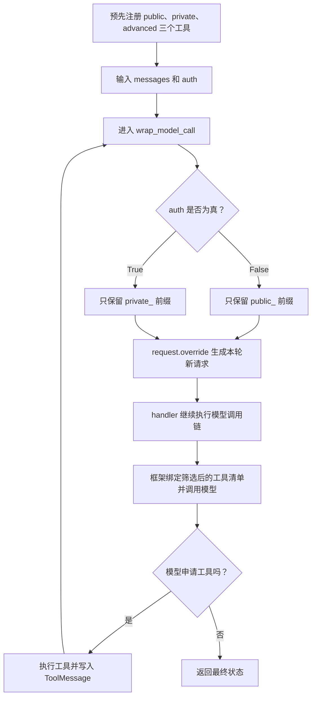

# LangChain 动态工具筛选：State、request.override 与 handler

> 先根据状态缩小本轮提供给模型的工具清单，再调用模型。本篇用公开、私有、高级三个演示搜索工具，把“注册工具、筛选工具、模型申请工具、程序执行工具”四个阶段拆开，并记录学习中对 `handler(request)` 的两个真实疑问。

[返回首页](../README.md) · [完整源码](../langchain_state_based_tools.py) · [离线测试](../tests/test_state_based_tools.py) · [上一章：类式中间件](20-langchain-class-middleware.md)

<a id="toc"></a>
## 目录

- [1. 本例实现的是哪一种动态工具](#purpose)
- [2. 先区分四个阶段](#stages)
- [3. State 和 auth 是什么](#state)
- [4. 按原代码逐行筛选](#filter)
- [5. 为什么 handler(request) 会调用模型](#handler)
- [6. 两种认证状态的完整推演](#walkthrough)
- [7. 真实疑问与对应理解](#questions)
- [8. 代码中需要核对的细节](#details)
- [9. 工具可见性与执行权限的边界](#boundary)
- [10. 配置和运行](#run)
- [11. 完整可运行代码](#source)
- [12. 实际离线验证](#validation)
- [13. 补充方案与复习问题](#review)
- [14. 相关资料](#references)

<a id="purpose"></a>
## 1. 本例实现的是哪一种动态工具

动态工具可以指两件不同的事：

| 方式 | 示例 | 本段代码是否实现 |
| --- | --- | --- |
| 运行时筛选已注册工具 | `[tool1, tool2, tool3] → [tool2]` | 是 |
| 运行时加入原本没有注册的工具 | `[tool1] → [tool1, tool2]` | 否 |

本例在 `create_agent` 时已经注册：

```python
tools=[public_search, private_search, advanced_search]
```

中间件没有创建新工具，而是每次调用模型前，根据 `auth` 从当前请求的工具集合里挑出一部分。官方将这类机制称为筛选预注册工具；真正运行时注册新工具还需要配套执行支持。[官方动态工具筛选说明](https://docs.langchain.com/oss/python/langchain/middleware/custom#dynamically-selecting-tools)

三个函数都只返回固定格式的演示字符串，没有真实搜索接口、实时天气数据或私密数据源。

<a id="stages"></a>
## 2. 先区分四个阶段

| 阶段 | 谁负责 | 发生什么 |
| --- | --- | --- |
| 注册工具 | `create_agent(tools=[...])` | 告诉 Agent 有哪些工具及其可执行实现 |
| 筛选本轮清单 | `state_based_tools` | 根据状态决定本轮向模型展示哪些工具 |
| 申请工具调用 | 模型 | 根据问题和工具说明，返回含 `tool_calls` 的消息；也可能直接回答 |
| 执行工具 | Agent 的工具执行逻辑 | 按工具名找到函数、传入参数，生成工具结果消息 |

流程示意：



列表推导式只筛选工具对象，没有执行工具。`handler(request)` 会继续模型调用链，工具函数则在模型提出调用请求后的工具阶段执行。

<a id="state"></a>
## 3. State 和 auth 是什么

### 3.1 继承 AgentState，增加状态字段

```python
class State(AgentState):
    auth: bool
```

`AgentState` 已经描述了消息等基础状态。这里在其基础上声明一个布尔字段 `auth`，用于演示是否处于已认证状态。

它不是登录函数，也不会访问账号服务。`auth: bool` 是字段类型声明，不是给字段赋默认值，更不表示“定义后自动认证成功”。

### 3.2 状态值来自 invoke 的输入

```python
agent.invoke({
    "messages": [{"role": "user", "content": "北京的天气如何"}],
    "auth": True,
})
```

这次输入显式给了 `True`，所以进入已认证分支。想观察另一条分支，应传布尔值 `False`。

这里需要区分 Python 的 `False` 与字符串 `"False"`：前者是假值，后者是一个非空字符串。类型提示不会自动把任意字符串转换为布尔值。本例脚本入口会将环境变量的 `true` / `false` 明确转换成布尔值。

### 3.3 state_schema=State 的作用

```python
@wrap_model_call(state_schema=State)
```

这让中间件声明自己使用的状态结构，框架构建 Agent 时可以纳入其中的 `auth` 字段。

它没有把 `State` 当作一个已经填好数据的对象，也没有执行认证。运行时实际的值仍从 `request.state` 中读取。

### 3.4 get 的默认值只用于这次读取

```python
state = request.state
is_auth = state.get("auth", False)
```

`dict.get(key, default)` 来自 Python 字典接口：有键就返回该键的值，没有就返回第二个参数。

| 当前状态 | `is_auth` |
| --- | --- |
| `{"auth": True}` | `True` |
| `{"auth": False}` | `False` |
| 没有 `auth` | 使用兜底值 `False` |

这个默认值不会自动把 `auth=False` 写回原状态。

在类型声明层面，原写法 `auth: bool` 表示一个必需字段；当前安装版本的实际图执行允许缺省输入，并由 `.get` 兜底，本篇有测试。如果设计上明确允许不传，可用 `NotRequired[bool]` 表达可选性，见[补充方案](#review)。

<a id="filter"></a>
## 4. 按原代码逐行筛选

### 4.1 request.tools 中是什么

本例三个函数都经过 `@tool`，框架把它们作为工具对象使用。因此可以读取工具的名字：

```python
t.name
```

例如 `public_search` 工具的 `.name` 是字符串 `"public_search"`。本例使用的是这类工具对象；若以后混入其他工具描述格式，应按相应类型处理，不能默认所有对象都支持 `.name`。

### 4.2 未认证：只保留 public_ 前缀

```python
tools = [t for t in request.tools if t.name.startswith("public_")]
```

把列表推导式展开：

```python
tools = []

for t in request.tools:
    if t.name.startswith("public_"):
        tools.append(t)
```

其中：

| 写法 | 所属对象或语法 | 作用 |
| --- | --- | --- |
| `for t in request.tools` | Python 遍历语法 | 逐个取工具对象，临时命名为 `t` |
| `t.name` | 工具对象的属性 | 取得工具名字符串 |
| `.startswith("public_")` | 字符串 `str` 方法 | 判断是否以指定前缀开头，返回布尔值 |
| `tools.append(t)` | 列表 `list` 方法 | 将当前工具对象加入结果列表 |

遍历结果：

| 工具名 | 以 public_ 开头吗 | 是否保留 |
| --- | --- | --- |
| `public_search` | 是 | 是 |
| `private_search` | 否 | 否 |
| `advanced_search` | 否 | 否 |

最后得到 `[public_search]`。这里列表里装的是工具对象，不是工具已经执行后的搜索结果。

### 4.3 已认证：只保留 private_ 前缀

```python
tools = [t for t in request.tools if t.name.startswith("private_")]
```

同理得到 `[private_search]`。当前规则是互斥的两组，不是“认证后自动包含所有工具”。

### 4.4 request.override(tools=tools) 怎么处理

```python
request = request.override(tools=tools)
```

可以按三个动作理解：

1. `tools` 变量里已经是筛选后的清单。
2. `request.override(...)` 创建一个使用这份清单的新请求对象。
3. 将局部变量 `request` 指向这个新请求，交给后面的 `handler`。

本例不是直接删除 Agent 的全局工具注册表，也没有修改 `state["auth"]`。测试在同一个 Agent 上先传 `False` 再传 `True`，模型分别收到公开和私有清单，说明前一次筛选没有把另一组工具永久删掉。

新请求也不等于所有内部对象都进行了深复制。这里需要理解的是“得到一个新请求、替换本轮 tools 字段”，不是“完整深拷贝整个 Agent”。

[回到目录](#toc)

<a id="handler"></a>
## 5. 为什么 handler(request) 会调用模型

### 5.1 handler 是框架传入的回调

```python
handler: Callable[[ModelRequest], ModelResponse]
```

这条类型提示表示：`handler` 是一个可调用对象，接收模型请求，正常返回模型响应。

它不是 Python 内置函数，也不是只要取名叫 `handler` 就能调用模型。关键在于：`@wrap_model_call` 对应的框架执行路径，会把后续模型处理函数作为参数传给这段中间件。

在本次验证版本中，Agent 工厂把 `_execute_model_sync` 作为最终模型处理逻辑。它根据请求准备绑定后的模型，加入系统消息，调用 `model_.invoke(messages)`，再将结果整理成 `ModelResponse`。

所以在本段代码中：

```python
return handler(request)
```

相当于：

```python
result = handler(request)  # 继续执行模型调用链，取得模型响应
return result             # 把响应返回给框架
```

如果前后组合了其他模型包装中间件，`handler` 可能先进入下一层包装器，最终才到模型。具体嵌套关系见[第 20 篇](20-langchain-class-middleware.md#nesting)。

### 5.2 为什么要在 handler 前筛选

后续模型调用会使用 `request.tools` 绑定本轮工具清单。因此筛选必须发生在把请求交给后续处理之前：

```text
本轮请求 tools 有三个工具
    ↓
中间件筛选出 public_search
    ↓
新请求 tools 只有 public_search
    ↓
handler 继续处理
    ↓
模型收到公开工具的名称、说明和参数结构
```

如果先完成模型调用，再去筛选一个新列表，已经生成的模型回复不会因此倒回去重新选择。

### 5.3 调用模型不等于立即执行工具

模型在这一步生成下一条消息：

- 可以直接给出普通回答，Agent 不进入工具节点。
- 也可以申请调用工具，例如输出 `public_search(query="北京的天气")` 对应的 `tool_calls`。

后一种情况下，Agent 的工具执行逻辑才真正调用函数。因此不能把 `handler(request)` 理解为“现在把筛选后的每个工具都执行一遍”。

### 5.4 return 为什么不能漏

模型包装器需要把合法 `ModelResponse` 交回框架。只写 `handler(request)` 却不返回，会让函数最终隐式返回 `None`，破坏本例返回协议。

节点式钩子的 `return None` 和这里的返回要求不同，见[第 19 篇](19-langchain-custom-middleware.md#original)。

<a id="walkthrough"></a>
## 6. 两种认证状态的完整推演

先看原规则的结果：

| auth | 模型本轮拿到的工具 | 被排除的工具 |
| --- | --- | --- |
| `False` | `public_search` | `private_search`、`advanced_search` |
| `True` | `private_search` | `public_search`、`advanced_search` |
| 未传 | 按 `.get` 兜底走公开分支 | `private_search`、`advanced_search` |

### 6.1 auth=False，模型申请公开工具

以离线测试设定的路径为例：

1. 输入一条用户消息与 `auth=False`。
2. 进入中间件，筛选后本轮工具清单为 `[public_search]`。
3. `handler` 调用模型，测试模型返回公开搜索的工具调用请求。
4. Agent 执行 `public_search(query="北京的天气")`。
5. 工具打印并返回固定演示文本，框架生成带配对 ID 的 `ToolMessage`。
6. 再次进入模型包装中间件，仍读取 `auth=False`，再次提供公开工具清单。
7. 测试模型根据工具结果返回最终回答，结束执行。

测试记录的两次模型工具清单是：

```text
第 1 次模型调用：[public_search]
第 2 次模型调用：[public_search]
```

消息类型顺序为：

```text
HumanMessage
AIMessage（含 tool_calls）
ToolMessage（对应 public_search，带 tool_call_id）
AIMessage（最终回答）
```

### 6.2 auth=True，走私有演示分支

把输入改为 `True`，中间件只保留 `private_search`。离线测试设定模型申请这个工具，执行后再让模型回复。

```text
第 1 次模型调用：[private_search]
第 2 次模型调用：[private_search]
```

这对应原代码的实际规则。即使用户问的是公开天气信息，代码也不会自动把 `public_search` 留回来，筛选规则先由程序决定，模型随后在收到的清单下生成回复。

### 6.3 为什么 advanced_search 一直没有参与

它既不以 `public_` 开头，也不以 `private_` 开头。两条分支都会排除它。

“注册了高级工具”与“本轮把高级工具展示给模型”是两件事。当前代码没有任何分支把高级工具保留在模型请求中，因此正常的工具清单里看不到它。

### 6.4 每次模型调用前都会重新读取状态

中间件挂在 `wrap_model_call` 上，不是只在整个 Agent 开始时运行一次。

如果流程中有节点明确更新了 `auth`，下一次模型调用会按新状态重新筛选。测试用一个返回 `Command(update=...)` 的工具模拟状态从 `False` 变成 `True`，记录到了：

```text
[public_search] → [private_search] → [private_search]
```

这只是测试图中的状态变化，不是实现了真实登录。原示例的三个字符串工具本身都没有更新 `auth`。

<a id="questions"></a>
## 7. 真实疑问与对应理解

下面两项来自本次学习过程；其余类型、权限和边界讨论属于补充分析。

### 疑问一：“这一步为了选择工具，因此要提前筛选工具，我没看懂怎么处理的”

当时容易把“筛选工具”和“执行工具”连成同一步。实际有两个选择层次：

| 选择层次 | 谁做决定 | 结果 |
| --- | --- | --- |
| 先筛清单 | Python 中间件 | 本轮向模型提供哪些工具 |
| 再申请调用 | 模型 | 是否需要工具、申请哪个、生成什么参数 |

列表推导式执行的是第一层；它只保留符合名称条件的工具对象。`handler` 之后才由模型生成消息，工具函数还要等到工具执行阶段。

可以类比成先准备本轮工具目录，再让模型根据任务生成调用请求。这个类比描述模型可见性，不代表已经实现了执行端权限检查。

### 疑问二：“return handler(request) 这个就是调用模型吗？为什么”

答案是：在这个模型包装钩子中，它继续模型调用链，最终调用模型。

原因不在 `handler` 的名字，而在框架传入了后续模型处理函数。我们修改请求后调用这个回调，框架才会按新请求绑定工具并执行模型。

拆成两句更清楚：

```python
result = handler(request)
return result
```

第一句执行并取得结果，第二句把结果交回调用方。这里的 `return` 负责传回结果，不是工具选择操作本身。

[回到目录](#toc)

<a id="details"></a>
## 8. 代码中需要核对的细节

### 8.1 前缀字符串不需要转义下划线

应写：

```python
t.name.startswith("public_")
t.name.startswith("private_")
```

如果实际 `.py` 文件里写了 `"public\_"`，请去掉下划线前的反斜杠。下划线在 Python 字符串中无需转义，普通工具名也不包含那个反斜杠。若只是富文本展示时出现的转义，则以真实源文件为准。

### 8.2 已认证并不自动等于全部工具可用

当前 `else` 也进行了过滤，只留下 `private_`。这是原代码的互斥规则，完整源码保留它。

如果想改成“未认证只用公开工具，认证后保留全部工具”，可以采用[补充方案](#review)，不要在阅读时直接把原 `else` 想象成这个行为。

### 8.3 导入 wrap_tool_call 不会自动执行它

原粘贴代码导入了 `wrap_tool_call`，但没有定义对应中间件。完整示例只使用模型包装器；它不包含自定义的工具执行包装。

### 8.4 搜索输出是演示文本

`public_search`、`private_search`、`advanced_search` 都没有调用外部搜索服务。即使打印“北京的天气”，也不能当作已经查到真实天气。

### 8.5 这次没有新的真实模型运行记录

本次提供了代码和提问，没有附真实服务执行输出。本章的调用轨迹与工具清单来自离线测试，模型申请哪一个工具由测试脚本明确指定，没有把它写成真实模型的自主决策记录。

<a id="boundary"></a>
## 9. 工具可见性与执行权限的边界

`request.override(tools=...)` 控制本轮传给模型的工具清单。Agent 创建时仍注册了三个工具，而 `private_search` 函数内部也没有检查身份。

因此，“只向模型提供公开工具”不能等同于“执行端已拒绝所有私有工具调用”。同样，直接在 `invoke` 输入里设置 `auth=True` 只是本地练习中的模拟，不是真实身份验证。

为确认这个区别，离线测试故意让模型替身在只收到 `[public_search]` 的情况下，返回一个已注册 `private_search` 的调用请求。当前安装版本中，Agent 仍执行了该私有演示函数。这是**故意构造的边界测试**，不是实际模型越权记录，也没有读取真实私密数据。

如果迁移到真实账号数据，应由服务端提供可信身份，并在工具执行处或工具包装器中检查访问权限。模型侧筛选仍然有用，但不承担整套认证与执行授权职责。

原始示例保持为动态筛选练习，没有额外声称实现了这套认证系统。工具包装的返回协议与异常边界可继续阅读[第 19 篇](19-langchain-custom-middleware.md#tool-wrapper)。

<a id="run"></a>
## 10. 配置和运行

### 10.1 安装依赖

在仓库根目录执行，使用 Python 3.10+；本次验证为 Python 3.11.7。

```bash
pip install -r requirements.txt
```

还没有 `.env` 时，PowerShell 执行：

```powershell
Copy-Item .env.example .env
```

已有配置文件就直接补充，避免覆盖其他示例的变量。

### 10.2 模型与演示参数

```ini
OPENROUTER_API_KEY=your_openrouter_api_key_here
DYNAMIC_TOOLS_MODEL=openai/gpt-5-mini
DYNAMIC_TOOLS_QUERY=北京的天气如何
DYNAMIC_TOOLS_AUTH=true
```

脚本沿用 `init_chat_model(model_provider="openrouter")`，自动读取 `OPENROUTER_API_KEY`。填入自己的 Key，不提交真实凭据。

`DYNAMIC_TOOLS_AUTH` 只接受 `true` / `false`，入口显式转成布尔值；默认 `true` 与本次传入 `auth=True` 的练习保持一致。

### 10.3 运行与切换分支

```bash
python langchain_state_based_tools.py
```

观察公开分支时，可把 `.env` 中的 `DYNAMIC_TOOLS_AUTH` 改为 `false`。也可在 PowerShell 临时设置：

```powershell
$env:DYNAMIC_TOOLS_AUTH="false"
python langchain_state_based_tools.py
```

进程中已存在的环境变量默认优先于 `.env`；需要恢复从文件读取时，可以执行：

```powershell
Remove-Item Env:DYNAMIC_TOOLS_AUTH
```

脚本最后打印完整状态 `response`，包括消息列表与已提供的 `auth`。没有配置 Checkpointer，不会自动跨次持久化对话。

### 10.4 不调用真实模型的验证

```bash
python -m unittest discover -s tests -p test_state_based_tools.py -v
```

<a id="source"></a>
## 11. 完整可运行代码

源码：[langchain_state_based_tools.py](../langchain_state_based_tools.py)。完整代码块与源文件一致，保留公开/私有互斥筛选规则；`advanced_search` 仍预注册，但不会出现在两条分支的模型清单里。

<details>
<summary>展开完整 Python 源码</summary>

<!-- STATE_BASED_TOOLS_SOURCE_BEGIN -->
```python
"""按 Agent 状态筛选本轮模型可见工具；不是运行时新增工具的实现。

未认证仅展示 public_，已认证仅展示 private_，保留练习的互斥规则。
三个搜索工具只返回演示字符串；auth 是演示标记，不是真实登录认证。
导入模块不会读取密钥或调用模型。
"""

import os
from pathlib import Path
from typing import Callable

from dotenv import load_dotenv
from langchain.agents import AgentState, create_agent
from langchain.agents.middleware import ModelRequest, ModelResponse, wrap_model_call
from langchain.chat_models import init_chat_model
from langchain.tools import tool
from langchain_core.language_models.chat_models import BaseChatModel
from langchain_core.tools import BaseTool


@tool
def public_search(query: str) -> str:
    """公开搜索演示：返回无需认证的固定示例文本。"""
    result = f"[公开搜索结果] 关于 '{query}' 的基础信息：这是公开可获取的内容。"
    print(result)
    return result


@tool
def private_search(query: str) -> str:
    """私有搜索演示：返回固定示例文本，不访问真实私密数据。"""
    result = f"[私有搜索结果] 关于 '{query}' 的私密数据：仅限认证用户查看。"
    print(result)
    return result


@tool
def advanced_search(query: str) -> str:
    """高级搜索演示：返回固定的分析示例文本。"""
    result = f"[高级搜索结果] 关于 '{query}' 的深度分析报告：包含详细统计和趋势。"
    print(result)
    return result


class State(AgentState):
    auth: bool  # 由调用方或上游逻辑提供；这里没有自动验证身份。


@wrap_model_call(state_schema=State)
def state_based_tools(
    request: ModelRequest,
    handler: Callable[[ModelRequest], ModelResponse],
) -> ModelResponse:
    """筛选已注册工具，然后继续模型调用链。"""
    state = request.state
    is_auth = state.get("auth", False)

    if not is_auth:
        tools = [t for t in request.tools if t.name.startswith("public_")]
        request = request.override(tools=tools)
    else:
        tools = [t for t in request.tools if t.name.startswith("private_")]
        request = request.override(tools=tools)

    return handler(request)  # 框架将本轮工具清单绑定给模型，再调用模型。


def build_agent(
    model: BaseChatModel | None = None,
    *,
    tools: list[BaseTool] | None = None,
):
    """默认预注册三个工具；测试可以注入离线模型和工具列表。"""
    if model is None:
        if not os.getenv("OPENROUTER_API_KEY", "").strip():
            raise RuntimeError("请在环境变量或 .env 中配置 OPENROUTER_API_KEY。")
        model = init_chat_model(
            model=os.getenv("DYNAMIC_TOOLS_MODEL", "openai/gpt-5-mini"),
            model_provider="openrouter",
        )
    return create_agent(
        model=model,
        tools=[public_search, private_search, advanced_search] if tools is None else tools,
        system_prompt="你是一位乐于助人的客服助手。根据用户的问题，选择合适的工具来提供答案。",
        middleware=[state_based_tools],
    )


def main() -> None:
    load_dotenv(Path(__file__).resolve().with_name(".env"))
    auth_text = os.getenv("DYNAMIC_TOOLS_AUTH", "true").strip().lower()
    if auth_text not in {"true", "false"}:
        raise ValueError("DYNAMIC_TOOLS_AUTH 必须是 true 或 false。")
    agent = build_agent()
    response = agent.invoke({
        "messages": [{
            "role": "user",
            "content": os.getenv("DYNAMIC_TOOLS_QUERY", "北京的天气如何"),
        }],
        "auth": auth_text == "true",
    })
    print(response)


if __name__ == "__main__":
    main()
```
<!-- STATE_BASED_TOOLS_SOURCE_END -->

</details>

[回到目录](#toc)

<a id="validation"></a>
## 12. 实际离线验证

测试文件：[test_state_based_tools.py](../tests/test_state_based_tools.py)。使用离线 `BaseChatModel` 驱动真实 Agent、中间件、工具绑定和 ToolNode 执行，记录每次模型实际收到的工具名。

同步与异步 HTTP 发送方法被阻断；没有把整个 `agent.invoke` 替换成一个假的返回值。

| 验证项 | 实际断言 |
| --- | --- |
| `auth=False` | 只绑定公开工具；直接回答时没有任何工具执行输出 |
| `auth=True` | 只绑定私有工具，公开和高级工具不在清单中 |
| 缺少 auth | 当前运行版本使用 `.get` 的公开分支兜底 |
| 公开工具循环 | 两次模型清单均为公开工具，ToolMessage ID 配对正确 |
| 私有工具循环 | 自定义 State 的 auth 可读，两次模型清单均为私有工具 |
| 同一 Agent 切换状态 | 前一次过滤不会永久删除另一组已注册工具 |
| override 的请求对象 | 新旧请求不同，原请求仍保留三个工具 |
| 没有名称匹配 | 模型收到空工具清单，不会自动执行高级工具 |
| 执行授权边界 | 故意返回未展示但已注册的私有调用，确认示例没有执行端权限检查 |
| 工具未处理异常 | 原异常向上抛出，模型包装器不吞掉工具失败 |
| 循环中状态改变 | 后续模型调用按新 auth 重新筛选工具 |
| 模型创建 | 明确使用 OpenRouter 提供商和带提供商前缀的模型 ID |

本章新增 **12 项离线测试通过**，仓库累计 **72 项离线测试通过**。已检查 Python 语法、本地 Markdown 链接、内部锚点及完整代码块与源文件的一致性。

实际环境：Python 3.11.7、`langchain 1.4.6`、`langchain-core 1.6.12`、`langgraph 1.2.16`、`langchain-openrouter 0.2.9`。

验证不包含真实模型认证、服务连通性、真实搜索质量或真实身份认证。模型工具决策在测试中由脚本指定，不据此宣称真实模型一定会申请工具。

<a id="review"></a>
## 13. 补充方案与复习问题

这一节是扩展知识，不把它们写成已经提出过的疑问或已运行的主示例行为。

### 13.1 如果登录后可以使用全部已注册工具

可把筛选逻辑改成只限制未认证分支：

```python
if not is_auth:
    tools = [t for t in request.tools if t.name.startswith("public_")]
    request = request.override(tools=tools)

return handler(request)
```

此时已认证分支保留当前请求的全部工具，包括 `advanced_search`。这与正文主示例的“已认证只保留私有工具”不同，使用前应先确定想要哪一种规则。

### 13.2 如果 auth 明确允许缺省

类型声明可以表达为：

```python
from typing import NotRequired

class State(AgentState):
    auth: NotRequired[bool]
```

`NotRequired` 来自标准库 `typing`（Python 3.11+），表示这个键在类型意义上可以不存在。它同样不会替你填默认值，读取时仍用 `.get("auth", False)`。

正文主代码保留了原练习的 `auth: bool`；讨论可选字段时，需要同时区分类型提示与当前框架的运行行为。

### 13.3 运行时新增工具还缺什么

当前示例只有过滤，没有把未注册工具动态加入执行体系。即使在某个请求的 `tools` 中放入一个新工具，也还要保证框架知道如何执行它。

当前版本会检查未知的客户端工具；运行时发现并注册工具需要配套的工具执行逻辑。本篇没有启用 `wrap_tool_call`，因此不能把注释里的第二种动态工具方式当作已经完成。

### 13.4 复习问题

| 问题 | 核心答案 |
| --- | --- |
| tools 列表推导式执行了搜索吗？ | 没有，只保留工具对象 |
| 注册三个工具，模型每轮都会收到三个吗？ | 不会，中间件可筛选本轮请求清单 |
| `auth: bool` 会验证用户登录吗？ | 不会，它是状态字段类型声明 |
| `.get("auth", False)` 会写回 False 吗？ | 不会，它只是本次读取的兜底值 |
| `state_schema=State` 会替我创建登录结果吗？ | 不会，值来自输入或前面逻辑的状态更新 |
| `startswith` 返回什么？ | 是否以指定字符串开头的布尔值 |
| 原代码 auth=True 时能用公开工具吗？ | 本轮模型清单里不包含公开工具，只包含 private_ |
| advanced_search 为什么一直没有展示？ | 名字不匹配两条分支的前缀 |
| override 会永久删除 Agent 工具吗？ | 本例只是创建替换本轮 tools 的新请求 |
| handler 是 Python 固定的模型 API 名称吗？ | 不是，是框架传入的回调参数 |
| handler(request) 在这里为什么最终调用模型？ | 框架传入的是后续模型调用链，会绑定工具并调用模型 |
| 模型一定要调用一个工具吗？ | 不一定，也可以直接回答 |
| 工具返回后还会重新筛选吗？ | 会，每次模型调用前都进入该包装器 |
| 过滤工具能代替执行端鉴权吗？ | 本例不能，当前注册表与工具体没有独立身份检查 |
| 这段是否实现了运行时新增工具？ | 没有，只筛选预先注册的工具 |

### 13.5 小练习

1. 分别传入 `auth=False` 和 `auth=True`，先预测模型清单，再用离线测试核对。
2. 将列表推导式展开为 for 循环，确认筛选过程中没有执行任何工具。
3. 只预注册 `advanced_search`，观察为什么筛选结果为空。
4. 改成登录后保留全部工具，明确这是一条新规则，再更新对应测试。
5. 接真实私有数据前，把可信身份校验放到执行端，再验证异常调用是否被阻止。

[回到目录](#toc)

<a id="references"></a>
## 14. 相关资料

- [LangChain：动态筛选工具](https://docs.langchain.com/oss/python/langchain/middleware/custom#dynamically-selecting-tools)：预注册工具与运行时筛选。
- [LangChain：自定义中间件](https://docs.langchain.com/oss/python/langchain/middleware/custom)：请求覆盖、包装器与自定义状态。
- [LangChain Agent 工厂源码](https://github.com/langchain-ai/langchain/blob/master/libs/langchain/langchain/agents/factory.py)：本章结合安装版本检查模型绑定与 `_execute_model_sync`；在线默认分支可能与本地版本不同。
- [第 19 篇：自定义中间件](19-langchain-custom-middleware.md)：回调语法、六种钩子与工具消息协议。
- [第 20 篇：类式中间件](20-langchain-class-middleware.md)：多层 handler 的嵌套边界。
- [离线测试说明](../tests/README.md#状态驱动的工具筛选)：运行方式与覆盖范围。

- [下一章：动态提示词](22-langchain-dynamic-prompt.md)：通过 Runtime Context 调整角色表达，理解装饰器如何继续模型调用。
