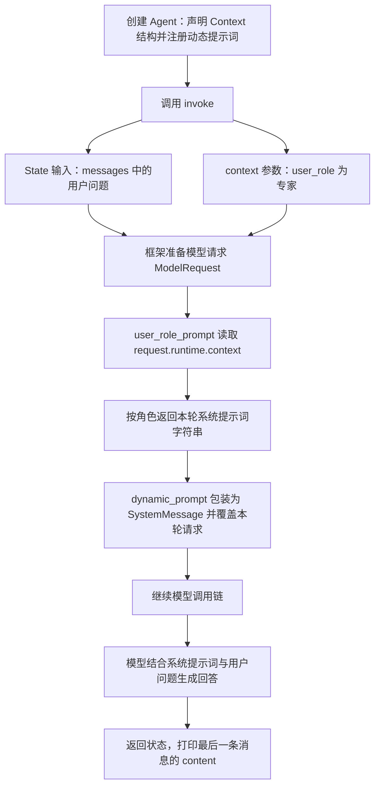

# LangChain 动态提示词：根据 Runtime Context 调整回答方式

> 同样问“解释一下机器学习”，面向初学者和专家，可以给模型不同的表达要求。本篇从 `@dynamic_prompt` 出发，拆解上下文传递、提示词生成、系统消息注入，以及它与 State 和普通模型包装器的区别。

[返回首页](../README.md) · [完整源码](../langchain_dynamic_prompt.py) · [离线测试](../tests/test_dynamic_prompt.py) · [上一章：动态工具筛选](21-langchain-state-based-tools.md)

<a id="toc"></a>
## 目录

- [1. 这段代码解决什么问题](#purpose)
- [2. 完整调用流程](#flow)
- [3. TypedDict 和 context_schema](#context)
- [4. 动态提示词函数逐行拆解](#prompt-function)
- [5. 不写 handler，为什么仍会调用模型](#handler)
- [6. Context、State 和消息角色的区别](#comparison)
- [7. 三条角色分支的推演](#branches)
- [8. 缺省、静态提示词与消息列表](#details)
- [9. OpenRouter 配置与运行](#run)
- [10. 完整可运行代码](#source)
- [11. 实际离线验证](#validation)
- [12. 复习问题与扩展练习](#review)
- [13. 相关资料](#references)

<a id="purpose"></a>
## 1. 这段代码解决什么问题

用户的问题不变：

```text
解释一下机器学习
```

我们希望根据本次调用提供的用户水平，调整系统提示词：

| 用户水平 | 给模型的表达要求 |
| --- | --- |
| 初学者 | 用简单易懂的语言描述概念，避免专业术语 |
| 专家 | 提供更详细的技术解答，使用专业术语 |
| 其他角色 | 使用基础助手提示词 |

这里的“动态”指**运行时根据当前请求生成系统提示词**。并没有按角色更换模型，也没有新增搜索工具。本例没有配置工具，主路径是一条用户消息经过一次模型调用得到回答。

基础提示词“你是一位乐于助人的专家”描述助手的身份；`user_role` 描述用户的水平。专家助手也可以面向初学者讲解，两者并不冲突。

<a id="flow"></a>
## 2. 完整调用流程



最容易混在一起的是三个值：

| 值 | 举例 | 谁使用 |
| --- | --- | --- |
| 用户问题 | `解释一下机器学习` | 作为用户消息提供给模型 |
| 调用上下文 | `{"user_role": "专家"}` | 中间件读取并选择规则 |
| 生成的系统提示词 | `你是一位乐于助人的专家。尽量提供详细的技术解答……` | 框架作为本轮模型的系统消息使用 |

动态提示词函数返回的是**指令文本**，不是机器学习问题的最终答案。最终答案仍由模型生成。

<a id="context"></a>
## 3. TypedDict 和 context_schema

### 3.1 Context 描述字典结构

```python
from typing import TypedDict

class Context(TypedDict):
    user_role: str
```

`TypedDict` 来自 Python 标准库 `typing`，用于描述字典有哪些键、这些键对应什么类型。

这里表示：上下文中有一个键 `user_role`，它的值按类型声明应为字符串。实际传入的数据仍写成普通字典：

```python
{"user_role": "专家"}
```

不要把它与“创建一个带 `.user_role` 属性的普通类实例”混淆。因为本例选择的是字典结构，所以读取时使用 `.get(...)`。

`user_role: str` 是类型标注，不是在给角色赋默认值，也不会自动创建一份已经填好内容的上下文。它没有把合法值限制成“初学者、专家”两个选项。

### 3.2 context_schema=Context 声明预期结构

```python
agent = create_agent(
    model=model,
    context_schema=Context,
    middleware=[user_role_prompt],
)
```

`context_schema` 告诉框架本例使用什么结构的运行上下文；每次执行时的数据由 `invoke(..., context=...)` 提供。

它与上一章的 `state_schema=State` 不同：前者声明运行上下文，后者声明 Agent 状态字段。不要仅因为二者都叫 schema，就把它们当成同一个数据入口。

### 3.3 context 是 invoke 的独立参数

```python
response = agent.invoke(
    {"messages": [{"role": "user", "content": "解释一下机器学习"}]},
    context={"user_role": "专家"},
)
```

第一份字典是状态输入；逗号后面的 `context=` 是这次调用的另一个参数。

如果只把 `"user_role": "专家"` 放进第一份字典，却没有提供运行上下文，本例的 `request.runtime.context` 不会因此得到这个角色。离线测试专门验证了这种误放位置的情况。

### 3.4 这里的 Context 不表示自动长期记忆

本例把用户水平作为本次执行的依赖参数来读，不使用它记录对话历史，也没有配置 Checkpointer 或 Store。

同一个 Agent 可以先传专家、再传初学者，无需重新构建 Agent。需要跨次记忆时，应按业务需求接入相应的状态和持久化机制，见[Runtime Context](15-langgraph-runtime-context.md)与[结构化天气 Agent](16-langchain-weather-structured-agent.md)。

<a id="prompt-function"></a>
## 4. 动态提示词函数逐行拆解

原函数的关键读取：

```python
user_role = request.runtime.context.get("user_role", "初学者")
```

逐层展开：

| 表达式 | 含义 |
| --- | --- |
| `request` | 当前模型请求对象，类型提示为 `ModelRequest` |
| `request.runtime` | 框架传入的运行时对象 |
| `request.runtime.context` | 这次 `invoke` 提供的上下文 |
| `.get("user_role", "初学者")` | 读取角色；字典没有该键时，使用“初学者” |

完整源码先做一层保护：

```python
context = request.runtime.context or {}
user_role = context.get("user_role", "初学者")
```

`or {}` 表示左边是假值时使用空字典。完全没传 `context` 时，当前运行环境中的上下文可能是 `None`；先换成 `{}`，才能继续调用字典的 `.get`。

接着准备基础指令：

```python
base_prompt = "你是一位乐于助人的专家。"
```

再按字符串值决定返回哪一条：

```python
if user_role == "初学者":
    return f"{base_prompt}用简单易懂的语言描述概念，避免使用专业术语。"
elif user_role == "专家":
    return f"{base_prompt}尽量提供详细的技术解答，需要使用专业术语。"

return base_prompt
```

常见语法对照：

| 写法 | 所属语法或对象 | 参数或作用 |
| --- | --- | --- |
| `dict.get(key, default)` | 字典方法 | 有键读值，无键返回默认值，不会自动写回 |
| `==` | 相等比较 | 判断角色字符串是否与目标相等 |
| `if / elif` | 条件分支 | 按顺序选择符合条件的代码块 |
| `f"{base_prompt}..."` | f-string | 将变量值插入字符串 |
| `return ...` | 函数返回语句 | 立即结束本次函数调用，交回提示词 |
| `-> str` | 返回类型提示 | 描述这个函数正常返回字符串 |

`str` 类型提示不会替函数生成返回值。这里最后的 `return base_prompt` 很有必要，确保未匹配角色时也有合法提示词。

[回到目录](#toc)

<a id="handler"></a>
## 5. 不写 handler，为什么仍会调用模型

上一章讨论过：

```python
return handler(request)
```

在模型包装器里，它继续后续模型调用链。这次函数没有 `handler` 参数，是因为 `@dynamic_prompt` 已经替我们组织了这层包装。

### 5.1 dynamic_prompt 是专门生成系统提示词的便捷装饰器

```python
@dynamic_prompt
def user_role_prompt(request: ModelRequest) -> str:
    ...
```

框架接收函数返回的字符串，将它设为当前请求的系统提示词，并继续执行模型调用。官方接口也允许返回完整 `SystemMessage`；本例只用字符串。[官方 dynamic_prompt API](https://reference.langchain.com/python/langchain/agents/middleware/types/dynamic_prompt)

结合当前安装版本的实现，可以按下面的概念步骤理解：

```text
调用你的提示词函数，拿到字符串 prompt
    ↓
构造 SystemMessage(content=prompt)
    ↓
request.override(system_message=这条系统消息)
    ↓
handler(新的请求)
    ↓
后续模型调用链
```

这些步骤由装饰器生成的中间件完成，不需要在提示词函数里手动重复调用模型。

### 5.2 与普通 wrap_model_call 的返回值区别

| 写法 | 你写的函数返回什么 | 谁继续调用模型 |
| --- | --- | --- |
| `@wrap_model_call` | 本例链路通常返回 `ModelResponse` | 你在包装器中调用 `handler(request)` |
| `@dynamic_prompt` | 系统提示词字符串或 `SystemMessage` | 装饰器内部的包装逻辑 |

因此，这里 `return "你是一位……"` 不会让 Agent 直接把这句话当作最终回答。它先成为模型指令，模型随后才生成答案。

### 5.3 注册时为什么不加括号

```python
middleware=[user_role_prompt]
```

函数经过 `@dynamic_prompt` 处理后，这个名字指向的是可注册的中间件对象。把它放进列表即可，不需要在注册时自己执行一次。

与类式的 `LoggingMiddleware()` 比较，关键仍是“当前名字指向类，还是已经生成的对象”，见[第 20 篇](20-langchain-class-middleware.md#classes)。

<a id="comparison"></a>
## 6. Context、State 和消息角色的区别

### 6.1 与上一章放在一起看

| 内容 | 上一章动态工具 | 本章动态提示词 |
| --- | --- | --- |
| 输入标记 | `auth` | `user_role` |
| 数据位置 | Agent State | Runtime Context |
| 调用时写法 | 放进状态输入字典 | 独立的 `context={...}` 参数 |
| 中间件读取 | `request.state.get(...)` | `request.runtime.context.get(...)` |
| 改动的本轮请求字段 | `tools` | `system_message` |
| 最终作用 | 调整提供给模型的工具清单 | 调整模型的表达与回答要求 |

二者都能影响模型本轮看到的输入，但数据职责和修改目标不同。不能把 `context_schema` 直接替换成 `state_schema`，却仍照原路径读取数据。

### 6.2 user_role 与消息里的 role 不是同一个字段

```python
"messages": [{"role": "user", "content": "解释一下机器学习"}]
```

其中 `"role": "user"` 是聊天消息协议：表示这条内容来自用户。

```python
context={"user_role": "专家"}
```

其中 `user_role` 是应用自定义的用户水平标记，决定系统提示词内容。

即使用户水平为“专家”，用户消息的 `role` 仍是 `"user"`，不用改成 `"专家"`。

### 6.3 user_role 在本例只调整表达风格

它不会创建真实专家身份、改变模型参数，也不表示获得某个工具的执行权限。本章没有把角色分支接入上一章的工具筛选逻辑。

<a id="branches"></a>
## 7. 三条角色分支的推演

### 7.1 传入专家

输入：

```python
context={"user_role": "专家"}
```

执行过程：

1. 读取字符串 `"专家"`。
2. 不满足初学者分支，满足专家分支。
3. 返回技术表达要求。
4. 装饰器将其设为系统消息，继续调用模型。

测试实际捕获的系统提示词为：

```text
你是一位乐于助人的专家。尽量提供详细的技术解答，需要使用专业术语。
```

### 7.2 传入初学者

输入：

```python
context={"user_role": "初学者"}
```

命中第一条分支，模型实际收到的系统提示词为：

```text
你是一位乐于助人的专家。用简单易懂的语言描述概念，避免使用专业术语。
```

用户问题仍然是“解释一下机器学习”。变化发生在系统指令中，不需要把原问题改写两遍。

### 7.3 传入其他角色

```python
context={"user_role": "访客"}
```

两个条件都不满足，走最后的返回：

```text
你是一位乐于助人的专家。
```

“其他角色返回基础指令”与“键缺失时按初学者处理”是两条不同的兜底规则。

以上是离线测试中捕获的提示词内容，不是本次真实模型生成的机器学习答案。提示词已正确传递，也不等于真实模型一定严格达到期望的解释深度。

[回到目录](#toc)

<a id="details"></a>
## 8. 缺省、静态提示词与消息列表

本次提供了代码和总结上传请求，没有新的报错日志。下面是代码边界分析与离线实验，不把它们写成已经发生过的个人错误。

### 8.1 缺少键与缺少整个 context

| 调用情况 | 原读取方式的关键区别 | 完整源码行为 |
| --- | --- | --- |
| `context={"user_role": "专家"}` | 字典包含目标键 | 专家分支 |
| `context={}` | 字典没有键，`.get` 能使用默认值 | 初学者分支 |
| 完全不传 context | 上下文可能是 `None`，不能直接调用 `.get` | 先 `or {}`，再走初学者分支 |
| `context={"user_role": ""}` | 键存在，值为空字符串，`.get` 不会改用默认值 | 其他角色，基础提示词 |
| 显式传 `user_role=None` | 不是声明期望的字符串类型，但当前 TypedDict 路径不会自动转换 | 对不上两条分支，基础提示词 |

`TypedDict` 的类型提示不能替代输入值检查。如果需要限制角色集合，可在应用入口增加校验；本例保留原来的字符串分支规则。

### 8.2 两个“默认角色”分别在哪一层

- 函数读取时，缺少 `user_role` 默认“初学者”。
- 脚本入口从环境变量读取角色，未配置时主动传入“专家”，保持本次示例的调用方式。

所以直接运行脚本默认走专家分支，并不与函数的缺省保护矛盾。此时入口已经显式提供了一个角色。

### 8.3 静态 system_prompt 不会自动与动态结果拼接

原代码把静态 `system_prompt` 留在注释中，实际只使用动态中间件返回的指令。

离线实验另外创建了一个同时传静态提示词的 Agent。当前中间件会用返回结果覆盖本轮请求的 `system_message`，模型实际收到的是动态提示词，没有自动附加那条静态指令。

因此需要保留的共同要求，可以像本例一样明确写进 `base_prompt`，再拼接分支内容。不能假设静态和动态两份文本会由框架自动合并。

这是当前组合下的实际行为；如果再叠加其他修改提示词的中间件，应同时检查注册顺序和覆盖逻辑。

### 8.4 模型输入与返回的消息列表并不完全相同

本例一次直接回答时，离线模型实际看到：

```text
SystemMessage：本轮动态生成的角色指令
HumanMessage：解释一下机器学习
```

执行结束后，`response["messages"]` 中是：

```text
HumanMessage：解释一下机器学习
AIMessage：模型返回的回答
```

本例的动态系统消息通过模型请求注入，没有自动追加到返回状态的消息列表里。不能只看最终 `messages` 中没有系统提示，就认定它没传给模型。

### 8.5 print 最后打印什么

```python
print(response["messages"][-1].content)
```

`[-1]` 取得列表的最后一个元素，`.content` 读取该消息的内容。本例正常完成后，它是模型生成的最终回答，而不是 `user_role_prompt` 返回的指令文本。

### 8.6 如果以后加入工具

原示例没有工具。离线测试额外注册了一个固定术语工具，验证发生工具循环时，两次模型调用都会注入同一角色要求。

这说明动态提示词作用于每次模型调用，不能把它固定理解成整个 `invoke` 只计算一次。这个工具仅用于验证，不在完整主示例中。

<a id="run"></a>
## 9. OpenRouter 配置与运行

### 9.1 沿用现有模型接入方式

本篇完整示例使用：

```python
init_chat_model(
    model="openai/gpt-5-mini",
    model_provider="openrouter",
)
```

显式选择 OpenRouter 集成，读取已有的 `OPENROUTER_API_KEY`。原片段的 `model="gpt-5-mini"` 没有显式选择这一集成；沿用本仓库方式可以避免依赖默认提供商推断。

动态提示词与提供商选择是两个独立配置：切换角色没有重新创建不同型号的模型。

### 9.2 环境准备

从仓库根目录执行，使用 Python 3.10+；本次实际验证为 Python 3.11.7。

```bash
pip install -r requirements.txt
```

还没有 `.env` 时，PowerShell 执行：

```powershell
Copy-Item .env.example .env
```

已有 `.env` 就补充变量，不覆盖其他示例的配置：

```ini
OPENROUTER_API_KEY=your_openrouter_api_key_here
DYNAMIC_PROMPT_MODEL=openai/gpt-5-mini
DYNAMIC_PROMPT_ROLE=专家
DYNAMIC_PROMPT_QUERY=解释一下机器学习
```

填入自己的 Key，不提交真实凭据。脚本从同目录加载 `.env`，默认不覆盖进程中已存在的同名环境变量。

### 9.3 执行和切换角色

```bash
python langchain_dynamic_prompt.py
```

可以把 `.env` 中的角色改为“初学者”，也可以在 PowerShell 临时设置：

```powershell
$env:DYNAMIC_PROMPT_ROLE="初学者"
python langchain_dynamic_prompt.py
```

临时测试完成后，恢复从文件读取：

```powershell
Remove-Item Env:DYNAMIC_PROMPT_ROLE
```

无真实模型请求的验证命令：

```bash
python -m unittest discover -s tests -p test_dynamic_prompt.py -v
```

<a id="source"></a>
## 10. 完整可运行代码

源码：[langchain_dynamic_prompt.py](../langchain_dynamic_prompt.py)。保留初学者、专家、其他角色三条分支，脚本默认传入专家；上下文缺失时提供初学者兜底。

<details>
<summary>展开完整 Python 源码</summary>

<!-- DYNAMIC_PROMPT_SOURCE_BEGIN -->
```python
"""按 Runtime Context 中的用户角色动态生成本轮系统提示词。

默认脚本角色为专家；上下文缺失时使用初学者规则。
导入模块不会读取密钥或调用模型，测试可注入离线模型。
"""

import os
from pathlib import Path
from typing import TypedDict

from dotenv import load_dotenv
from langchain.agents import create_agent
from langchain.agents.middleware import ModelRequest, dynamic_prompt
from langchain.chat_models import init_chat_model
from langchain_core.language_models.chat_models import BaseChatModel


class Context(TypedDict):
    user_role: str


@dynamic_prompt
def user_role_prompt(request: ModelRequest) -> str:
    context = request.runtime.context or {}  # 没传 context 时也可使用默认角色。
    user_role = context.get("user_role", "初学者")
    base_prompt = "你是一位乐于助人的专家。"

    if user_role == "初学者":
        return f"{base_prompt}用简单易懂的语言描述概念，避免使用专业术语。"
    elif user_role == "专家":
        return f"{base_prompt}尽量提供详细的技术解答，需要使用专业术语。"

    return base_prompt


def build_agent(model: BaseChatModel | None = None):
    """创建同一个可按每次 context 调整提示词的 Agent。"""
    if model is None:
        if not os.getenv("OPENROUTER_API_KEY", "").strip():
            raise RuntimeError("请在环境变量或 .env 中配置 OPENROUTER_API_KEY。")
        model = init_chat_model(
            model=os.getenv("DYNAMIC_PROMPT_MODEL", "openai/gpt-5-mini"),
            model_provider="openrouter",
        )
    return create_agent(
        model=model,
        context_schema=Context,
        middleware=[user_role_prompt],
    )


def main() -> None:
    load_dotenv(Path(__file__).resolve().with_name(".env"))
    agent = build_agent()
    response = agent.invoke(
        {"messages": [{
            "role": "user",
            "content": os.getenv("DYNAMIC_PROMPT_QUERY", "解释一下机器学习"),
        }]},
        context={"user_role": os.getenv("DYNAMIC_PROMPT_ROLE", "专家")},
    )
    print(response["messages"][-1].content)


if __name__ == "__main__":
    main()
```
<!-- DYNAMIC_PROMPT_SOURCE_END -->

</details>

[回到目录](#toc)

<a id="validation"></a>
## 11. 实际离线验证

测试文件：[test_dynamic_prompt.py](../tests/test_dynamic_prompt.py)。通过离线 `BaseChatModel` 驱动真实 Agent 和 `dynamic_prompt`，捕获模型实际收到的 `SystemMessage` 与用户消息。

测试阻断同步和异步 HTTP 客户端，不使用真实 Key 发请求。除模型输出由脚本指定外，提示词注入、Context 传递与 Agent 执行使用实际库实现。

| 验证项 | 实际断言 |
| --- | --- |
| 初学者 | 简明表达指令作为系统消息放在用户问题前 |
| 专家 | 模型收到技术细节要求 |
| 未知、空字符串与 None 角色 | 当前运行路径返回基础提示词，未自动转换成初学者 |
| 空上下文字典 | 使用缺少键时的初学者默认值 |
| 完全不传 context | 经过 `or {}` 保护，正常使用初学者分支 |
| 同一 Agent 切换角色 | 各次提示词正确，系统消息不累积 |
| Context 与 State 区分 | 返回状态没有自动增加 user_role，动态系统消息没有写入 messages |
| 角色误放入 State 输入 | 不替代 Runtime Context，使用上下文缺省分支 |
| 静态与动态同时配置 | 本组合下动态结果替换静态系统提示 |
| 补充工具循环 | 每次模型调用都带角色指令，工具调用 ID 配对正常 |
| OpenRouter 构造参数 | 显式使用 `model_provider="openrouter"` |
| 脚本入口 | 角色正确传入，只打印最后回答文本 |

本篇新增 **12 项离线测试通过**，仓库累计 **84 项离线测试通过**。已检查 Python 语法、Markdown 本地链接、内部目录锚点与完整代码块和源文件的一致性。

实际环境：Python 3.11.7、`langchain 1.4.6`、`langchain-core 1.6.12`、`langgraph 1.2.16`、`langchain-openrouter 0.2.9`。

没有发起真实 OpenRouter 请求，也没有评估真实模型的回答风格、术语使用或机器学习解释质量。离线回复只用于检查数据传递与调用流程，不写成真实模型回答记录。

<a id="review"></a>
## 12. 复习问题与扩展练习

### 12.1 复习卡片

| 问题 | 核心答案 |
| --- | --- |
| 这次动态改变了什么？ | 每次模型请求的系统提示词 |
| 会按角色换成另一个模型吗？ | 不会，本例只调整指令文本 |
| Context(TypedDict) 是给角色赋值吗？ | 不是，是描述字典结构；值在调用时传入 |
| context_schema 与 state_schema 一样吗？ | 不一样，分别声明运行上下文与状态字段结构 |
| role="user" 与 user_role="专家" 一样吗？ | 不一样，前者是消息协议角色，后者是应用水平标记 |
| 为什么本次函数没有 handler 参数？ | dynamic_prompt 内部替我们组织覆盖请求和继续模型调用 |
| 函数返回的 str 是最终答案吗？ | 不是，是提供给模型的系统指令 |
| middleware 列表里的 user_role_prompt 要加括号吗？ | 不加，装饰器已经生成可注册对象 |
| .get 的默认值能保护 context=None 吗？ | 不能直接在 None 上调用 get，需要先处理缺失上下文 |
| 角色键存在但值为空字符串，会用默认值吗？ | 不会，会走未匹配角色的基础分支 |
| 默认脚本为什么是专家？ | 入口未配置角色时主动传入专家；函数自身的缺省角色是初学者 |
| 静态与动态提示会自动合并吗？ | 本组合不会，动态结果覆盖本轮 system_message |
| 最终 messages 里没有 SystemMessage，就说明没用提示词吗？ | 不能这样判断，应检查实际模型输入 |
| 传入 Context 就会自动成为长期记忆吗？ | 本例没有这项自动持久化设计 |

### 12.2 小练习

1. 在同一 Agent 上分别传入专家与初学者，先预测系统提示词，再用离线模型核对。
2. 分别尝试空上下文字典和未知角色，说明为什么它们走不同的兜底分支。
3. 新增“产品经理”角色，要求用业务案例解释，再补上对应分支验证。
4. 把共同的回答要求放进 `base_prompt`，避免依赖静态提示词自动拼接。
5. 与上一章组合时，分别读取 State 中的 auth 和 Context 中的 user_role，明确谁控制工具清单、谁控制表达方式。

本次没有新增具体的语法提问或错误输出，因此这些内容作为代码走读和扩展实验整理，不编造个人排错经历。

[回到目录](#toc)

<a id="references"></a>
## 13. 相关资料

- [LangChain：dynamic_prompt API](https://reference.langchain.com/python/langchain/agents/middleware/types/dynamic_prompt)：返回字符串或 SystemMessage 的便捷中间件接口。
- [LangChain：自定义中间件](https://docs.langchain.com/oss/python/langchain/middleware/custom)：模型请求包装与系统消息修改。
- [LangChain 中间件类型源码](https://github.com/langchain-ai/langchain/blob/master/libs/langchain_v1/langchain/agents/middleware/types.py)：本章结合安装版本检查装饰器如何生成包装逻辑；在线分支可能与安装版本不同。
- [第 15 篇：Runtime Context](15-langgraph-runtime-context.md)：状态、上下文和运行依赖的区别。
- [第 21 篇：动态工具筛选](21-langchain-state-based-tools.md)：对比 request.state、request.override 与 handler。
- [离线测试说明](../tests/README.md#动态提示词)：执行命令和验证范围。
