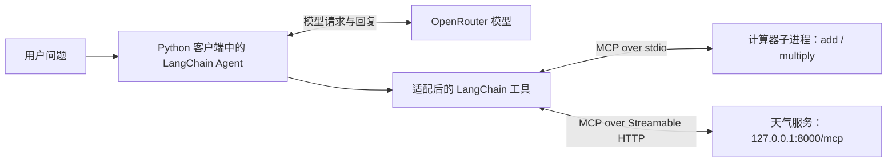

# MCP 双服务 Agent：计算器 stdio、天气 HTTP 与异步会话

> 将计算器和天气函数放进独立 MCP 服务，再让 LangChain Agent 发现并调用它们。本文把三份文件作为一套程序来理解，重点解释工具发现、协议适配、会话生命周期、异步工具调用和真实运行中的 401 排错。

[返回首页](../README.md) · [三文件示例目录](../examples/mcp_multi_server/README.md) · [本机集成测试](../tests/test_mcp_multi_server.py) · [上一章：动态提示词](22-langchain-dynamic-prompt.md)

<a id="toc"></a>
## 目录

- [1. 一套程序为什么拆成三个文件](#architecture)
- [2. MCP、FastMCP、适配器和 Agent 分别做什么](#roles)
- [3. 计算器服务：函数怎样变成 MCP 工具](#math-server)
- [4. 天气服务：HTTP 地址和服务启动](#weather-server)
- [5. 客户端配置与工具发现](#client)
- [6. 原会话代码为什么拿不到计算器工具](#tool-scope)
- [7. 持久会话与 get_tools 的区别](#sessions)
- [8. async、await 和异步上下文拆解](#async)
- [9. 计算和天气两条调用链推演](#walkthrough)
- [10. 真实 401 与 ExceptionGroup 排错](#debugging)
- [11. 依赖版本、代理和启动步骤](#run)
- [12. 三份完整源码](#source)
- [13. 实际验证与范围](#validation)
- [14. 复习问题与扩展练习](#review)
- [15. 相关资料](#references)

<a id="architecture"></a>
## 1. 一套程序为什么拆成三个文件

| 文件 | 提供什么 | 通信方式 | 生命周期 |
| --- | --- | --- | --- |
| `math_server.py` | `add(a, b)`、`multiply(a, b)` | stdio 标准输入/输出 | 客户端启动子进程，会话退出时清理 |
| `weather_server.py` | `get_weather_for_location(city)` | Streamable HTTP | 单独启动，客户端连接已有服务 |
| `agent_client.py` | 连接两边、加载工具、运行 Agent | MCP 客户端 + 模型 API | 入口使用 `asyncio.run(main())` |



有两条不同的数据路径：Agent 向模型请求决策，客户端向 MCP 服务请求工具执行。天气服务和计算器服务本身不需要模型 Key。

`mcp.run(...)` 是会持续运行的服务入口。三个程序各有自己的启动方式，不能因为它们属于一套功能，就把三段入口顺序粘到一个文件里执行。

示例目录没有写死开发机器的用户路径，计算器脚本路径由客户端文件所在目录计算。

<a id="roles"></a>
## 2. MCP、FastMCP、适配器和 Agent 分别做什么

| 名称 | 在本例中的职责 |
| --- | --- |
| MCP | 约定客户端如何发现工具、描述参数并发起调用的协议 |
| FastMCP | 帮 Python 函数生成工具描述并提供 MCP 服务 |
| `MultiServerMCPClient` | 保存多个服务连接配置，建立会话并加载工具 |
| `load_mcp_tools` | 从指定会话获取 MCP 工具，适配成 LangChain 可使用的工具 |
| `create_agent` | 将模型、工具及提示词组成调用循环 |
| 模型 | 根据问题生成回答或工具调用申请，不直接执行远端 Python 函数 |

工具适配的过程是：

```text
服务端函数、类型标注和说明
    ↓
MCP 工具描述与参数结构
    ↓
load_mcp_tools → LangChain 工具包装器
    ↓
模型看到工具说明并申请调用
    ↓
包装器通过会话发送 MCP 调用
    ↓
服务端执行函数并返回结果
```

客户端不是把计算器函数源码复制过来运行。它持有的是调用服务端工具的包装器。

MCP 工具也不等同于每个函数对应一个普通 REST 路径。天气示例使用 `/mcp` 协议端点，工具名称和参数在 MCP 消息中传递，而不是访问一个 `/get_weather_for_location` 网页。

<a id="math-server"></a>
## 3. 计算器服务：函数怎样变成 MCP 工具

```python
mcp = FastMCP("Math")

@mcp.tool()
def add(a: int, b: int) -> int:
    """两数相加。"""
    return a + b
```

逐项理解：

| 写法 | 含义 |
| --- | --- |
| `FastMCP("Math")` | 创建一个名为 Math 的服务对象 |
| `@mcp.tool()` | 将函数注册成这个服务提供的 MCP 工具 |
| `a: int, b: int` | 声明两个整型参数，参与工具参数结构生成与校验 |
| `-> int` | 声明返回整数 |
| 函数文档字符串 | 提供工具功能说明 |

`multiply` 同理，只是返回 `a * b`。

这里使用的是 FastMCP 的 `@mcp.tool()`；前面本地 Agent 示例中的 `@tool` 属于 LangChain 工具接口。二者处于不同位置，客户端需要适配器把 MCP 工具接到 LangChain 上。

### stdio 是什么

```python
mcp.run(transport="stdio")
```

客户端启动该 Python 脚本，并通过进程的标准输入/输出收发 MCP 消息。它不需要监听 8000 端口，也没有一个可在浏览器中打开的 stdio URL。[FastMCP 服务启动说明](https://gofastmcp.com/deployment/running-server)

stdio 的 stdout 用于协议通信，不要随意往里面打印普通调试文本。需要服务日志时应使用相应日志机制或 stderr；本例计算器函数只返回结果。

`if __name__ == "__main__":` 让直接运行脚本时启动服务，导入文件时只完成定义和注册，不马上阻塞进入服务循环。

<a id="weather-server"></a>
## 4. 天气服务：HTTP 地址和服务启动

天气函数仍是演示数据：

```python
return f"在{city}总是阳光明媚！"
```

它不查询真实天气接口，不应把输出当成实时天气。

服务通过 Streamable HTTP 启动，默认监听本机 `127.0.0.1:8000`，MCP 地址为：

```text
http://127.0.0.1:8000/mcp
```

拆开看：

| 部分 | 含义 |
| --- | --- |
| `http://` | 通过 HTTP 通信 |
| `127.0.0.1` | 当前电脑的回环地址 |
| `8000` | 天气服务监听的端口 |
| `/mcp` | 本例的 MCP 协议端点 |

HTTP 可以用于本机或远程连接；这里是本机测试，不代表已经部署到云服务器。客户端配置一个 URL，不会自动把天气服务启动起来，因此需要先单独运行天气脚本。

浏览器直接打开 `/mcp`，不一定得到普通网页。MCP 客户端会按协议发送初始化、工具发现与工具调用消息。

[回到目录](#toc)

<a id="client"></a>
## 5. 客户端配置与工具发现

### 5.1 两个连接名

```python
client = MultiServerMCPClient({
    "math": {...},
    "weather": {...},
})
```

`math`、`weather` 是客户端连接配置中的键。调用 `client.session("weather")` 时，框架按这个键查找对应连接配置。

它们与服务端的展示名称 `FastMCP("Math")`、`FastMCP("Weather")` 不承担相同职责，也不是工具函数名。

### 5.2 stdio 的 command 和 args

```python
"command": sys.executable,
"args": [str(Path(__file__).resolve().with_name("math_server.py"))],
```

- `sys.executable` 是当前客户端使用的 Python 解释器路径，让子进程使用同一套环境。
- `__file__` 表示当前脚本路径。
- `Path(...).resolve()` 取得绝对路径。
- `.with_name("math_server.py")` 指向同目录的计算器脚本。
- `str(...)` 转成子进程参数需要的字符串。

这样无需依赖命令行中 `python` 恰好指向哪个环境，也无需把个人电脑的绝对路径写进仓库。

### 5.3 加载不等于执行

```python
math_tools = await load_mcp_tools(math_session)
```

这一步读取并适配工具信息，得到可调用包装器。它没有执行 `add(3, 4)`。

真正执行发生在模型申请工具后，Agent 通过包装器调用 MCP 服务时。也可以在测试中直接调用包装器的 `ainvoke`，绕过模型来单独验证服务。

<a id="tool-scope"></a>
## 6. 原会话代码为什么拿不到计算器工具

原片段是：

```python
async with client.session("weather") as session:
    tools = await load_mcp_tools(session)
```

这个 `session` 只连接天气服务，所以加载到的工具是：

```text
get_weather_for_location
```

虽然客户端配置里还写了 `math`，这一步不会自动把另一个服务的工具合并进来。原注释中列出的 `add`、`multiply`、天气三个工具，不对应这条单会话加载路径的实际结果。

如果随后问 `(3 + 4) * 5`，Agent 的工具清单里没有计算器。模型可能自己算出 35，但那不能证明算术 MCP 工具已经执行成功。

### 同时打开两个会话，分别加载后合并

```python
async with (
    client.session("math") as math_session,
    client.session("weather") as weather_session,
):
    math_tools = await load_mcp_tools(math_session)
    weather_tools = await load_mcp_tools(weather_session)
    tools = math_tools + weather_tools
```

这里 `+` 是 Python 列表拼接，得到三个工具，不是执行加法工具：

```text
[add, multiply] + [get_weather_for_location]
    ↓
[add, multiply, get_weather_for_location]
```

`create_agent(..., tools=tools)` 得到合并后的清单，两个 `ainvoke` 都在会话有效期间完成。

如果以后两个服务暴露同名工具，需要另外处理命名冲突；本例三个名称互不重复，沿用默认不加服务名前缀的方式。

<a id="sessions"></a>
## 7. 持久会话与 get_tools 的区别

### 7.1 本例选择显式会话

```python
async with client.session("math") as math_session:
    math_tools = await load_mcp_tools(math_session)
    # 在这个作用域里使用工具
```

多个计算器工具调用可以复用这个会话。完整示例还同时持有天气会话，因此是**每个服务一个会话**，不是三个工具共用同一个跨服务会话。

从会话中加载的工具绑定着这个会话。不能退出 `async with` 后，把它当成仍然保持连接的工具继续调用；本篇有关闭后调用失败的实际验证。

### 7.2 get_tools 的按次建会话方式

```python
tools = await client.get_tools()
```

默认会收集所有已配置服务的工具。在本章使用的适配器版本中，这种加载方式返回的工具会在每次执行时建立相应会话，而不是持有上面显式打开的那一个会话。[适配器官方说明](https://github.com/langchain-ai/langchain-mcp-adapters)

| 方式 | 工具范围 | 调用时的会话 |
| --- | --- | --- |
| `client.get_tools()` | 默认汇总所有配置服务 | 按工具调用创建会话 |
| `load_mcp_tools(weather_session)` | 当前 weather 会话的工具 | 复用已打开的天气会话 |
| 分别加载 math、weather 后拼接 | 两个会话的工具并集 | 各工具复用自己所属服务的会话 |

“按次建会话”不等于服务端不可能保留任何业务数据。服务仍可能使用数据库、文件或其他共享状态；这里讨论的是客户端连接和 MCP 会话的生命周期。

### 7.3 MCP 会话不是 Agent 对话记忆

完整示例没有配置 Checkpointer。两次 `agent.ainvoke` 传入的是两份新的消息输入，不会因为复用了 MCP 会话，就自动把计算问题的对话历史带入天气问题。

MCP 会话管理工具连接，Agent 记忆管理对话状态。二者需要分别设计，见[短期记忆管理](10-langgraph-short-term-memory-management.md)。

[回到目录](#toc)

<a id="async"></a>
## 8. async、await 和异步上下文拆解

### 8.1 async def 和 asyncio.run

```python
async def main():
    ...

asyncio.run(main())
```

`async def` 定义协程函数；调用 `main()` 得到协程对象，交给 `asyncio.run` 运行事件循环，直到主流程结束。

这适合本例的普通 Python 脚本入口。不是在服务器脚本里调用客户端 `main`，而是在第三份客户端文件中启动异步流程。

### 8.2 await 等待什么

| 表达式 | 等待的工作 |
| --- | --- |
| `await load_mcp_tools(session)` | 通过当前会话读取工具描述并完成适配 |
| `await agent.ainvoke(...)` | 完成一次 Agent 异步执行，包括可能的模型与工具循环 |
| `await tool.ainvoke(...)` | 单独执行一个适配后的异步工具 |

`await` 不会替模型决定要用哪个工具，也不表示后面所有任务都自动并行。

本例先等计算流程结束，再执行天气流程，因此两个问题按代码顺序串行完成。

### 8.3 async with 管理生命周期

完整代码中的两个异步上下文，等价于嵌套写法：

```python
async with client.session("math") as math_session:
    async with client.session("weather") as weather_session:
        # 加载两边工具，并在这里完成 Agent 调用
        ...
```

进入时建立并初始化会话，退出时清理；后进入的 weather 会话先退出，再退出 math 会话。当前主例使用括号排版以减少缩进，Python 3.10+ 支持这种写法。

`async with` 也解释了报错为什么可能带上多层上下文栈：内部的模型错误会沿会话退出流程向上传播。

<a id="walkthrough"></a>
## 9. 计算和天气两条调用链推演

以下是本机集成测试安排的模型决策路径。工具服务真实运行，模型申请由离线脚本给定，不当作真实模型自主决策记录。

### 9.1 计算 (3 + 4) * 5

| 步骤 | 模型或程序行为 | 结果 |
| --- | --- | --- |
| 1 | 用户输入表达式 | `(3 + 4) * 5` |
| 2 | 模型申请 `add(a=3, b=4)` | Agent 向计算器发送 MCP 工具调用 |
| 3 | 计算器执行加法 | 返回 7，写入配对的 ToolMessage |
| 4 | 模型申请 `multiply(a=7, b=5)` | 再次使用计算器会话 |
| 5 | 计算器执行乘法 | 返回 35，写入另一条 ToolMessage |
| 6 | 模型生成最终回答 | 测试回复为 `35` |

这条路径含三次模型调用、两次实际计算器工具调用。真实模型也可能采用其他调用安排，系统提示词并没有把这条精确执行序列写成硬性协议。

验证时要同时看工具调用消息、参数和结果，不能只看最终回答是否恰好等于 35。

### 9.2 查询西安天气

```text
用户：西安的天气怎么样？
    ↓
模型申请 get_weather_for_location(city="西安")
    ↓
Agent 工具包装器通过 HTTP 天气会话发起 MCP 调用
    ↓
天气服务返回：在西安总是阳光明媚！
    ↓
ToolMessage 回到模型
    ↓
模型生成最终回答
```

工具结果是服务端的固定演示值；测试最后的天气回复也是离线模型固定输出。这里验证通信、会话和消息配对，不验证真实天气事实。

### 9.3 “必须使用工具”不是协议级强制

原提示词保留为：

```text
你是一个乐于助人的助手，回答问题必须使用工具完成！
```

它是给模型的行为指令，不能单靠这句话保证任何情况下都产生工具调用。本篇测试显式安排工具调用路径，并断言真实工具结果；没有声称提示词本身就实现了强制执行校验。

<a id="debugging"></a>
## 10. 真实 401 与 ExceptionGroup 排错

### 10.1 已提供的真实失败记录

此前的客户端运行日志出现：

```text
AuthenticationError / OpenAIAuthenticationError
Error code: 401
code: invalid_api_key
During task with name 'model'
```

当时客户端仍通过 `create_agent("gpt-5-mini", ...)` 创建模型，实际栈进入了 `langchain_openai` 的模型调用。使用 OpenRouter Key，却没有按现有 OpenRouter 方式显式创建客户端，返回了官方接口的密钥拒绝错误。

本套代码沿用已调整的配置：

```python
init_chat_model(
    model="openai/gpt-5-mini",
    model_provider="openrouter",
)
```

原生集成读取 `OPENROUTER_API_KEY`。修复点是明确模型提供商与客户端，不是简单把同一把 Key 改一个环境变量名字。

本次没有重新发真实模型请求，因此不把离线模型构造测试写成“已验证真实认证成功”。

### 10.2 为什么外面有多层 ExceptionGroup

模型调用发生在 MCP 的异步会话作用域内。内部模型异常沿 `async with` 退出，并经过 AnyIO TaskGroup，可能被包装成嵌套异常组。

阅读时从最深层的具体错误往外看：

```text
具体认证错误：401 invalid_api_key
    ↑
Agent 模型调用失败
    ↑
会话退出与 TaskGroup 的异常包装
    ↑
外层 ExceptionGroup traceback
```

不能因为外层有 `client.session("weather")`，就直接认定天气服务坏了。当前真实记录明确报错在模型认证阶段。

本篇测试额外注入一个离线模型异常，验证经双会话退出后，异常组仍能追溯到原始模型错误。这是模拟测试，与真实 401 记录分开看。

### 10.3 不同错误要分层定位

| 表现 | 优先检查 |
| --- | --- |
| `401 invalid_api_key`，任务名是 model | 模型提供商、Key 对应关系与请求客户端 |
| 连接 127.0.0.1:8000 被拒绝 | 天气脚本是否启动、端口是否一致 |
| 只加载到天气工具 | 是否只对 weather 会话调用 load_mcp_tools |
| 子进程提示找不到模块 | command 指向的 Python 环境和依赖 |
| 工具参数缺少 b | MCP 工具结构、模型生成参数与验证错误 |
| 退出会话后工具调用失败 | 是否把绑定会话的工具留到作用域外使用 |

本章适配器的 `load_mcp_tools` 默认启用 `handle_tool_errors=True`。服务端返回 MCP 工具执行错误时，适配器可以将它转换成 `status="error"` 的 ToolMessage；缺少参数 b 的测试验证了这个分支。连接错误或模型认证错误不能据此一概当作普通工具错误消息处理。

原始日志还包含进程退出码 `0xC0000005`。仅凭所给 traceback 不能确认该原生进程异常退出的原因，本篇不把它直接归因为 401，也不声称已修复这一独立问题。

[回到目录](#toc)

<a id="run"></a>
## 11. 依赖版本、代理和启动步骤

### 11.1 先使用兼容的版本组合

本章围绕给出的 `MultiServerMCPClient` 与 `load_mcp_tools` API，固定使用：

| 包 | 本次实际验证版本 |
| --- | --- |
| FastMCP | 2.14.5 |
| MCP Python SDK | 1.30.0 |
| langchain-mcp-adapters | 0.3.2 |
| LangChain | 1.4.6 |
| langchain-core | 1.6.12 |
| LangGraph | 1.2.16 |
| langchain-openrouter | 0.2.9 |
| Python | 3.11.7 |

仓库为本章补充 `fastmcp==2.14.5`、`langchain-mcp-adapters==0.3.2`、`mcp>=1.24,<2`。

补充验证发现，原全局环境混装了 FastMCP 4.1.1 与 MCP 1.30.0：前者需要 MCP 2.x，而本章适配器需要 MCP 1.x，导入时缺少 `mcp.server.request_state`。这是依赖组合问题，不能当作本次 Python 函数逻辑错误。

验证使用独立虚拟环境补入兼容包，保留了现有全局包。LangChain 当前文档还有新的 `langchain.mcp` 接口；本篇保留并验证给定适配器写法，不把两个版本体系混装成一套示例。[适配器维护与迁移说明](https://github.com/langchain-ai/langchain-mcp-adapters)

### 11.2 准备环境

在仓库根目录打开 PowerShell：

```powershell
python -m venv .venv
.venv\Scripts\Activate.ps1
python -m pip install -r requirements.txt
```

还没有 `.env` 时复制模板；已有文件直接补充：

```powershell
Copy-Item .env.example .env
```

```ini
OPENROUTER_API_KEY=your_openrouter_api_key_here
MCP_AGENT_MODEL=openai/gpt-5-mini
MCP_WEATHER_PORT=8000
```

不要提交真实 Key。客户端默认根据端口生成本机 MCP URL；若设置了可选的 `MCP_WEATHER_URL`，该完整地址会优先使用。

### 11.3 终端 A：先启动天气服务

```powershell
python examples/mcp_multi_server/weather_server.py
```

保持终端运行。若 8000 已被占用，可把 `.env` 中 `MCP_WEATHER_PORT` 改成其他空闲端口，再重启服务。未单独指定 URL 时，客户端使用同一个端口变量。

### 11.4 终端 B：再启动客户端

打开另一个 PowerShell，进入同一仓库并激活同一个虚拟环境：

```powershell
.venv\Scripts\Activate.ps1
python examples/mcp_multi_server/agent_client.py
```

计算器脚本由客户端按 stdio 配置启动，不需要额外手动再开一个计算器终端。

客户端正常输出包含工具名、计算回答和天气回答。真实模型的文本可能不同，观察工具是否实际执行不能只依赖最终自然语言答案。

### 11.5 代理怎么处理

天气服务在本机，应确保回环地址绕过代理。在客户端终端可以设置：

```powershell
$env:NO_PROXY="127.0.0.1,localhost"
```

同一个 `NO_PROXY` 值中的多个主机用逗号分隔。若 IDE 用分号分隔多个环境变量，那是 IDE 的配置格式，不能与 NO_PROXY 的主机列表混为一谈。

模型访问与本机 MCP 连接是两条不同链路。外部模型是否需要代理取决于实际网络，不必为了本机 MCP 调用把全局代理全部关闭。

### 11.6 结束运行

客户端结束后，显式会话退出并清理它启动的计算器进程；天气服务是在终端 A 独立启动的，完成练习后在该终端按 Ctrl+C 停止。

<a id="source"></a>
## 12. 三份完整源码

三份文件应放在同一个 [examples/mcp_multi_server](../examples/mcp_multi_server/README.md) 目录中。下面三个代码块分别与源文件一致。

### 12.1 math_server.py

[查看计算器服务](../examples/mcp_multi_server/math_server.py)

<!-- MCP_MATH_SOURCE_BEGIN -->
```python
"""计算器 MCP 服务；由客户端通过 stdio 启动并管理进程。"""

from fastmcp import FastMCP

mcp = FastMCP("Math")


@mcp.tool()
def add(a: int, b: int) -> int:
    """两数相加。"""
    return a + b


@mcp.tool()
def multiply(a: int, b: int) -> int:
    """两数相乘。"""
    return a * b


if __name__ == "__main__":
    mcp.run(transport="stdio", show_banner=False)
```
<!-- MCP_MATH_SOURCE_END -->

### 12.2 weather_server.py

[查看天气服务](../examples/mcp_multi_server/weather_server.py)

<!-- MCP_WEATHER_SOURCE_BEGIN -->
```python
"""天气 MCP 服务；单独启动，通过 Streamable HTTP 接收请求。"""

import os
from pathlib import Path

from dotenv import load_dotenv
from fastmcp import FastMCP

mcp = FastMCP("Weather")


@mcp.tool()
def get_weather_for_location(city: str) -> str:
    """返回指定城市的演示天气，固定为阳光明媚。"""
    return f"在{city}总是阳光明媚！"


if __name__ == "__main__":
    load_dotenv(Path(__file__).resolve().parents[2] / ".env")
    mcp.run(
        transport="streamable-http",
        show_banner=False,
        host="127.0.0.1",
        port=int(os.getenv("MCP_WEATHER_PORT", "8000")),
    )
```
<!-- MCP_WEATHER_SOURCE_END -->

### 12.3 agent_client.py

[查看客户端](../examples/mcp_multi_server/agent_client.py)

<!-- MCP_CLIENT_SOURCE_BEGIN -->
```python
"""连接计算器和天气 MCP 服务，将两边工具交给同一个异步 Agent。"""

import asyncio
import os
import sys
from pathlib import Path

from dotenv import load_dotenv
from langchain.agents import create_agent
from langchain.chat_models import init_chat_model
from langchain_core.language_models.chat_models import BaseChatModel
from langchain_mcp_adapters.client import MultiServerMCPClient
from langchain_mcp_adapters.tools import load_mcp_tools


def build_client(weather_url: str | None = None) -> MultiServerMCPClient:
    port = os.getenv("MCP_WEATHER_PORT", "8000")
    url = weather_url or os.getenv("MCP_WEATHER_URL", f"http://127.0.0.1:{port}/mcp")
    return MultiServerMCPClient({
        "math": {
            "transport": "stdio",
            "command": sys.executable,
            "args": [str(Path(__file__).resolve().with_name("math_server.py"))],
        },
        "weather": {
            "transport": "streamable-http",
            "url": url,
        },
    })


def build_model() -> BaseChatModel:
    if not os.getenv("OPENROUTER_API_KEY", "").strip():
        raise RuntimeError("请在环境变量或 .env 中配置 OPENROUTER_API_KEY。")
    return init_chat_model(
        model=os.getenv("MCP_AGENT_MODEL", "openai/gpt-5-mini"),
        model_provider="openrouter",
    )


async def run_demo(
    model: BaseChatModel | None = None,
    *,
    weather_url: str | None = None,
) -> dict:
    """两次调用都在两个有效会话内部完成；测试可注入离线模型。"""
    if model is None:
        model = build_model()
    client = build_client(weather_url)

    async with (
        client.session("math") as math_session,
        client.session("weather") as weather_session,
    ):
        math_tools = await load_mcp_tools(math_session)
        weather_tools = await load_mcp_tools(weather_session)
        tools = math_tools + weather_tools

        agent = create_agent(
            model=model,
            tools=tools,
            system_prompt="你是一个乐于助人的助手，回答问题必须使用工具完成！",
        )
        math_result = await agent.ainvoke({
            "messages": [{"role": "user", "content": "(3 + 4) * 5 等于多少"}],
        })
        weather_result = await agent.ainvoke({
            "messages": [{"role": "user", "content": "西安的天气怎么样？"}],
        })
        return {
            "tool_names": [t.name for t in tools],
            "math_result": math_result,
            "weather_result": weather_result,
        }


async def main() -> None:
    load_dotenv(Path(__file__).resolve().parents[2] / ".env")
    result = await run_demo()
    print("已加载工具：", ", ".join(result["tool_names"]))
    print("计算结果：", result["math_result"]["messages"][-1].content)
    print("天气结果：", result["weather_result"]["messages"][-1].content)


if __name__ == "__main__":
    asyncio.run(main())
```
<!-- MCP_CLIENT_SOURCE_END -->

[回到目录](#toc)

<a id="validation"></a>
## 13. 实际验证与范围

### 13.1 真实本机服务 + 离线模型

[test_mcp_multi_server.py](../tests/test_mcp_multi_server.py) 启动实际天气 HTTP 子进程，使用临时空闲端口；计算器通过 MCP SDK 真实启动 stdio 子进程。模型使用离线 `BaseChatModel`，没有请求 OpenRouter。

测试允许回环地址 HTTP，阻止外部 HTTP 请求。它不是把 MCP 工具整体替换成假函数：工具发现、参数结构、会话、协议传输、函数执行与结果适配使用实际实现。

测试只清理自己创建的进程。验证过程中没有占用示例默认 8000 端口，也没有修改现有全局 Python 包。

### 13.2 覆盖范围

| 验证项 | 实际检查 |
| --- | --- |
| 模型配置 | 显式创建 OpenRouter 模型，模型 ID 和提供商正确 |
| 两个会话工具范围 | math 只有 add/multiply，weather 只有天气工具，合并后三个 |
| stdio 计算 | 真实得到 7、35，并检查负数与零 |
| HTTP 天气 | 同一有效天气会话可先后查询两个演示城市 |
| 完整 Agent 循环 | 离线模型驱动真实 add、multiply、天气调用，消息 ID 配对正确 |
| get_tools 路径 | 汇总两服务工具，并能按次建立会话完成调用 |
| 会话退出 | 已绑定会话的工具不能在关闭后继续正常使用 |
| 参数错误 | 缺少必需参数 b 时报告工具调用错误 |
| 异常组 | 双会话退出后仍可追溯原始离线模型异常 |

本章新增 **9 项验证通过**，仓库累计 **93 项验证通过**。原有 84 项保持离线模型验证；本章包含真实本机 MCP 通信，不把它写成“没有任何网络通信”的测试。

已检查 Python 语法、内部目录与本地链接，以及三个完整服务/客户端代码块与源文件的一致性。

### 13.3 环境限制与没有验证的部分

Windows 默认沙箱限制了 stdio 所需的异步命名管道，首次出现 `WinError 5`。本机集成测试使用同一验证环境在沙箱外复核；这不是修改服务逻辑或假造通信结果。

没有发起真实模型 API 请求，不宣称已验证 OpenRouter Key、真实模型的工具决策质量或强制使用工具效果。天气数据仍为固定演示值，也没有做公网部署、账号认证或性能压测。

<a id="review"></a>
## 14. 复习问题与扩展练习

| 问题 | 核心答案 |
| --- | --- |
| 为什么三份文件属于一套程序？ | 两个 MCP 服务提供工具，客户端把它们接入同一个 Agent |
| stdio 服务谁启动？ | 客户端按 command 与 args 启动子进程 |
| HTTP 服务配置 URL 后会自动启动吗？ | 本例不会，需要先独立运行天气服务 |
| Math 和客户端配置键 math 一样吗？ | 不是同一职责，session 参数匹配客户端配置键 |
| load_mcp_tools(weather_session) 会加载计算器吗？ | 不会，只加载当前天气会话的工具 |
| 为什么使用列表加号？ | 将两个服务的工具列表拼接成 Agent 可用清单 |
| load_mcp_tools 已经执行了加法吗？ | 没有，主要完成发现与适配 |
| 模型能直接执行服务器里的 Python 函数吗？ | 模型申请调用，由 Agent 包装器通过 MCP 执行 |
| 两个服务是不是共用同一个会话？ | 不是，每个服务有自己的会话 |
| MCP 会话能代替 Checkpointer 吗？ | 不能，连接生命周期与对话状态不同 |
| async 就表示两个问题并行吗？ | 本例没有并行，两个 ainvoke 顺序等待 |
| handler、ainvoke 和工具执行有什么关系？ | 模型调用产生工具申请，Agent 循环随后执行工具并再次请求模型 |
| 看到 ExceptionGroup 就说明 MCP 服务坏了吗？ | 不能，要找最内层具体异常和失败阶段 |
| 401 与天气端口被拒绝一样吗？ | 不是，分别属于模型认证与 MCP 服务连接问题 |
| 最终答案 35 能证明计算器调用成功吗？ | 不能，还要看实际 tool_calls 与对应工具结果 |
| 退出 with 后还能用显式会话工具吗？ | 不能当作连接仍然有效，调用应在作用域内完成 |

扩展练习：

1. 分别打印两个会话加载出的工具名，确认注册服务与加载工具的区别。
2. 不接模型，直接调用适配后的 add 和天气工具，先验证 MCP 通信链路。
3. 将显式双会话改成 get_tools，比较连接与工具作用域。
4. 为数学表达式增加减法工具，检查参数结构和消息配对。
5. 接真实天气 API 时保留 MCP 工具接口，将固定字符串替换成可验证数据源。

[回到目录](#toc)

<a id="references"></a>
## 15. 相关资料

- [FastMCP：运行服务](https://gofastmcp.com/deployment/running-server)：stdio、HTTP 与启动方式；本章版本以验证矩阵为准。
- [LangChain MCP Adapters](https://github.com/langchain-ai/langchain-mcp-adapters)：MultiServerMCPClient、显式会话及 get_tools 的生命周期说明。
- [LangChain 当前 MCP 文档](https://docs.langchain.com/oss/python/langchain/mcp)：了解新接口与迁移方向，避免与本章依赖混用。
- [FastMCP 2.14.5 包元数据](https://pypi.org/pypi/fastmcp/2.14.5/json)：核对 MCP 1.x 依赖约束。
- [第 19 篇：中间件与工具消息](19-langchain-custom-middleware.md)：ModelResponse、ToolMessage 与工具执行边界。
- [测试目录说明](../tests/README.md#mcp-双服务集成)：执行命令与实际覆盖范围。
