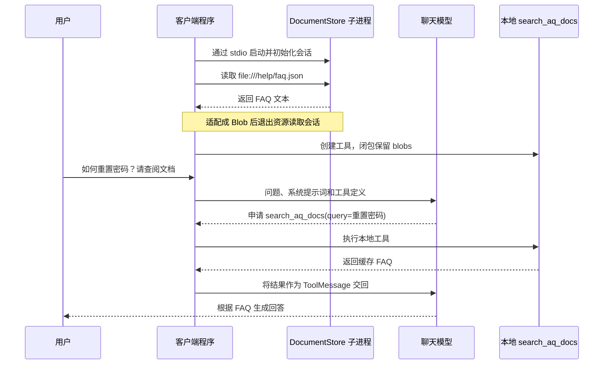

# MCP 文档资源接入 Agent：从 FAQ 预读取到本地工具调用

> 把用户指南与密码 FAQ 注册成 MCP 资源，客户端通过 stdio 读取文档，再让 Agent 调用一个读取缓存的本地工具。重点是理解“资源已经读到内存”和“模型申请调用工具”发生在不同阶段。

[返回首页](../README.md) · [两文件示例](../examples/mcp_document_store/README.md) · [验证源码](../tests/test_mcp_document_store.py) · [上一章：MCP 双服务](23-langchain-mcp-multi-server.md)

<a id="toc"></a>
## 目录

- [1. 这个例子解决什么问题](#purpose)
- [2. 为什么只需要两个文件](#two-files)
- [3. 资源、工具和模型分别负责什么](#roles)
- [4. 服务端逐步拆解](#server)
- [5. 客户端逐步拆解](#client)
- [6. blobs、MIME 与 JSON 文本](#blobs)
- [7. 闭包、本地工具与 query](#closure)
- [8. 完整消息链与执行推演](#walkthrough)
- [9. 为什么缓存能在会话关闭后使用](#lifecycle)
- [10. 我的实际困惑与排错记录](#questions)
- [11. 运行方式与完整源码](#source)
- [12. 实际验证及能力边界](#validation)
- [13. 复杂度、改进方向与复习题](#review)
- [14. 相关资料](#references)

<a id="purpose"></a>
## 1. 这个例子解决什么问题

用户问：“如何重置密码？请查阅文档。”应用先准备密码 FAQ，再给 Agent 一个查阅工具，让模型根据文档组织回答。

FAQ 的内容是：

```json
{"q1": "如何重置密码？", "a1": "请点击“忘记密码”链接。"}
```

这里演示的是知识获取与回答，不会访问真实账号、修改密码或调用真实的密码重置 API。

最容易误解的地方：当前程序并不是等模型选中工具后才读取 MCP 文档。它先读取 FAQ，将结果保存在内存，再创建本地工具。工具被调用时，直接返回已加载的内容。

```text
准备阶段：MCP 文档服务 → 客户端读取 → blobs 缓存
回答阶段：用户 → 模型申请工具 → 本地工具读取 blobs → 模型回答
```

这不是向量检索，也没有根据问题挑选文档片段。最小例子先把“远程资源接入”和“Agent 工具循环”串起来，后续再扩展检索策略。

<a id="two-files"></a>
## 2. 为什么只需要两个文件

| 文件 | 职责 | 谁启动 |
| --- | --- | --- |
| docs_server.py | 注册指南和 FAQ 两个 MCP 资源，通过 stdio 提供访问 | 客户端自动启动子进程 |
| agent_client.py | 连接服务、读取 FAQ、创建工具与 Agent、打印回答 | 自己运行 |

MCP 没有要求每个案例都写三个文件。上一章有计算器服务、天气服务和客户端，所以是三个文件；本章一个文档服务加一个客户端，就是两个文件。Agent 可以直接写在客户端里。



stdio 使用进程输入输出管道，不需要监听端口，也不需要填写 HTTP URL。只运行客户端即可，它会启动服务端；手动提前运行另一个 stdio 服务端实例，不会让客户端自动复用那个进程。

[回到目录](#toc)

<a id="roles"></a>
## 3. 资源、工具和模型分别负责什么

| 概念 | 在本例中的对应 | 容易混淆的地方 |
| --- | --- | --- |
| MCP 资源 | guide.txt、faq.json 两个 URI | 资源不会因为存在就自动进入模型上下文 |
| MCP 客户端 | MultiServerMCPClient | 负责连接与读取，不负责生成自然语言答案 |
| Blob | 适配后的文档内容对象 | 是客户端内存数据，不是活跃连接 |
| 本地 LangChain 工具 | search_aq_docs | 不是服务端用 mcp.tool 注册的 MCP 工具 |
| Agent | create_agent 创建的工具调用循环 | 协调模型与工具，实际执行由程序完成 |
| 模型 | OpenRouter 上配置的聊天模型 | 申请工具调用、阅读工具结果、组织回答 |

服务端只使用 `@mcp.resource`，没有注册任何 MCP 工具。客户端没有调用 `client.get_tools()`，而是通过 `get_resources()` 取得文档，再使用 `@tool` 创建一个本地工具。

因此，不能把本章的调用过程写成“模型直接调用 MCP 搜索工具”。实际过程是“应用先通过 MCP 读取资源，模型随后调用应用提供的本地查阅工具”。

提示词模板是 MCP 的另一项能力，本章两份文件没有使用 `@mcp.prompt` 或 `get_prompt()`，不需要把它们混进这条链。

<a id="server"></a>
## 4. 服务端逐步拆解

### 4.1 FastMCP 对象与名称

```python
mcp = FastMCP("DocumentStore")
```

这是服务端实例，保存注册的资源。`DocumentStore` 是服务名称。客户端配置中的字典键也是 `DocumentStore`，这里只是为了便于对应；客户端查找配置使用的是字典键，不是从服务名推导连接地址。

### 4.2 装饰器把函数注册为资源

```python
@mcp.resource("file:///help/faq.json")
def get_faq() -> str:
    ...
```

装饰器建立资源 URI 与处理函数之间的关联。客户端请求读取这个 URI 时，服务端执行相应函数，返回文档内容。函数名与 URI 不需要同名。

`-> str` 是返回类型注解，说明函数返回字符串。它不会把字符串自动写入磁盘。

### 4.3 file:/// 是标识，不意味着文件真的存在

`file:///help/faq.json` 在本例中是资源标识。文档内容由函数直接构造，程序没有调用 `open()`，也没有读取 Windows 磁盘上的 `/help/faq.json`。

MCP 允许具有文件语义的资源使用 file URI，而不要求它映射到真实物理文件。只有自己在函数里实现文件读取，才会访问相应磁盘内容。客户端应请求服务端已经注册的 URI，而不是随便改一个文件名。

### 4.4 JSON 作为字符串返回

```python
json.dumps({"q1": "如何重置密码？", "a1": "请点击“忘记密码”链接。"}, ensure_ascii=False)
```

`json.dumps` 属于 Python 标准库 `json`，将字典序列化成 JSON 字符串。`ensure_ascii=False` 让中文保持可读；原来的默认设置会使用 Unicode 转义，但 JSON 语义相同。

`get_guide` 返回普通多行字符串；`get_faq` 返回包含 JSON 的字符串。两者在本例中均未显式设置 MIME，验证环境下都作为 `text/plain` 返回。

### 4.5 stdio 与入口保护

```python
if __name__ == "__main__":
    mcp.run(transport="stdio", show_banner=False)
```

直接运行文件时才启动服务，导入模块时不会启动。`show_banner=False` 关闭启动横幅。stdio 的标准输出用于协议数据，服务端需要日志时应使用标准错误或日志框架，不要随意 `print()` 业务调试信息到 stdout。

[回到目录](#toc)

<a id="client"></a>
## 5. 客户端逐步拆解

### 5.1 连接配置负责启动子进程

```python
"DocumentStore": {
    "transport": "stdio",
    "command": sys.executable,
    "args": [str(Path(__file__).resolve().with_name("docs_server.py"))],
}
```

| 写法 | 作用 |
| --- | --- |
| sys.executable | 当前客户端所用的 Python 解释器路径 |
| Path(__file__) | 当前客户端文件的路径对象 |
| resolve() | 转成解析后的绝对路径 |
| with_name("docs_server.py") | 保留目录，替换文件名，定位同目录服务端 |
| str(...) | 转成启动子进程所需的字符串参数 |
| args 的列表 | 每个元素是独立命令行参数，不是拼接后的整段命令 |

这样启动的服务端使用与客户端相同的虚拟环境。原来的 `command="python"` 依赖 PATH，硬编码个人脚本路径也不便复现；这里改成当前解释器与同目录定位，业务流程保持不变。

### 5.2 读取指定资源

```python
blobs = await client.get_resources("DocumentStore", uris=[FAQ_URI])
```

第一个参数匹配连接配置键；`uris` 指定资源标识列表。这里只读取 FAQ，不会顺便把用户指南加载进来。

在 langchain-mcp-adapters 0.3.2 中，这个高层方法内部创建会话，完成资源读取，再退出会话。对于 stdio 配置，连接过程中会启动服务端子进程，并在退出连接时完成相应清理。

`await` 表示等待异步读取完成，拿到结果后继续往下执行。它没有让后面的 Agent 提前运行，也没有自动创建多个并行任务。

如果省略 `uris`，这个版本的适配器会列出静态资源再逐一读取内容。MCP 的“列出资源”与“读取资源”是不同操作，高层方法把它们组合起来了。带参数的资源模板不属于这里默认枚举的普通静态资源。

### 5.3 创建本地工具后绑定给 Agent

```python
search_docs = make_doc_tool(blobs)
agent = create_agent(model=model, tools=[search_docs], ...)
```

`tools` 接收的是 LangChain 工具列表。这里没有把 `blobs` 直接当作工具，也没有把两份资源都注册成 MCP 工具。`make_doc_tool` 只是把定义工具的过程抽成可测试的函数。

### 5.4 OpenRouter 配置是另一条通信路径

```python
init_chat_model(model="openai/gpt-5-mini", model_provider="openrouter")
```

stdio 负责文档服务通信；OpenRouter 负责模型请求。这是两条不同路径。服务端返回 FAQ 不需要模型 Key；真实模型组织答案需要 `OPENROUTER_API_KEY`。

仓库示例通过 `MCP_DOCS_MODEL` 选择模型，默认值与当前使用方式一致。`build_model()` 的密钥检查只检查变量是否为空，不代表认证已经通过。

<a id="blobs"></a>
## 6. blobs、MIME 与 JSON 文本

适配器把 MCP 的资源返回内容转换成 LangChain `Blob` 对象。这里的变量 `blobs` 是列表，因为可能读取多份资源，且单个资源响应也可能包含多个内容项。

| 属性或方法 | 本例值或含义 |
| --- | --- |
| blob.metadata["uri"] | file:///help/faq.json |
| blob.mimetype | text/plain |
| blob.as_string() | 获得资源文本，而不是解析成字典 |

`Blob` 来自 `langchain_core.documents.base`。`as_string()` 是对象的方法，获取其文本表示；`metadata` 是元数据字典。

文件扩展名、内容格式、MIME 是三个不同概念：URI 以 `.json` 结尾，内容可以是 JSON 字符串，而 MIME 仍可能是 `text/plain`。不能仅靠扩展名推断程序实际拿到的 MIME。

例如：

```python
text = blob.as_string()   # str
data = json.loads(text)   # dict，前提是 text 确实是合法 JSON
answer = data["a1"]
```

当前工具返回完整 JSON 文本，没有调用 `json.loads` 提取 `a1`。模型能看到其中的问答内容，再生成自然语言答案。

若以后服务端显式设置 `mime_type="application/json"`，客户端仍只接受 `text/plain`，就会过滤掉该文档。需要同步调整允许的 MIME 或改为按资源类型分别解析，而不是认定读取失败。

<a id="closure"></a>
## 7. 闭包、本地工具与 query

### 7.1 为什么工具函数能使用 blobs

原代码把工具定义在 `main()` 内部：

```python
blobs = await client.get_resources(...)

@tool
def search_aq_docs(query: str) -> str:
    for blob in blobs:
        ...
```

内层函数引用外层作用域中的 `blobs`，形成闭包。模型调用时只需传入 `query`；`blobs` 已经由应用保存，不会出现在工具参数中。

仓库源码将外层作用域提取为 `make_doc_tool(blobs)`，返回装饰后的工具。即使这个工厂函数执行完毕，闭包仍保留对 `blobs` 的引用。这里不是复制出一个独立数据库，也不是要求 MCP 连接持续存在。

### 7.2 @tool 与函数签名

`@tool` 来自 `langchain.tools`，根据函数名、类型注解和文档字符串构造模型可用的工具描述。模型能获知工具名 `search_aq_docs`、用途和字符串参数 `query`。

`search_aq_docs` 这个名称沿用当前代码；名字里有 search 不代表内部已经实现搜索。实际行为由函数体决定。

装饰后得到的是工具对象，直接验证时使用：

```python
result = search_docs.invoke({"query": "重置密码"})
# 异步调用：await search_docs.ainvoke({"query": "重置密码"})
```

Agent 循环会负责根据模型返回的参数执行相应工具。

### 7.3 query 当前没有被使用

```python
def search_aq_docs(query: str) -> str:
    results = []
    for blob in blobs:
        if blob.mimetype == "text/plain":
            results.append(blob.as_string())
    return "\n\n".join(results) if results else "未找到相关文档"
```

输入“重置密码”或“一个完全无关的问题”，会返回相同的缓存 FAQ。函数没有包含关键词匹配、向量检索或相关性评分。

`results.append(...)` 向列表追加文本。`"\n\n".join(results)` 使用两个换行符连接多份文本。三元表达式 `A if condition else B` 根据列表是否为空选择拼接结果或兜底消息；空列表在条件中为假。

“未找到相关文档”在这份实现中准确表示没有通过 MIME 筛选的 Blob，不表示系统已经根据 `query` 完成检索并确认没有答案。

### 7.4 包成工具的目的

应用可以直接把 FAQ 拼进系统消息或用户消息；本章选择工具方式，让模型能够提出查阅申请，并通过 ToolMessage 接收结果。这提供一个后续可扩展的调用接口。

但按需的是“是否执行本地工具、何时把文档交给模型”，不是“是否从 MCP 服务读取文档”。启动时预读取的成本已经发生。

[回到目录](#toc)

<a id="walkthrough"></a>
## 8. 完整消息链与执行推演

以当前固定问题为例：

| 步骤 | 执行方 | 输入与结果 |
| --- | --- | --- |
| 1 | 客户端 | get_resources 请求 FAQ_URI |
| 2 | MCP 服务端 | get_faq 返回 JSON 字符串 |
| 3 | 适配器 | 转换为一个 text/plain Blob，保存 URI 元数据 |
| 4 | 客户端 | 创建闭包工具，把它放入 Agent 的 tools |
| 5 | Agent 请求模型 | 系统指令、用户问题、工具定义 |
| 6 | 模型 | 返回 search_aq_docs 的调用申请及 query 参数 |
| 7 | Agent 工具执行层 | 执行本地函数，得到缓存 JSON 文本 |
| 8 | Agent 再次请求模型 | 将文本作为配对的 ToolMessage 交给模型 |
| 9 | 模型 | 根据文档生成“点击忘记密码链接”等回答 |

下面是协议结构示意，不是粘贴的真实提供商运行日志：

```text
HumanMessage：如何重置密码？请查阅文档
AIMessage：tool_calls=[search_aq_docs(query="重置密码", id="faq-call-1")]
ToolMessage：tool_call_id="faq-call-1"，content 为 FAQ JSON 文本
AIMessage：请点击“忘记密码”链接。
```

工具结果通过 `tool_call_id` 对应模型发起的调用。不是让模型直接执行 Python，也不是工具返回后就必然直接结束；通常还需要模型读取工具结果再生成最终文本。

系统提示词“务必调用工具”影响模型选择，但不构成强制执行保证。判断工具真的执行，要看实际 `AIMessage.tool_calls` 与对应 `ToolMessage`，而不能只看最终回答恰好包含“忘记密码”。

<a id="lifecycle"></a>
## 9. 为什么缓存能在会话关闭后使用

上一章中，`load_mcp_tools(session)` 生成的工具依赖活跃 MCP 会话，真正调用时还要通过这个会话请求服务端。因此必须在 `async with` 作用域内使用。

本章不同：`get_resources()` 已将文档读回，工具闭包里保存的是内容对象。连接关闭后，读取这些对象不需要重新联系服务端。

| 比较项 | 本章缓存文档工具 | 依赖显式 MCP 会话的远程工具 |
| --- | --- | --- |
| 工具执行时读什么 | 客户端内存中的 Blob | 通过会话请求服务端 |
| 是否要求原会话仍有效 | 不要求 | 要求 |
| 服务端文档更新后 | 当前缓存仍是旧版本 | 下一次读取才能取得新版本 |
| 是否等于 Agent 对话记忆 | 否 | 否 |

`asyncio.run(main())` 创建并运行异步入口；`await agent.ainvoke(...)` 等待 Agent 的模型与工具流程完成。工具本身是同步函数，也可以由异步 Agent 调度，不必因为它读取内存就再开一个 HTTP 服务。

缓存能保留并不表示已经做了持久化。程序退出后，当前进程内的 `blobs` 就不再保留；重新启动会重新读取资源。

<a id="questions"></a>
## 10. 我的实际困惑与排错记录

### 10.1 “MCP 听得云里雾里，正常吗？”

这段学习过程同时出现服务端、客户端、两种传输、资源、工具、提示词、异步和 Agent，容易把概念层次混在一起。复习时先把每一步的执行方标出来：

1. 服务端提供文档。
2. 客户端负责读取。
3. Blob 保存返回内容。
4. 本地工具把内容返回给 Agent。
5. 模型负责申请工具和组织答案。

先不接模型，直接读取 FAQ 并打印文本，就能验证 MCP 资源链路。再调用本地工具，最后才接回 Agent。

### 10.2 “为什么每次都要写三个文件？”

不需要。文件数量取决于组织方式。两个服务加一个客户端是三个；本章一个服务和一个客户端是两个。工具、资源、提示词也可以注册在同一个服务实例中，不需要各占一个服务文件。

### 10.3 “贴出的三段代码是一套吗？”

需要按连接配置辨别：前面的 HTTP 客户端连接 8080 上的 MyServer，使用配置资源与分析提示词；DocumentStore 服务端与这个 stdio 客户端才构成本章的两文件组合。

客户端配置不是通过文件贴在一起的顺序决定配对，而是由 transport、command、args 或 url 决定。当前客户端 args 应指向本章 docs_server.py。

### 10.4 实际出现的依赖冲突

此前环境先出现 `No module named 'mcp.server.request_state'`：FastMCP 4.1.1 需要 MCP 2.x，而已安装的 MCP 是 1.30.0；langchain-mcp-adapters 0.3.2 又要求 MCP 小于 2。

降级 FastMCP 后又出现 `cannot import name 'IdentityAssertionParams'`。检查发现 fastmcp-slim 4.1.1 仍在，旧版 oauth_proxy.py 与新版 oauth_proxy 包同时存在，Python 导入了不兼容组件。

这属于依赖与安装文件冲突，不是 resource 装饰器、JSON 或 Agent 逻辑写错。`AuthlibDeprecationWarning` 是警告，要与真正导致退出的 ImportError 区分。

新建干净虚拟环境并固定兼容版本更便于复现。本章依赖沿用 FastMCP 2.14.5、MCP 1.x 和 adapters 0.3.2。已有混装环境若要修复，应先清理 fastmcp 与 fastmcp-slim，再安装兼容组合，避免仅覆盖其中一个分发包留下旧文件。

这些错误曾发生在本机 MCP 学习环境，不能据此声称本章应用本身已经遇到或修复了所有运行错误。

### 10.5 补充辨析：HTTP 502 不属于本章 stdio 链路

前一个 HTTP 资源客户端曾在访问 127.0.0.1:8080/mcp 时遇到 502，绕过本地代理后读取成功。这说明排查时要区分传输方式：本章文档资源通过 stdio 管道读取，没有 8080 端口，也不靠给该管道设置 NO_PROXY 修复连接。

真实 OpenRouter 模型请求仍可能受网络或代理影响。模型认证错误与本地 MCP 子进程启动错误也应分别定位。

[回到目录](#toc)

<a id="source"></a>
## 11. 运行方式与完整源码

### 11.1 环境和启动

在仓库根目录创建独立环境，避免混用全局 Python 包：

```powershell
python -m venv .venv
.\.venv\Scripts\python.exe -m pip install -r requirements.txt
Copy-Item .env.example .env
```

已有 `.env` 时直接编辑，不需要重复复制覆盖。填写自己的配置，不要提交真实密钥：

```ini
OPENROUTER_API_KEY=填写自己的密钥
MCP_DOCS_MODEL=openai/gpt-5-mini
```

只运行客户端：

```powershell
.\.venv\Scripts\python.exe examples\mcp_document_store\agent_client.py
```

它自动启动服务端、读取 FAQ、发起模型请求。无需打开浏览器，不需要启动前章的 HTTP 服务。

`main()` 从仓库根目录加载 `.env`。`Path(__file__).resolve().parents[2]` 的三层分别是当前示例目录、examples、仓库根目录；这与原来的个人绝对路径无关。

终端最终打印模型回答。答案应依据 FAQ，但真实模型的措辞和是否主动调用工具需要查看实际消息验证，不应写成固定的成功记录。

### 11.2 docs_server.py

[打开服务端源码](../examples/mcp_document_store/docs_server.py)

<!-- DOCS_SERVER_SOURCE_BEGIN -->
```python
"""通过 stdio 暴露两份固定文档资源；客户端负责启动这个子进程。"""

import json

from fastmcp import FastMCP

mcp = FastMCP("DocumentStore")


@mcp.resource("file:///help/guide.txt")
def get_guide() -> str:
    return """# 用户指南
1. 首先登录系统
2. 点击“新建项目”
3. 输入项目名称
"""


@mcp.resource("file:///help/faq.json")
def get_faq() -> str:
    # 返回 JSON 文本，未显式声明 MIME，因此本例仍是 text/plain。
    return json.dumps({
        "q1": "如何重置密码？",
        "a1": "请点击“忘记密码”链接。",
    }, ensure_ascii=False)


if __name__ == "__main__":
    # stdio 的 stdout 用于 MCP 协议，不在这里 print 业务日志。
    mcp.run(transport="stdio", show_banner=False)
```
<!-- DOCS_SERVER_SOURCE_END -->

### 11.3 agent_client.py

[打开客户端源码](../examples/mcp_document_store/agent_client.py)

<!-- DOCS_CLIENT_SOURCE_BEGIN -->
```python
"""先经 MCP 读取 FAQ，再用本地工具把缓存文档交给 Agent。"""

import asyncio
import os
import sys
from pathlib import Path

from dotenv import load_dotenv
from langchain.agents import create_agent
from langchain.chat_models import init_chat_model
from langchain.tools import tool
from langchain_core.documents.base import Blob
from langchain_core.language_models.chat_models import BaseChatModel
from langchain_mcp_adapters.client import MultiServerMCPClient

FAQ_URI = "file:///help/faq.json"


def build_client() -> MultiServerMCPClient:
    return MultiServerMCPClient({
        "DocumentStore": {
            "transport": "stdio",
            "command": sys.executable,
            "args": [str(Path(__file__).resolve().with_name("docs_server.py"))],
        },
    })


def build_model() -> BaseChatModel:
    if not os.getenv("OPENROUTER_API_KEY", "").strip():
        raise RuntimeError("请在环境变量或 .env 中配置 OPENROUTER_API_KEY。")
    return init_chat_model(
        model=os.getenv("MCP_DOCS_MODEL", "openai/gpt-5-mini"),
        model_provider="openrouter",
    )


def make_doc_tool(blobs: list[Blob]):
    """闭包保存已读到的 Blob；调用工具时不再向 MCP 发请求。"""
    @tool
    def search_aq_docs(query: str) -> str:
        """查阅已加载的重置密码 FAQ；当前不按 query 筛选。"""
        results = []
        for blob in blobs:
            if blob.mimetype == "text/plain":
                results.append(blob.as_string())
        return "\n\n".join(results) if results else "未找到相关文档"

    return search_aq_docs


async def run_demo(model: BaseChatModel | None = None) -> dict:
    client = build_client()
    # 此调用完成资源读取及 Blob 转换，并退出内部 MCP 会话。
    blobs = await client.get_resources("DocumentStore", uris=[FAQ_URI])
    search_docs = make_doc_tool(blobs)
    if model is None:
        model = build_model()
    agent = create_agent(
        model=model,
        tools=[search_docs],
        system_prompt="务必调用工具，根据文档回答；文档未提供的信息请明确说明。",
    )
    return await agent.ainvoke({
        "messages": [{"role": "user", "content": "如何重置密码？请查阅文档"}],
    })


async def main() -> None:
    load_dotenv(Path(__file__).resolve().parents[2] / ".env")
    response = await run_demo()
    print(response["messages"][-1].content)


if __name__ == "__main__":
    asyncio.run(main())
```
<!-- DOCS_CLIENT_SOURCE_END -->

<a id="validation"></a>
## 12. 实际验证及能力边界

验证使用独立 Python 3.11 环境与前章相同的 MCP 兼容组合。通过真实 stdio 子进程读取文档，模型使用可控的离线替身。

```powershell
.\.venv\Scripts\python.exe -m unittest discover -s tests -p test_mcp_document_store.py -v
```

新增验证覆盖：

| 范围 | 实际检查内容 |
| --- | --- |
| 模型配置 | 显式 OpenRouter 提供商、模型名与缺失 Key 提示 |
| 进程配置 | 当前解释器与同目录脚本定位 |
| 本地工具 | query 未参与筛选、空列表、非 text/plain、多文档拼接 |
| 真实 MCP | 两个资源的枚举与读取、服务端没有注册 MCP 工具 |
| 文档格式 | FAQ 的 URI、实际 MIME、JSON 文本与指南内容 |
| 异常 | 不存在的 URI 是读取错误，不是“搜索无结果” |
| 生命周期 | 退出会话后，已加载 Blob 仍可供本地工具使用 |
| 完整 Agent | 只预读一次，模型申请工具，真实 ToolMessage 配对后生成回答 |

实际结果：本章新增 **12 项验证全部通过**，其中 6 项启动真实 stdio 文档子进程；全仓库 **105 项验证全部通过**。完整回归耗时约 70 秒。完整 Agent 流程检查了资源只预读取一次、工具实际收到缓存 FAQ，以及 `faq-call-1` 对应的 ToolMessage。

本次先发现验证环境继承到 MCP 2.3.0，导致旧适配器缺少 RequestContext；在验证虚拟环境内覆盖固定 MCP 1.30.0 后运行通过，没有修改全局安装。Windows 的 stdio 集成在允许命名管道的沙箱外运行。

完整 Agent 测试中的模型申请是离线脚本控制的，用来检查工具执行与消息流，不能证明真实模型一定遵守“务必调用工具”。测试阻止进程内 HTTP 客户端请求外部服务，stdio 子服务关闭横幅并只返回固定资源。未发起真实 OpenRouter 请求，也没有验证 Key 的有效性或实际模型答案质量。

Windows 集成测试需要运行环境允许创建异步子进程命名管道。验证过程只启动并清理由测试创建的 stdio 服务，不改变全局依赖，不操作已有业务进程。

<a id="review"></a>
## 13. 复杂度、改进方向与复习题

### 13.1 当前复杂度与边界

设预加载内容总长度为 L，通过筛选的 Blob 数为 n。单次工具调用遍历列表并拼接文本，时间约为 O(n + L)，结果字符串占 O(L) 空间；缓存本身也需保留文档内容。启动阶段还有子进程启动、MCP 初始化与资源传输成本。

这里没有按 query 搜索，因此不能把复杂度描述成向量检索或关键词索引查询。模型上下文还要容纳返回的文档文本，长文档会增加输入长度与成本。

边界包括：只加载 FAQ 时无法回答指南问题；空文档列表或 MIME 被过滤时返回兜底；URI 不存在会在预加载阶段报错；缓存不会自动跟随服务端更新；关闭程序不会保留缓存。

### 13.2 补充改进方向

以下是后续练习，不是当前源码已经具备的能力：

1. 将 JSON 文本解析成字典，只返回匹配的问答字段，让 query 真正参与选择。
2. 文档较多时再加入分块、关键词或向量检索；先定义检索目标与无匹配行为。
3. 需要最新内容时，在异步工具中调用 get_resources，或在有效的显式会话内读取；这会改变会话生命周期与失败位置。
4. 需要容纳多种资源时，按 MIME 分别处理文本、JSON 与二进制，避免简单放行所有内容。
5. 文档来源扩大后，明确可读取的 URI 范围，并把文档当作数据处理，不让其中的指令覆盖系统要求。

预读取适合小规模固定文档，调用路径简单且工具阶段不依赖 MCP 在线；按需读取减少不必要预加载并获得较新数据，但工具执行时要处理连接与读取失败。根据文档规模、更新频率和响应要求选择，不是越复杂越好。

### 13.3 复习问题

| 问题 | 核心答案 |
| --- | --- |
| 两个文件分别做什么？ | 服务端提供资源，客户端读取资源并运行 Agent |
| 需要先手动运行服务端吗？ | stdio 本例不需要，由客户端启动 |
| file URI 是真实磁盘路径吗？ | 本例是注册标识，内容由函数构造 |
| 服务端注册了搜索工具吗？ | 没有，只注册两个资源 |
| search_aq_docs 在哪里执行？ | 客户端进程中的本地工具 |
| 模型什么时候读到 FAQ？ | 工具结果作为 ToolMessage 交回模型时 |
| MCP 资源什么时候读取？ | 创建 Agent 前的 get_resources 阶段 |
| query 当前起什么作用？ | 是工具参数，但函数体没有使用它筛选 |
| FAQ 为什么会通过 text/plain 筛选？ | 本例返回字符串且未显式声明 JSON MIME |
| 退出 MCP 会话后工具为什么还能用？ | Blob 内容已保存在内存，不再依赖该连接 |
| 只看最终回答能证明工具执行吗？ | 不能，需检查工具调用申请与配对结果 |
| 这是持久化记忆或完整 RAG 吗？ | 都不是；是预加载文档与本地工具的最小组合 |

动手顺序：先打印资源 URI 和内容，再直接调用本地工具，最后查看 Agent 中的 ToolMessage。每一步分别验证，避免把模型问题、MCP 通信与 Python 语法混在一起。

[回到目录](#toc)

<a id="references"></a>
## 14. 相关资料

- [MCP 资源规范](https://modelcontextprotocol.io/specification/2025-06-18/server/resources)：资源 URI、列出与读取的区别，以及 file URI 的语义。
- [LangChain MCP Adapters 源码](https://github.com/langchain-ai/langchain-mcp-adapters)：本章基于 0.3.2 的 MultiServerMCPClient、资源适配与 Blob 转换行为；以固定版本和实际验证为准。
- [FastMCP 2.14.5 发布信息](https://pypi.org/project/fastmcp/2.14.5/)：核对本章兼容版本，避免混用不同代际接口。
- [Python 闭包与作用域](https://docs.python.org/3/tutorial/classes.html#python-scopes-and-namespaces)：理解嵌套函数如何引用外层变量。
- [第 23 篇：MCP 双服务](23-langchain-mcp-multi-server.md)：对照远程工具、显式会话与传输方式。
